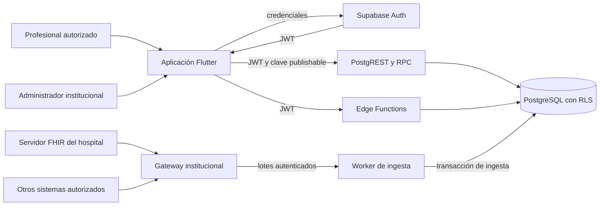
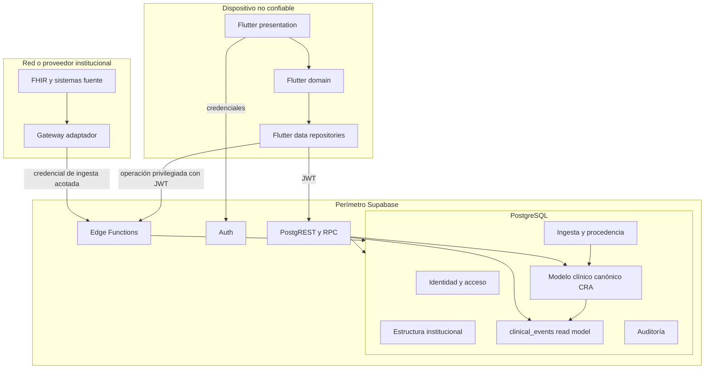
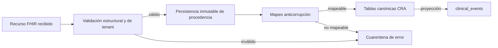
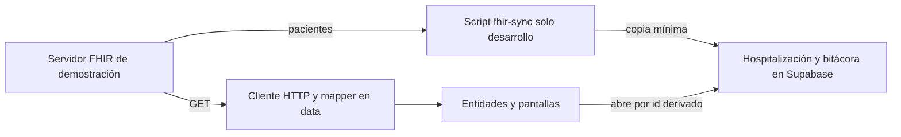

# Arquitectura objetivo

## Propósito y carácter de este documento

Este documento define la arquitectura objetivo de Carer Record App (CRA). Es una especificación de destino: guía la evolución incremental del repositorio, pero no afirma que todos los componentes, tablas o controles descritos ya estén implementados.

El repositorio `carer-record-app` es la implementación canónica de CRA. El repositorio hermano `../carer-record` se consulta como evidencia histórica y de producto, no como fuente normativa de código, despliegue ni esquema. En particular, su modelo MariaDB y su propuesta FastAPI no forman parte de la arquitectura objetivo salvo cuando una decisión se reafirma expresamente aquí.

## Decisiones vinculantes

1. CRA es una capa de contexto clínico e integración para hospitalización, no una Ficha Clínica Electrónica (FCE), un sistema de prescripción ni el repositorio legal primario. La definición de producto exige complementar las fuentes existentes, conservar trazabilidad y no sustituir el juicio profesional (`../carer-record/carer-record.md:5-9`, `../carer-record/carer-record.md:153-165`).
2. La aplicación cliente es Flutter. Supabase aporta Auth, PostgreSQL, PostgREST y Edge Functions. RLS en PostgreSQL es la autoridad final para toda operación accesible con una sesión de usuario; los guards de Flutter solo mejoran la experiencia (ADR-003; `AGENTS.md:13-18`).
3. El modelo relacional de CRA es el modelo canónico interno. FHIR es una frontera de interoperabilidad: los recursos FHIR se validan, conservan como procedencia y se traducen mediante una capa anticorrupción; no determinan por sí solos la forma de las tablas de consumo.
4. La hospitalización es el eje clínico. El acceso, la ubicación, el timeline y el contexto se resuelven en relación con una hospitalización, no mediante atributos mutables almacenados directamente en el paciente.
5. El sistema se inicia con una organización de demostración, pero el modelo, las claves, los índices, la ingesta y RLS son multiinstitución desde el primer diseño. En esta documentación, una `organization` representa la institución u hospital que actúa como tenant de seguridad.
6. Cada hospital configura sus roles a partir de un catálogo fijo de permisos mantenido por CRA. Los nombres de rol son locales a la organización; no son enums globales ni claims confiables del cliente.
7. Los roles se conceden con alcance de organización o unidad, pero para Personal clínico ese alcance no sustituye la asignación individual vigente a una hospitalización ni la unidad restringe su lectura en la demo. El Administrador de demo accede clínicamente solo con `clinical.organization.read` reservado, permisos concretos y alcance organizacional, bajo RLS y limitado a datos sintéticos, conforme a ADR-013.
8. `clinical_events` es un read model reconstruible para la línea de tiempo. Nunca es la fuente canónica de condiciones, observaciones, procedimientos, documentos, notas de contexto u hospitalizaciones.
9. La primera capacidad clínica continúa siendo de lectura. Toda futura escritura originada en CRA debe tener permiso explícito, autoría, procedencia, auditoría y una tabla canónica propia; no se habilita por inferencia desde un permiso de lectura.
10. Las operaciones privilegiadas de identidad, administración e ingesta se ejecutan en Edge Functions o procesos de integración confiables. La Service Role Key no se distribuye a Flutter ni a gateways hospitalarios generales (`AGENTS.md:12-15`, `supabase/functions/create-practitioner/index.ts:74-101`).
11. En la demo sintética/local, Flutter puede leer un servidor FHIR directamente mediante un cliente y un mapper en `data/`, sin recursos FHIR en dominio ni presentación y sin autorización de servidor. Es una excepción acotada de ADR-019: no sustituye la frontera de ingesta ni la autoridad de RLS (decisión 2) para datos reales.

## Baseline y brecha

### Lo que existe hoy

El baseline contiene Flutter en `app/`, infraestructura Supabase en `supabase/` y un scaffold de ingesta en `scripts/` (`baseline/carer-record-app.md:15-38`). Flutter consulta directamente por PostgREST las tablas `patients`, `clinical_events` y `practitioners`; por ejemplo, el repositorio de pacientes selecciona atributos de identidad y ubicación desde `patients` (`app/lib/domains/patient/data/patient_repository.dart:9-28`) y el timeline lee `clinical_events` por `patient_id` (`app/lib/domains/clinical_event/data/clinical_event_repository.dart:10-16`).

El esquema capturado en el baseline tiene tres tablas de dominio:

- `practitioners`, cuyo PK coincide con `auth.users.id` y que contiene un único rol enum global (`supabase/migrations/20260910000000_initial_clinical_schema.sql:4-14`).
- `patients`, con identidad, `care_unit`, `bed_label` y un `payload` genérico en la misma fila (`supabase/migrations/20260910000000_initial_clinical_schema.sql:16-26`, `supabase/migrations/20260910110000_clinical_timeline.sql:1-5`).
- `clinical_events`, que mezcla clases heterogéneas en un enum y deja el detalle en JSONB (`supabase/migrations/20260910000000_initial_clinical_schema.sql:28-39`).

La autorización del baseline permite lectura global de pacientes y eventos a cualquier practitioner activo con rol `physician`, `nurse` o `technician`; no distingue organización, unidad, hospitalización ni relación asistencial (`supabase/migrations/20260910100000_patient_read_access.sql:3-23`, `supabase/migrations/20260910110000_clinical_timeline.sql:53-68`). Las pruebas capturadas confirman que el administrador no recibe acceso clínico implícito y que las tablas clínicas son de solo lectura para roles asistenciales (`supabase/tests/patients_rls.test.sql:56-116`, `supabase/tests/patients_rls.test.sql:133-169`).

### Brechas que resuelve el objetivo

| Brecha observada en el baseline       | Riesgo                                                 | Resolución objetivo                                                                                           |
| ------------------------------------- | ------------------------------------------------------ | ------------------------------------------------------------------------------------------------------------- |
| Rol enum almacenado en el perfil      | No permite configuración por hospital ni más de un rol | Membresía, roles organizacionales, permisos y asignaciones separados                                          |
| Paciente sin tenant                   | Una fila puede quedar visible fuera de su institución  | `organization_id` obligatorio y coherencia institucional en todas las relaciones                              |
| Unidad y cama dentro de `patients`    | Pierde historia y confunde persona con episodio        | Hospitalización y períodos de ubicación explícitos                                                            |
| Acceso clínico global por tipo de rol | Sobreexposición dentro del hospital                    | Permisos concretos más asignación asistencial vigente; excepción explícita y auditada para Administrador demo |
| `clinical_events` genérico            | JSONB se convierte en fuente clínica implícita         | Tablas canónicas por concepto y timeline derivado reconstruible                                               |
| Identificador externo global          | Colisiones entre hospitales o fuentes                  | Unicidad por organización, fuente, tipo y external ID                                                         |
| Sin ejecución/checkpoint de ingesta   | Reintentos no trazables ni idempotentes                | Fuentes, ejecuciones, recursos y errores persistidos                                                          |
| Cliente conoce tablas físicas         | Acoplamiento de UI y persistencia                      | Repositorios Flutter y contratos de lectura estables; RPC/Edge Function cuando una operación cruza agregados  |

## Vista de contexto

La vista Flutter de composición está disponible en `/roles`, alcanzable desde la sección de administración institucional de `/settings`. La navegación exige los permisos efectivos `iam.role.read` e `iam.role.manage`; no depende del nombre o ID del rol. Presenta solo roles activos no protegidos y permisos ordinarios activos que el actor puede delegar. La pantalla no es autoridad: la RPC transaccional `replace_iam_role_permissions` vuelve a validar actor, tenant, rol no protegido, catálogo delegable y permisos poseídos, y aplica el reemplazo completo con idempotencia.

El diagrama separa tres caminos:

- **Sesión:** Flutter autentica contra Supabase Auth y recibe un JWT. La identidad autenticada es `auth.uid()`; permisos, estado y alcance se resuelven desde tablas de dominio.
- **Consulta ordinaria:** Flutter usa la clave publishable y el JWT contra PostgREST/RPC. PostgreSQL aplica privilegios y RLS aun cuando el cliente fabrique una consulta o evite la navegación prevista.
- **Administración e ingesta:** Edge Functions y workers realizan operaciones que requieren atomicidad, secretos o privilegios no entregables al móvil. Deben autenticar al actor o al origen, limitar su capacidad y dejar auditoría.

## Contenedores y responsabilidades

### Flutter

Mantiene la separación `data/domain/presentation` ya exigida por el repositorio (`AGENTS.md:10-13`). Sus responsabilidades son presentar, validar interacción local, mantener estado efímero, invocar repositorios y ocultar opciones que el usuario no puede ejercer. No decide autorización, no contiene Service Role Key, no confía en claims de rol enviados por sí mismo y no persiste datos clínicos sensibles fuera de una política futura explícita de almacenamiento local.

El dominio `fhir_record` (ADR-019) contiene un cliente HTTP de solo lectura y un mapper en `data/`, las entidades `PatientSummary`, `ClinicalRecord` y `RecordEntry` en `domain/` y las pantallas de lista y ficha en `presentation/`. La interfaz nunca ve recursos FHIR crudos. La regla que enlaza un paciente de FHIR con su hospitalización de Supabase vive en `domain/hospitalization_link.dart`.

Los repositorios Flutter son la frontera del cliente. Una pantalla no consulta Supabase directamente. Los modelos de transporte no sustituyen entidades de dominio y los cambios del esquema físico no deben propagarse indiscriminadamente a presentación.

En el corte IAM actualmente implementado, `institutional/domain/` contiene entidades, reglas, puertos y fábrica de intentos; `institutional/data/` contiene mappers y adaptadores Supabase. `users/presentation/` mantiene widgets y controladores consumidores de puertos. La composición raíz en `app/` reúne refresh de autorización, router/política, lifecycle y ajustes; IAM no depende de providers clínicos y la composición de rutas no reside en `core`. Estos límites describen el corte IAM, no uniformizan los flujos aún pendientes ni declaran completa toda la arquitectura Flutter. La parte A de IA local y notas se preserva.

El dominio vertical `on_device_ai` encapsula ASR, síntesis local y gestión de modelos en `data/domain/presentation` (ADR-018). `context_note` conserva los casos de uso de negocio, vault y los controladores de dictado, asistencia y edición/publicación; consume capacidades de IA mediante leases genéricos y puertos. `LocalCapabilityRepository` es la única frontera de provisioning. `ConfirmedMilestoneWriter` y `DictationAudio` pertenecen al dominio de notas. La composición raíz inyecta el hook genérico de limpieza al cerrar sesión.

### Supabase Auth

Autentica credenciales, recupera contraseñas y emite sesiones. No es el catálogo de profesionales ni el motor de permisos. `auth.users` prueba identidad técnica; `profiles` y `organization_memberships` determinan si esa identidad tiene una persona activa en una institución. Esta separación evita almacenar contraseñas en el dominio y permite que una cuenta participe en más de una organización.

### PostgreSQL, PostgREST y RLS

PostgreSQL conserva el modelo canónico CRA, procedencia, configuración de acceso, proyecciones y auditoría. PostgREST expone únicamente tablas, vistas y RPC previstas. Los grants de esquema/tabla son la primera barrera; RLS restringe cada fila; constraints y claves foráneas protegen invariantes aunque el escritor sea privilegiado.

Las funciones usadas por RLS deben ser pequeñas, `stable` cuando corresponda, con `search_path` vacío o fijo, permisos de ejecución mínimos y sin aceptar del cliente organization IDs como prueba de autoridad. El endurecimiento observado en los helpers del baseline ya aplica esos principios (`supabase/migrations/20260912000000_harden_function_privileges.sql:1-17`, `supabase/migrations/20260912000000_harden_function_privileges.sql:45-56`).

### Edge Functions

Se reservan para operaciones que no pueden ser una mutación directa segura y atómica:

- creación, invitación, suspensión o recuperación administrativa de cuentas;
- cambios de membresía que deban coordinar Auth y tablas de dominio;
- recepción autenticada de lotes de ingesta;
- reconstrucción controlada de proyecciones;
- generación futura de resúmenes, con minimización de datos y trazabilidad;
- operaciones futuras de Storage con buckets privados.

Una Edge Function invocada por un usuario valida primero el JWT con un cliente que actúa como el llamador y comprueba autorización contra la base. Solo después crea un cliente privilegiado separado, como ya hace `create-practitioner` (`supabase/functions/create-practitioner/index.ts:21-45`, `supabase/functions/create-practitioner/index.ts:74-95`). Tener Service Role no autoriza a omitir validaciones ni auditoría.

### Gateway y worker de ingesta

El gateway vive junto a la fuente cuando la conectividad o protocolo lo exige. Traduce transporte, no reglas de acceso de usuario ni modelo de presentación. No recibe una Service Role Key general. Se autentica como integración de una organización/fuente concreta y solo puede entregar lotes o consultar su estado.

El worker valida el lote, deduplica por procedencia, conserva el recurso recibido, traduce FHIR al modelo canónico CRA dentro de una transacción y actualiza el checkpoint solo al completar el lote. El plan histórico ya identificó la necesidad de upserts idempotentes, checkpoints en PostgreSQL, asociación a hospital/fuente y exclusión de workers concurrentes (`../carer-record/infra/MIGRATION_TO_SUPABASE.md:166-185`).

## Límites de confianza

| Límite                     | Dentro se confía en                            | Fuera no se confía en                                                               | Controles obligatorios                                                       |
| -------------------------- | ---------------------------------------------- | ----------------------------------------------------------------------------------- | ---------------------------------------------------------------------------- |
| Dispositivo/Supabase       | Validación criptográfica del JWT               | UI, parámetros, caché, rutas y claims fabricados por el cliente                     | TLS, JWT, grants, RLS, validación de payload                                 |
| Auth/dominio               | `auth.uid()` como identidad técnica            | Existencia, rol o institución inferidos solo desde Auth                             | `profiles`, membresía activa y asignaciones consultadas en DB                |
| API/PostgreSQL             | Constraints y transacción confirmada           | Filtros enviados por Flutter como mecanismo de seguridad                            | RLS en toda tabla expuesta y deny by default                                 |
| Edge Function/Service Role | Secreto cargado en entorno servidor            | Cualquier autorización previa implícita por poseer el secreto                       | Autenticar actor, autorizar, validar, auditar, cliente privilegiado separado |
| Hospital/gateway           | Credencial de integración acotada a una fuente | Contenido FHIR, IDs, orden, timestamps y reintentos                                 | Esquema, firma/mTLS según despliegue, idempotencia, límites, cuarentena      |
| FHIR/CRA canónico          | Recurso original conservado e identificable    | Suposición de que un recurso está completo, vigente o usa códigos locales conocidos | Capa anticorrupción, terminología, procedencia, estado de mapeo              |
| App/servidor FHIR (demo)   | Nada: el servidor de demostración no autentica | Cualquier cliente de red que alcance el puerto                                      | Solo datos sintéticos y red local; guardas de ruta son UX; Q-AUTH-03         |
| Canónico/read model        | FKs canónicas y versión de proyección          | Escritura directa en `clinical_events`                                              | Escritor técnico único, unicidad de origen, reconstrucción y reconciliación  |

La Service Role omite RLS y, por tanto, amplía el daño de un error. Debe existir únicamente en secretos de Edge Functions o workers administrados, nunca en Flutter, `.env` compartidos, logs, payloads, gateways genéricos o repositorios. La clave publishable sí pertenece al cliente y no representa autoridad (`README.md:27-47`).

## Frontera FHIR y modelo canónico CRA

FHIR define el contrato de intercambio con sistemas externos. El adaptador realiza estas etapas:

Reglas de la frontera:

- El tipo, ID, versión y `lastUpdated` FHIR se tratan como procedencia externa, no como PK interna ni garantía de unicidad global.
- La clave externa incluye organización, fuente, tipo de recurso e ID externo. El diseño histórico ya documentó el riesgo de colisión y la necesidad de esa composición (`../carer-record/infra/MIGRATION_TO_SUPABASE.md:121-145`).
- El JSON original puede conservarse en `source_resources` para trazabilidad y reproceso, sujeto a retención y cifrado; no se consulta desde Flutter como modelo ordinario.
- Los códigos conservan sistema, código y display. Una etiqueta local no reemplaza el código de origen.
- Referencias se resuelven dentro de la misma organización y fuente salvo una regla de reconciliación explícita.
- Un reintento del mismo recurso y versión no duplica entidades ni eventos.
- Una eliminación lógica o estado `entered-in-error` se proyecta según semántica del recurso; no provoca cascadas físicas de historial.
- CRA no escribe de vuelta al servidor FHIR en la fase inicial.

### Lectura directa en la demo (ADR-019)

Junto a la frontera de ingesta, la demo permite que la app lea un servidor FHIR sin pasar por el modelo canónico. La frontera anticorrupción se conserva dentro del cliente: el mapper proyecta solo lo que se presenta y el resto se ignora.

- No hay raw, procedencia, identidad compuesta, idempotencia por recurso ni cuarentena: no es una ingesta.
- La bitácora y su autorización siguen en Supabase bajo RLS. El script crea la hospitalización y las asignaciones de demostración de cada paciente, con ids derivados del id de FHIR.
- La lectura de FHIR no pasa por RLS ni por ninguna autorización de servidor (RK-031).

## Flujos críticos

### Consulta de pacientes hospitalizados

El corte DB `20261011270000_clinical_rls_contracts.sql` y su corrección `20261011280000_harden_clinical_runtime_writes_and_views.sql` publican `clinical_census_by_hospitalization`, `clinical_patient_demographics_by_hospitalization` y `clinical_timeline_by_hospitalization` como vistas PostgreSQL 17 `security_invoker` y `security_barrier`. Los grants mínimos sobre tablas base y sus policies RLS siguen aplicando al invocador. El censo acumula `clinical.census.read` y `clinical.patient.read` para incluir la demografía; el timeline contiene `patient_id` y `created_at`, pero no `recorded_by` ni payload. `clinical_events.summary` es tipado y derivado de `payload`; el JSONB original no se concede al invocador. No hay DML clínico runtime, tampoco para `service_role`. Flutter consume los contratos por hospitalización desde la subtarea 4.4; las revisiones 4.5 y 5.2 verificaron la integración para la demo sintética/local, sin afirmar producción ni concurrencia de dos sesiones.

1. Flutter envía el JWT a PostgREST.
2. RLS resuelve `auth.uid()`, perfil activo, membresía activa y permisos concretos. Para Personal clínico exige además una asignación asistencial vigente; para el Administrador de demo exige `clinical.organization.read` reservado y alcance organizacional. No evalúa el nombre ni el ID del rol.
3. La consulta parte desde `hospitalizations`, une el paciente y su ubicación vigente y retorna solo episodios autorizados.
4. Abrir un paciente no amplía autoridad: cada consulta de condiciones, observaciones o timeline vuelve a aplicar RLS por hospitalización.
5. El detalle ofrece vínculo de procedencia hacia la entidad canónica y, cuando esté permitido, hacia metadatos de la fuente.

En la demo (ADR-019), la lista de pacientes proviene del servidor FHIR y no de `clinical_census_by_hospitalization`; al tocar un paciente se abre la hospitalización enlazada y desde ahí aplican los pasos 1 a 4.

La lista no se deriva de `patients.care_unit` ni de un texto de cama. El modelo del baseline sí lo hacía (`supabase/migrations/20260910110000_clinical_timeline.sql:1-5`), por lo que esa interfaz debe migrar hacia una consulta centrada en hospitalizaciones.

### Ingesta idempotente

1. El gateway se autentica como una fuente perteneciente a una organización.
2. El backend crea `ingestion_run` y bloquea una sola ejecución activa por fuente.
3. Cada recurso se valida y se inserta o reconoce en `source_resources` por clave de procedencia y versión/hash.
4. La capa de mapeo crea o actualiza la entidad canónica sin cambiar su tenant.
5. En la misma transacción se actualizan entidades dependientes y la fila correspondiente de `clinical_events`.
6. Se persisten contadores, errores y checkpoint. Un error de recurso puede quedar en cuarentena sin declarar exitosa una ejecución incompleta según la política de la fuente.
7. Reprocesar recursos conservados puede reconstruir el canónico o la proyección sin pedir de nuevo el bundle al hospital.

### Administración de acceso

1. Un administrador con el permiso IAM o de asignación exacto en la organización solicita una operación.
2. La Edge Function valida el JWT y vuelve a consultar ese permiso con RLS/RPC.
3. Si se crea una cuenta, usa la API administrativa de Auth con Service Role y coordina la creación de perfil/membresía.
4. El rol asignado debe pertenecer a la misma organización y solo contener permisos del catálogo fijo.
5. La asignación de alcance debe referenciar una unidad de esa organización o declarar alcance organizacional; una asignación asistencial debe referenciar una hospitalización sintética de esa organización y exige `clinical.assignment.manage`.
6. La operación y su resultado quedan en auditoría. Suspender la membresía revoca el acceso de esa organización sin necesariamente invalidar otras membresías de la misma persona.

## Despliegue objetivo y aislamiento

La demo usa un proyecto Supabase y una organización. Eso simplifica operación, pero no autoriza valores implícitos de tenant. Ninguna tabla institucional depende de una constante “demo”, y ninguna política selecciona “la primera organización”.

El modelo lógico admite varias organizaciones en el mismo proyecto. El aislamiento primario es por fila con `organization_id`, FKs compuestas y RLS. Si una institución futura exige aislamiento físico, residencia regional o claves independientes, podrá desplegarse otro proyecto Supabase con el mismo esquema; el diseño de dominio no cambia.

Los entornos local, preview/staging y producción deben usar proyectos, secretos y datos separados. Solo se permiten datos sintéticos en desarrollo, según ADR-002 y [`10-security-privacy.md`](10-security-privacy.md).

## Observabilidad, auditoría y recuperación

- Cada request debe transportar un correlation ID generado o validado en el borde, sin incluir PHI en logs.
- La ingesta registra ejecución, fuente, checkpoint, cantidades, latencia y errores sanitizados.
- Las operaciones administrativas y escrituras CRA registran actor, organización, acción, objetivo, resultado y timestamp. La auditoría no almacena tokens ni secretos.
- Las lecturas clínicas sensibles requieren una estrategia de auditoría de acceso antes de producción. PostgreSQL/RLS autoriza; un componente de auditoría complementa, no reemplaza, esa decisión.
- `clinical_events` se reconstruye desde tablas canónicas. La recuperación verifica conteos y claves de origen antes de cambiar la proyección activa.
- Backups, point-in-time recovery, retención, borrado y respuesta a incidentes deben definirse por entorno antes de usar datos reales; quedan fuera del prototipo académico según [`03-scope.md`](03-scope.md), pero no de una eventual evaluación productiva.

## Cualidades y reglas de evolución

| Cualidad         | Decisión verificable                                                                                     |
| ---------------- | -------------------------------------------------------------------------------------------------------- |
| Confidencialidad | Deny by default, RLS por tenant y alcance, secretos solo servidor, mínimos datos en respuestas           |
| Integridad       | FKs compuestas por tenant, constraints temporales, writer único para proyecciones, auditoría append-only |
| Trazabilidad     | Toda entidad importada enlaza recurso/fuente/ejecución; toda escritura CRA enlaza actor                  |
| Idempotencia     | Unicidad de procedencia y versión/hash; checkpoints transaccionales                                      |
| Disponibilidad   | El corte del gateway no impide consultar datos ya sincronizados; reintentos no duplican                  |
| Evolución        | Migraciones aditivas versionadas; contratos de repositorio desacoplados de tablas físicas                |
| Rendimiento      | Índices comienzan por `organization_id` y siguen patrones de RLS/listado; timelines paginados            |
| Testabilidad     | pgTAP cubre permitido/denegado por permiso, alcance, estado y tenant; fixtures no dependen del seed      |

No se editan migraciones aplicadas. La evolución se expresa mediante migraciones aditivas y pruebas de RLS, según `AGENTS.md:13-18` y [testing y validación](11-testing-validation.md#pgtap-y-base-de-datos).

## Alternativas descartadas

### Mantener el esquema mínimo y agregar `hospital_id`

Descartado porque no resuelve roles configurables, historial de ubicación, episodios, procedencia ni el carácter derivado del timeline. Agregar tenant a tres tablas reduciría una colisión, pero conservaría un modelo centrado en persona y JSONB.

### Copiar el esquema MariaDB del repositorio histórico

Descartado como objetivo. Ese esquema modela numerosos recursos como tablas directas, mantiene ubicación y admisión dentro de `patients` (`../carer-record/backend/app/core/init_db.sql:27-60`) y no incorpora tenant a las tablas clínicas. Es evidencia útil de cobertura FHIR, no un contrato canónico seguro.

### FastAPI como backend obligatorio

Descartado para la arquitectura canónica adoptada. El plan histórico mantenía FastAPI como API principal (`../carer-record/infra/MIGRATION_TO_SUPABASE.md:33-50`), mientras el baseline de CRA usa Supabase directamente y protege datos con RLS. Introducir FastAPI duplicaría autorización y operación sin un requisito que PostgREST, RPC y Edge Functions no puedan cubrir. Puede reevaluarse si aparecen procesos largos, contratos públicos complejos o conectividad que justifique un servicio dedicado.

### Rol único en JWT o en `profiles`

Descartado porque los roles son configurables por hospital, una persona puede pertenecer a más de una institución y los cambios de permiso deben surtir efecto sin esperar a refrescar claims. El JWT prueba identidad; la base resuelve autoridad vigente.

### FHIR como esquema interno

Descartado porque acopla consultas y reglas de acceso a una especificación de intercambio, dificulta combinar fuentes no FHIR y obliga a la UI a entender recursos complejos. CRA conserva FHIR en la frontera y expone conceptos de hospitalización comprensibles para su producto.

### `clinical_events` como tabla clínica maestra

Descartado porque un payload genérico no puede imponer invariantes específicos, representar actualizaciones con claridad ni sostener trazabilidad clínica suficiente. El timeline optimiza lectura y puede regenerarse; las tablas canónicas conservan significado.

### Base o esquema separado por hospital desde la demo

Descartado como requisito universal porque multiplica despliegues, migraciones y monitoreo antes de validar el producto. El modelo multiinstitución con RLS permite la demo y un despliegue compartido. Un proyecto dedicado sigue disponible cuando una institución exija aislamiento físico.

### Permisos libres creados por cada hospital

Descartado porque los identificadores arbitrarios no pueden vincularse de forma segura y testeable a políticas RLS. Los hospitales pueden crear roles y elegir permisos, pero solo desde el catálogo fijo versionado por CRA.

## Criterios de aceptación arquitectónica

La transición alcanza esta arquitectura cuando:

- todas las tablas institucionales y clínicas tienen tenant explícito y FKs que impiden relaciones cruzadas;
- la demo funciona con una organización sin codificar una excepción monoinstitucional;
- los roles se configuran por organización desde un catálogo fijo y RLS evalúa permiso, estado y alcance;
- pacientes y timelines se consultan mediante hospitalizaciones autorizadas;
- la ubicación activa se deriva de períodos de ubicación y no de columnas del paciente;
- la ingesta FHIR es idempotente, conserva procedencia y no requiere Service Role en el gateway;
- `clinical_events` solo recibe escrituras del proyector y puede reconstruirse desde datos canónicos;
- los administradores no obtienen acceso clínico implícito; el Administrador de demo solo accede mediante `clinical.organization.read` reservado, permisos concretos y RLS, sin nombre/ID de rol como autoridad;
- las pruebas demuestran denegación entre tenants, fuera de alcance, para suspendidos y para operaciones no concedidas;
- la documentación operativa distingue capacidades implementadas de capacidades objetivo.
