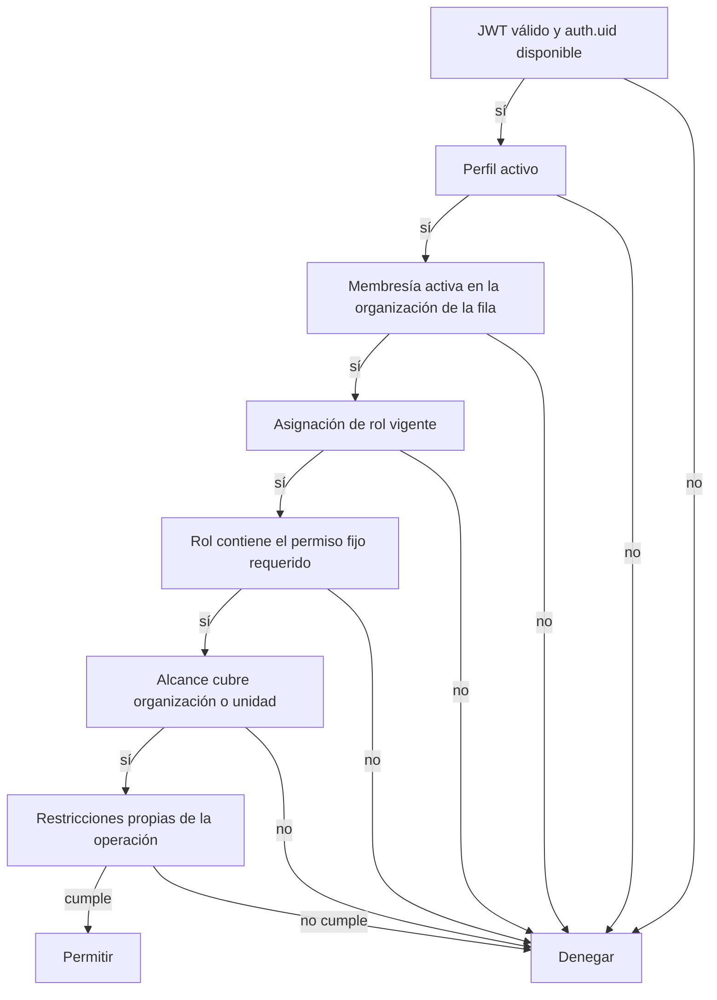

# Control de acceso

## Objetivo

Este documento define el modelo objetivo de autenticación, autorización y Row Level Security (RLS) de CRA. Es normativo para nuevas tablas y flujos, pero distingue expresamente el esquema propuesto de las políticas capturadas en el baseline.

El principio rector es mínimo privilegio con denegación por defecto. Una sesión válida no concede acceso clínico. El usuario debe tener perfil activo, membresía activa en la organización, un permiso del catálogo fijo y un alcance aplicable a la fila. Ningún filtro de Flutter, ruta de GoRouter, nombre de rol, organization ID recibido del cliente ni posesión de la clave publishable reemplaza esa evaluación.

## Evidencia del baseline

Hoy `practitioners` combina perfil, estado y un único rol enum, y su PK es directamente `auth.users.id` (`supabase/migrations/20260910000000_initial_clinical_schema.sql:4-14`, `supabase/migrations/20260910010000_auth_administration.sql:2-5`). Los helpers autorizan por listas de roles globales: un administrador activo administra practitioners y tres roles asistenciales activos leen todos los pacientes (`supabase/migrations/20260910010000_auth_administration.sql:12-32`, `supabase/migrations/20260910100000_patient_read_access.sql:3-23`).

Las políticas capturadas preservan dos contratos que el objetivo conserva:

- una cuenta suspendida pierde acceso;
- administración no implica acceso clínico.

Ambos comportamientos están comprobados por pgTAP (`supabase/tests/practitioners_rls.test.sql:71-107`, `supabase/tests/patients_rls.test.sql:105-130`). El router repite esta separación para UX, pero no es la autoridad (`app/lib/core/router/app_router.dart:28-45`).

El objetivo sustituye el rol global por permisos organizacionales con alcance. No debe interpretarse como descripción de políticas ya migradas.

## Vocabulario de seguridad

| Concepto               | Definición                                                                                        |
| ---------------------- | ------------------------------------------------------------------------------------------------- |
| Identidad autenticada  | Usuario de Supabase Auth identificado por `auth.uid()`                                            |
| Perfil                 | Persona utilizable por CRA y vinculada de forma única a una identidad Auth                        |
| Organización           | Tenant institucional; en la demo corresponde al hospital de demostración                          |
| Membresía              | Relación activa o suspendida entre perfil y organización                                          |
| Permiso                | Capacidad atómica, estable y versionada por CRA                                                   |
| Rol                    | Conjunto nombrado de permisos configurado dentro de una organización                              |
| Asignación de rol      | Concesión temporal de un rol a una membresía con alcance organizacional o de unidad               |
| Unidad                 | Servicio o unidad clínica jerárquica dentro de una organización                                   |
| Asignación asistencial | Relación individual entre una membresía y una hospitalización; queda preparada, sin flujo inicial |
| Recurso objetivo       | Fila cuya organización, unidad y hospitalización determinan el alcance exigido                    |

“Hospital” y “organización” son equivalentes en la frontera de autorización inicial. Si una red sanitaria con varios hospitales necesita un nivel superior, se agregará explícitamente; no se sobrecarga ahora `organization_id` con dos significados.

## Capas de decisión

Una operación se permite solo si supera todas las capas:

La asignación individual futura agrega una ruta explícita y más estrecha, no una excepción informal. Solo se considera si el rol incluye el permiso específico de acceso asignado y existe una asignación asistencial vigente para la hospitalización. En la entrega inicial no se crean tales asignaciones desde UI ni se incluyen esos permisos en roles seed.

## Catálogo fijo de permisos

Los códigos son contratos de aplicación: solo una migración versionada de CRA puede agregarlos, retirarlos o cambiar su semántica. Una organización puede decidir qué permisos componen sus roles, pero no crear códigos arbitrarios.

### Identidad y estructura

| Código                  | Operación protegida                                 | Observación                                       |
| ----------------------- | --------------------------------------------------- | ------------------------------------------------- |
| `iam.membership.read`   | Listar perfiles y membresías de la organización     | No incluye datos clínicos                         |
| `iam.membership.manage` | Invitar, activar, suspender y actualizar membresías | Operación privilegiada mediante Edge Function/RPC |
| `iam.role.read`         | Leer roles, permisos y asignaciones                 | No concede uso de esos permisos                   |
| `iam.role.manage`       | Crear roles locales y componerlos desde el catálogo | No puede modificar el catálogo                    |
| `iam.role.assign`       | Asignar o revocar roles y alcances                  | Impide autoelevación mediante reglas adicionales  |
| `org.unit.read`         | Consultar unidades                                  | Necesario para navegación y selección de alcance  |
| `org.unit.manage`       | Crear, actualizar, cerrar o reparentar unidades     | Debe preservar jerarquía y tenant                 |

### Consulta clínica

| Código                             | Operación protegida                                                   | Alcance evaluado                                                  |
| ---------------------------------- | --------------------------------------------------------------------- | ----------------------------------------------------------------- |
| `clinical.census.read`             | Listar hospitalizaciones y ubicación vigente                          | Organización o unidad de ubicación vigente                        |
| `clinical.patient.read`            | Ver demografía mínima del paciente vinculada a un episodio autorizado | Derivado de hospitalización accesible                             |
| `clinical.patient.identifier.read` | Ver identificadores completos no incluidos en la demografía mínima    | Hospitalización accesible; la vista ordinaria puede enmascararlos |
| `clinical.timeline.read`           | Ver `clinical_events`                                                 | Hospitalización y su unidad aplicable                             |
| `clinical.condition.read`          | Ver condiciones/diagnósticos                                          | Hospitalización                                                   |
| `clinical.medication.read`         | Ver solicitudes de medicación                                         | Hospitalización                                                   |
| `clinical.observation.read`        | Ver observaciones y resultados                                        | Hospitalización                                                   |
| `clinical.procedure.read`          | Ver procedimientos                                                    | Hospitalización                                                   |
| `clinical.document.read`           | Ver informes y metadatos documentales                                 | Hospitalización; contenido puede exigir control adicional         |
| `clinical.provenance.read`         | Ver metadatos de fuente y enlaces de trazabilidad                     | No habilita payload bruto automáticamente                         |
| `clinical.assigned.read`           | Acceso individual a hospitalizaciones asignadas                       | Preparado, no concedido en el flujo inicial                       |

### Contexto originado en CRA y operación

| Código                      | Operación protegida                                    | Observación                                             |
| --------------------------- | ------------------------------------------------------ | ------------------------------------------------------- |
| `context.note.read`         | Leer notas de contexto confirmadas                     | Mismo alcance que la hospitalización                    |
| `context.note.create`       | Crear borrador/nota de contexto                        | Escritura futura, no implícita por lectura              |
| `context.note.confirm`      | Confirmar contenido antes de hacerlo visible al equipo | Conserva autor y versión                                |
| `context.note.correct`      | Sustituir una nota mediante corrección trazable        | No edita historial destructivamente                     |
| `audit.read`                | Consultar auditoría de la organización                 | Restringido y separado de administración ordinaria      |
| `integration.source.read`   | Ver fuentes y estado de sincronización                 | No revela secretos                                      |
| `integration.source.manage` | Configurar/desactivar fuentes                          | Edge Function; secretos fuera de tablas expuestas       |
| `integration.run.read`      | Consultar ejecuciones y errores sanitizados            | Sin payload clínico bruto salvo permiso separado futuro |

No existe un permiso “superusuario” implícito. Service Role es una capacidad técnica de servidor y no un rol de negocio.

## Roles configurables por hospital

`roles` pertenece a una organización y contiene nombre, descripción y estado. `role_permissions` lo relaciona con el catálogo fijo. CRA puede sembrar plantillas sugeridas, pero una organización puede renombrarlas, clonarlas y ajustar su composición.

Ejemplo no normativo para la demo:

| Rol local                    | Permisos principales                                            | Alcance habitual |
| ---------------------------- | --------------------------------------------------------------- | ---------------- |
| Administración institucional | `iam.*`, `org.unit.*`, `integration.*`                          | Organización     |
| Médico tratante              | Lecturas clínicas y timeline                                    | Unidad           |
| Enfermería                   | Censo, paciente, timeline, observaciones, medicación y contexto | Unidad           |
| Técnico asistencial          | Censo, paciente, timeline y observaciones necesarias            | Unidad           |
| Auditor                      | `audit.read`, permisos de procedencia acordados                 | Organización     |

La tabla no reproduce automáticamente el baseline. En las políticas capturadas, physician, nurse y technician tienen exactamente la misma lectura clínica global (`supabase/migrations/20260910100000_patient_read_access.sql:10-48`; `supabase/tests/patients_rls.test.sql:56-130`). En el objetivo, cada hospital elige una composición explícita y comprobable.

Reglas de administración:

- Un nombre de rol es único dentro de la organización, no global.
- Un rol del sistema puede marcarse como protegido para impedir eliminación, pero sus permisos siguen siendo filas visibles y auditables.
- Un rol desactivado no puede recibir nuevas asignaciones y sus asignaciones vigentes dejan de conceder permisos.
- Nadie puede asignar un permiso que su propia autoridad administrativa no le permita gestionar. Como mínimo, la operación exige `iam.role.assign`; para evitar autoelevación, la función compara el conjunto solicitado con el conjunto delegable definido por política de plataforma.
- Cambiar la composición de un rol tiene efecto inmediato en RLS y genera auditoría.
- Administración institucional no incluye permisos `clinical.*` ni `context.*` salvo configuración deliberada del hospital.

## Alcances

### Alcance de organización

Una asignación con `scope_type = organization` cubre todas las unidades y hospitalizaciones de esa organización para los permisos contenidos en el rol. No cruza a otra organización aunque el mismo perfil tenga otra membresía.

Se utiliza para funciones realmente institucionales, por ejemplo administración de membresías o auditoría. Conceder lectura clínica a alcance organizacional es posible, pero debe ser una decisión explícita y excepcional del hospital.

### Alcance de unidad

Una asignación con `scope_type = unit` referencia una unidad de la misma organización. Cubre la unidad y, si la organización lo configura, sus descendientes. La primera implementación debe elegir una semántica única:

- recomendación: cubrir descendientes mediante una jerarquía materializada/closure table o un path mantenido por servidor;
- alternativa simple: alcance exacto, obligando a asignar cada unidad.

No se debe recorrer recursivamente una jerarquía arbitraria dentro de cada política RLS si eso vuelve impredecible el plan de consulta. La semántica elegida debe materializarse e indexarse.

Para una hospitalización activa, el alcance se evalúa contra la unidad de su ubicación vigente. Para datos históricos, se evalúa contra la unidad a la que pertenecía la hospitalización en el momento relevante o contra la unidad responsable del episodio, según el tipo de dato. La consulta no puede depender de `patients.care_unit`, que en el baseline era solo texto y no tenía historia (`supabase/migrations/20260910110000_clinical_timeline.sql:1-5`).

### Asignación individual preparada

`care_assignments` relaciona una membresía con una hospitalización, registra vigencia y motivo/rol asistencial opcional. Esta capacidad queda preparada por tres motivos: hospitales que restringen por equipo tratante, coberturas temporales y consultas interunidades justificadas.

No forma parte del flujo inicial:

- no existe pantalla para crearla;
- los roles seed no contienen `clinical.assigned.read`;
- no se infiere desde `recorded_by`, autoría de una nota ni haber abierto previamente al paciente;
- una asignación vencida o revocada no concede acceso;
- no reemplaza el permiso: permiso y asignación deben coexistir.

## Matriz de decisión objetivo

| Actor/condición                   | Administración IAM                     | Censo y paciente              | Timeline y recursos clínicos                         | Escritura de contexto                     | Auditoría                             |
| --------------------------------- | -------------------------------------- | ----------------------------- | ---------------------------------------------------- | ----------------------------------------- | ------------------------------------- |
| Anónimo                           | Denegada                               | Denegada                      | Denegada                                             | Denegada                                  | Denegada                              |
| Auth sin perfil                   | Denegada                               | Denegada                      | Denegada                                             | Denegada                                  | Denegada                              |
| Perfil suspendido                 | Denegada                               | Denegada                      | Denegada                                             | Denegada                                  | Denegada                              |
| Membresía suspendida              | Denegada en esa organización           | Denegada en esa organización  | Denegada en esa organización                         | Denegada                                  | Denegada                              |
| Administrador sin permiso clínico | Según permisos IAM                     | Denegada                      | Denegada                                             | Denegada                                  | Según `audit.read`                    |
| Rol clínico, alcance organización | Sin permiso IAM                        | Permitida en organización     | Según permiso granular                               | Según permiso explícito                   | Denegada                              |
| Rol clínico, alcance unidad       | Sin permiso IAM                        | Solo unidad cubierta          | Solo episodios cubiertos                             | Solo episodio cubierto                    | Denegada                              |
| Rol con acceso asignado           | Sin permiso IAM                        | Solo hospitalización asignada | Solo permisos y asignación vigentes                  | Solo si además tiene permiso de escritura | Denegada                              |
| Worker de ingesta                 | Sin sesión humana                      | No usa APIs de usuario        | Escribe solo tablas de ingesta/canónicas autorizadas | Denegada                                  | Emite auditoría técnica               |
| Service Role                      | Capacidad técnica, no actor de negocio | Omite RLS                     | Omite RLS                                            | Omite RLS                                 | Debe registrar actor/origen explícito |

## Contrato de RLS

### Principios

1. RLS se habilita en toda tabla de `public` expuesta o potencialmente alcanzable por PostgREST.
2. No tener política es la condición normal para una operación no soportada.
3. Grants y RLS se combinan: un grant no basta y una policy no compensa un grant excesivo.
4. Las policies llaman helpers de autorización estables y acotados; no duplican lógica compleja en decenas de expresiones.
5. Los helpers derivan identidad de `auth.uid()`. Nunca aceptan un `profile_id`, membership ID u organization ID como sustituto de identidad.
6. Toda policy compara el tenant de la fila con el de membresías, roles, unidades y hospitalizaciones relacionadas.
7. Las escrituras validan tanto la fila previa (`USING`) como la nueva (`WITH CHECK`) para impedir mover datos entre tenants o alcances.
8. Los propietarios de tablas y roles de migración no se usan como roles de runtime. Workers reciben el mínimo privilegio práctico.
9. Funciones `security definer` fijan `search_path`, califican relaciones y revocan ejecución de `public` y `anon`, siguiendo el endurecimiento vigente (`supabase/migrations/20260912000000_harden_function_privileges.sql:1-56`).

### Predicados conceptuales

No son firmas SQL ni una migración; son contratos de comportamiento:

| Helper conceptual                            | Resultado                                                                 |
| -------------------------------------------- | ------------------------------------------------------------------------- |
| `current_profile()`                          | Perfil activo vinculado a `auth.uid()`, o ninguno                         |
| `active_membership(org)`                     | Membresía activa del perfil actual en `org`                               |
| `has_permission(org, code)`                  | Existe rol/asignación vigente y activa que contiene `code`                |
| `has_org_scope(org, code)`                   | El permiso proviene de una asignación organizacional vigente              |
| `has_unit_scope(org, unit, code)`            | El permiso proviene de una asignación que cubre `unit`                    |
| `has_care_assignment(hospitalization, code)` | Existe asignación individual vigente y el rol incluye el permiso asignado |
| `can_access_hospitalization(id, code)`       | Tenant, membresía, permiso y alcance aplican a la hospitalización         |

Los helpers deben poder evaluarse con índices por `auth_user_id`, `organization_id`, estado, vigencia, permission code y scope. Su uso se validará con `EXPLAIN` sobre volúmenes representativos antes de producción.

## Políticas por familia de tablas

| Familia                          | `SELECT` de usuario                                                                            | `INSERT/UPDATE/DELETE` de usuario                                    | Escritor privilegiado                        |
| -------------------------------- | ---------------------------------------------------------------------------------------------- | -------------------------------------------------------------------- | -------------------------------------------- |
| `profiles`                       | Propio perfil; administradores ven perfiles unidos a su organización con `iam.membership.read` | Propio perfil no cambia estado/autoridad; administración vía función | Edge Function de identidad                   |
| `organizations`, `units`         | Membresía activa y permisos de estructura cuando corresponda                                   | Sin DML directo salvo RPC controlada                                 | Administración institucional                 |
| Membresías, roles y asignaciones | Permisos IAM de la misma organización                                                          | Sin mutación directa para operaciones que puedan elevar privilegios  | Edge Function/RPC auditada                   |
| `permission_catalog`             | Autenticados activos pueden leer códigos necesarios para UI                                    | Sin DML de tenant                                                    | Migraciones CRA                              |
| `patients`                       | Solo si existe al menos una hospitalización accesible; respuesta minimizada                    | Sin DML directo en fase inicial                                      | Worker de ingesta/reconciliación             |
| `hospitalizations`, ubicaciones  | `clinical.census.read` o permiso clínico aplicable al episodio                                 | Sin DML directo                                                      | Ingesta; futuras operaciones CRA explícitas  |
| Tablas clínicas canónicas        | Permiso granular y acceso a la hospitalización                                                 | Sin DML directo                                                      | Worker/proceso canónico                      |
| `context_notes`                  | `context.note.read` y episodio accesible                                                       | Permisos separados; corrección append-only                           | Usuario bajo RLS/RPC, moderación excepcional |
| `clinical_events`                | `clinical.timeline.read` y episodio accesible                                                  | Ninguna escritura de usuario                                         | Proyector técnico                            |
| `source_resources`               | Solo metadatos limitados con `clinical.provenance.read`; payload no expuesto por defecto       | Ninguna                                                              | Worker de ingesta                            |
| `ingestion_runs/errors`          | `integration.run.read` de la organización, con error sanitizado                                | Ninguna                                                              | Worker de ingesta                            |
| `audit_events`                   | `audit.read` de la organización y filtros definidos                                            | Ninguna modificación                                                 | Funciones/servicios append-only              |

### Regla de acceso a paciente

Un paciente no tiene una unidad “actual” universal. RLS permite leer su demografía solo cuando el usuario puede acceder al menos a una hospitalización del paciente en esa organización. Si existe más de una hospitalización, consultar el paciente por ID no debe revelar episodios no autorizados. Las vistas/API deben entregar la demografía junto al episodio autorizado y evitar agregados que infieran actividad en unidades ocultas.

### Regla de acceso a recursos clínicos

Cada recurso clínico consumible referencia una hospitalización. Si una fuente no puede atribuirlo todavía, queda en staging/procedencia y no se publica al timeline hasta una reconciliación segura. Esta regla evita conceder acceso por el mero `patient_id`, que podría abarcar episodios en otras unidades o instituciones.

### Regla de eventos derivados

`clinical_events` repite `organization_id` y `hospitalization_id` para filtrar e indexar, pero esas columnas se derivan de la entidad fuente y deben ser coherentes mediante proyección controlada. RLS exige `clinical.timeline.read` sobre la hospitalización. Nadie obtiene acceso al evento porque figure como `recorded_by`.

## Operaciones privilegiadas

### Creación y administración de usuarios

El patrón vigente de `create-practitioner` separa un cliente del llamador y un cliente Service Role (`supabase/functions/create-practitioner/index.ts:29-45`, `supabase/functions/create-practitioner/index.ts:74-104`). El objetivo conserva esa separación y la amplía:

1. validar método, JWT y payload;
2. resolver organización desde la operación solicitada y comprobar `iam.membership.manage`;
3. crear o invitar en Auth;
4. crear/reutilizar perfil y membresía en forma compensable;
5. asignar roles solo si pertenecen a la organización y son delegables;
6. auditar éxito o fallo sin registrar contraseña;
7. eliminar/compensar una cuenta recién creada si falla el dominio, como intentaba el flujo del baseline.

No se permite que Flutter inserte perfiles, membresías o asignaciones con autoridad arbitraria.

### Ingesta

El gateway no usa una sesión humana ni Service Role general. La credencial identifica `organization_id` y `source_system_id`; el servidor ignora esos valores si vienen como autoridad en el body y usa los vinculados a la credencial. El writer de ingesta puede modificar recursos de su fuente, no roles, otras organizaciones ni datos originados en CRA.

### Generación de resúmenes

La función `clinical-summary` del baseline solo validaba la existencia de un usuario y estaba intencionalmente sin implementar (`supabase/functions/clinical-summary/index.ts:3-18`). Antes de activarla debe:

- comprobar permiso sobre cada hospitalización solicitada;
- recuperar datos mediante el contexto del llamador o una función que preserve autorización;
- minimizar información enviada al proveedor;
- registrar modelo, versión, fuentes, timestamp y actor;
- marcar la salida como generada y revisable;
- no convertir el resumen en fuente clínica ni permitir que revele filas fuera de alcance.

## Claims, caché y revocación

Los permisos no se almacenan como fuente de verdad en JWT. Pueden existir claims de UX no autoritativos, pero RLS consulta el estado vigente. Así, suspender una membresía, revocar una asignación o retirar un permiso surte efecto en la siguiente consulta aunque el access token siga criptográficamente válido.

Flutter puede cachear datos de presentación durante una sesión solo bajo una política futura explícita. Al cerrar sesión, cambiar de organización, quedar suspendido o recibir una respuesta de autorización, debe invalidar cachés relacionadas. Ocultar una ruta tras leer el perfil, como hacía GoRouter en el baseline (`app/lib/core/router/app_router.dart:28-45`), sigue siendo útil pero nunca suficiente.

## Auditoría

Se auditan como mínimo:

- altas, invitaciones, activaciones y suspensiones de membresía;
- creación/desactivación de roles y cambios en su composición;
- asignación, revocación y cambio de alcance;
- creación/revocación futura de asignaciones asistenciales;
- escrituras y correcciones de contexto CRA;
- configuración y ejecución de fuentes de ingesta;
- uso de funciones privilegiadas y reconstrucción de proyecciones;
- accesos clínicos, según política de cumplimiento definida antes de producción.

La auditoría registra actor Auth, perfil/membresía cuando exista, organización, acción, tipo e ID de objetivo, resultado, instante y correlation ID. No guarda contraseñas, JWT, Service Role keys ni payloads clínicos completos. Es append-only para usuarios; correcciones generan otro evento.

## Pruebas obligatorias

La estrategia canónica exige pgTAP para todo cambio de política, rol, estado u operación de acceso, con caso permitido y denegado ([testing y validación](11-testing-validation.md#pgtap-y-base-de-datos)). Para el modelo objetivo, cada familia debe cubrir al menos:

- anónimo y autenticado sin perfil;
- perfil y membresía activos frente a cada estado suspendido;
- organización A frente a fila de organización B;
- permiso presente frente a ausente;
- rol activo frente a desactivado;
- asignación vigente, futura, vencida y revocada;
- alcance organización, unidad cubierta y unidad ajena;
- administrador sin acceso clínico;
- intento de mover una fila a otra organización mediante `UPDATE`;
- intento de asignar rol/unidad de otra organización;
- lectura por asignación individual deshabilitada y, cuando se active, vigente/vencida;
- escritor de ingesta limitado a su organización y fuente;
- ausencia de privilegios RPC para `anon` y funciones internas no ejecutables por `authenticated`.

Las pruebas capturadas ofrecen el patrón de identidad simulada mediante `request.jwt.claim.sub`, casos permitidos/denegados y rollback (`supabase/tests/patients_rls.test.sql:1-53`, `supabase/tests/patients_rls.test.sql:56-169`). No deben depender del seed.

## Alternativas descartadas

### Conservar el enum global de roles

Descartado porque impide configuración por hospital, asignaciones múltiples y permisos granulares. También mezcla el nombre organizacional de un rol con la decisión técnica que RLS necesita evaluar.

### Guardar permisos completos en el JWT

Descartado porque retrasa revocaciones, aumenta tamaño y obliga a sincronizar claims con configuración mutable. La identidad viene del JWT; la autoridad vigente viene de PostgreSQL.

### Autorizar solo por `organization_id`

Descartado porque pertenecer a un hospital no significa poder consultar todos sus pacientes. Se exige permiso y alcance, con asignación individual futura cuando el hospital lo requiera.

### Conceder acceso a quien registró un evento

Descartado porque autoría y autorización son dimensiones distintas. Un autor que cambia de unidad o queda suspendido no conserva acceso por haber creado una fila.

### Usar exclusivamente Edge Functions para ocultar RLS

Descartado porque centralizaría todo acceso en código con Service Role y haría que un error de función expusiera múltiples tenants. Las Edge Functions coordinan privilegios; RLS protege cualquier camino de datos de usuario.

### Permitir permisos definidos libremente por tenant

Descartado porque RLS no puede interpretar de forma segura cadenas con semántica desconocida y las pruebas dejarían de cubrir el universo autorizado. El catálogo es fijo; las composiciones de rol son configurables.

## Criterios de aceptación

- Una misma identidad puede participar en varias organizaciones sin mezclar roles ni estado.
- Suspender una membresía revoca solo esa organización; suspender el perfil revoca todas.
- Cada rol pertenece a una organización y solo referencia permisos del catálogo fijo.
- Las asignaciones tienen exactamente un alcance organizacional o de unidad y una vigencia comprobable.
- Toda consulta clínica se autoriza a través de una hospitalización y no solo de un paciente.
- El administrador no obtiene datos clínicos sin permisos clínicos deliberados.
- La asignación individual está representada y testeable, pero ausente del flujo y roles iniciales.
- Las operaciones privilegiadas autentican, autorizan y auditan antes de usar Service Role.
- Las pruebas prueban aislamiento entre tenants, alcance, estado, temporalidad y operaciones de escritura.
