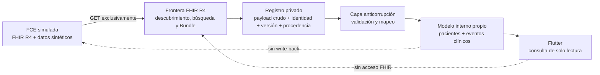

# Integración FHIR R4

## 1. Propósito y estado

Este documento fija la base arquitectónica para ingerir información desde una ficha clínica electrónica (FCE) hacia Carer Record. Es una decisión de diseño, no una declaración de funcionalidad ya implementada. El repositorio solo contiene un punto de entrada reservado para el pipeline, cuya ejecución informa que la ingesta FHIR fue diferida (`scripts/data_pipeline/main.py:1-15`).

La demostración utilizará una **FCE simulada**, expuesta como servidor FHIR, y **datos íntegramente sintéticos**. No se conectará una institución real, no se incorporarán datos personales o clínicos reales y no se enviarán modificaciones a la FCE. Esta restricción sigue ADR-002, el alcance definido en [`03-scope.md`](03-scope.md) y la prohibición de secretos o datos clínicos reales en el repositorio (`README.md:41-47`).

Las decisiones vinculantes son:

1. **FHIR R4 v4.0.1 es la frontera de interoperabilidad**, no el modelo de dominio ni el esquema público de Carer Record.
2. **Carer Record conserva un modelo interno propio**, optimizado para sus casos de uso y protegido por RLS.
3. La integración es **unidireccional y de solo lectura**: FCE simulada → pipeline → modelo interno. No existe `create`, `update`, `patch`, `delete`, transacción ni write-back hacia el servidor FHIR.
4. El MVP ingiere ocho recursos de dominio: `Organization`, `Patient`, `Encounter`, `Location`, `Condition`, `Observation`, `AllergyIntolerance` y `MedicationRequest`.
5. `CapabilityStatement`, `Bundle` y `OperationOutcome` son recursos de infraestructura necesarios para negociar, transportar y diagnosticar la ingesta; no se proyectan como eventos clínicos.
6. `DiagnosticReport`, `DocumentReference` y los restantes recursos no se implementan en el MVP. Su evaluación completa y su justificación se documentan en [Selección de recursos FHIR](appendices/fhir-resource-selection.md).

Actualización 2026-10-21: [ADR-019](decisions/adr-019-lectura-fhir-directa-desde-la-app.md) sustituye en parte esta arquitectura **solo para la demo sintética/local**: la app puede leer un servidor FHIR directamente para listar pacientes y mostrar su ficha (sección 15). El pipeline de ingesta, la identidad compuesta, el raw privado y la idempotencia de las secciones 4 a 10 siguen siendo la arquitectura objetivo para cualquier dato real.

## 2. Marco normativo

FHIR R4 identifica recursos intercambiables, sus elementos, referencias, búsquedas e interacciones HTTP. La especificación R4 publicada en su ubicación permanente corresponde a v4.0.1 y combina contenido normativo y de prueba de uso. La integración fija esa versión para evitar que cambios de R4B o R5 alteren silenciosamente cardinalidades, nombres o semántica.

La interfaz REST de FHIR R4 es normativa y permite que cada servidor seleccione los recursos e interacciones que ofrece. Por ello, el cliente no debe inferir capacidades a partir del nombre del producto: debe consultar `GET [base]/metadata` y examinar el `CapabilityStatement`. Los formatos aceptados serán JSON FHIR con `Accept: application/fhir+json; fhirVersion=4.0`; XML y Turtle quedan fuera del MVP.

El estándar define `Resource.id` como identificador lógico dentro de un servidor y un tipo de recurso, no como identidad universal de una persona ni como clave global entre organizaciones. También relaciona `meta.versionId` con `ETag` y `meta.lastUpdated` con `Last-Modified`. Esos metadatos se conservan para control de versiones, auditoría e idempotencia, pero no sustituyen la identidad compuesta local.

Fuentes oficiales principales:

- [FHIR R4 v4.0.1](https://hl7.org/fhir/R4/)
- [API REST FHIR R4](https://hl7.org/fhir/R4/http.html)
- [Búsqueda FHIR R4](https://hl7.org/fhir/R4/search.html)
- [Lista oficial de recursos R4](https://hl7.org/fhir/R4/resourcelist.html)
- [Guía para seleccionar recursos](https://hl7.org/fhir/R4/resourceguide.html)
- [Metadatos de Resource](https://hl7.org/fhir/R4/resource.html#metadata)
- [Gestión de versiones FHIR](https://hl7.org/fhir/R4/versions.html)

El catálogo por familias está en [Catálogo de recursos FHIR R4](appendices/fhir-r4-resource-catalog.md).

## 3. Evidencia y continuidad arquitectónica

### 3.1 Scaffold actual de Carer Record App

El scaffold ya establece límites compatibles con una traducción anticorrupción:

| Evidencia                                                                                                                                                                              | Consecuencia para FHIR                                                                                                                               |
| -------------------------------------------------------------------------------------------------------------------------------------------------------------------------------------- | ---------------------------------------------------------------------------------------------------------------------------------------------------- |
| `app/`, `supabase/` y `scripts/data_pipeline/` separan cliente, persistencia y frontera de ingesta.                                                                                    | La adquisición y traducción se ejecutan fuera de Flutter; la aplicación consume únicamente tablas y contratos internos.                              |
| `supabase/migrations/20260910000000_initial_clinical_schema.sql:16-37` define `patients` y `clinical_events`, cada uno con `payload` JSONB validado como objeto.                       | Existe un modelo local deliberadamente más pequeño que FHIR. Debe evolucionar mediante migraciones aditivas, no reflejar una tabla por cada recurso. |
| `app/lib/domains/patient/domain/entities/patient.dart:1-20` expone identidad, nombre, nacimiento y ubicación propios.                                                                  | La entidad Dart no se convierte en un `Patient` FHIR ni recibe el JSON crudo.                                                                        |
| `app/lib/domains/clinical_event/domain/entities/clinical_event.dart:1-23` modela un evento uniforme con fecha, clase y detalle.                                                        | Condiciones, observaciones, alergias, solicitudes y encuentros se proyectan al timeline sin transferir toda la estructura FHIR a presentación.       |
| `app/lib/domains/clinical_event/data/models/clinical_event_model.dart:12-21` solo interpreta el resumen tipado del `payload`.                                                          | La proyección de lectura debe producir un resumen estable; el recurso FHIR original pertenece a almacenamiento privado del pipeline.                 |
| `app/lib/domains/clinical_event/data/clinical_event_repository.dart:10-16` lee eventos por paciente y fecha.                                                                           | El pipeline prepara vistas de consulta; la app no consulta el servidor FHIR ni resuelve referencias.                                                 |
| `supabase/migrations/20260910100000_patient_read_access.sql:1-23` y `supabase/migrations/20260910110000_clinical_timeline.sql:53-68` restringen lectura a roles asistenciales activos. | Las proyecciones clínicas mantienen RLS; el staging crudo requiere una superficie todavía más restringida y nunca se concede a `authenticated`.      |
| `supabase/seed.sql:22-115` y `supabase/seed.sql:117-247` cargan pacientes y eventos ficticios.                                                                                         | La demo FHIR debe conservar el mismo principio y usar identificadores claramente sintéticos y reproducibles.                                         |

Actualización 2026-10-21: la fila sobre `clinical_event_repository.dart` (la app no consulta el servidor FHIR) describe el diseño objetivo. En la demo, ADR-019 permite que Flutter lea un servidor FHIR directamente desde `app/lib/domains/fhir_record/`; ver la sección 15.

La columna actual `patients.external_reference` es única globalmente (`supabase/migrations/20260910000000_initial_clinical_schema.sql:16-25`). No es suficiente para varias organizaciones, fuentes y tipos; la identidad de integración definida en la sección 7 debe vivir en una capa de correspondencias propia y no debe forzarse dentro de esa columna sin una migración de diseño posterior.

### 3.2 Antecedente `../carer-record`

El repositorio anterior aporta evidencia útil del problema y de los recursos que aparecen en datos sintéticos, pero no es una implementación de referencia para portar literalmente:

- Declara correctamente el patrón adaptador hacia un modelo interno (`../carer-record/integration/README.md:1-28`).
- Importa bundles sintéticos y documenta Synthea como fuente de pruebas (`../carer-record/integration/README.md:49-93`).
- Tiene un importador batch para `Patient` y múltiples recursos clínicos (`../carer-record/backend/app/fhir/fhir_adapter.py:257-831`).
- Tiene un sincronizador incremental por `_lastUpdated` y paginación `Bundle.link[relation=next]` (`../carer-record/backend/app/sync/sync_service.py:218-283`).
- Su esquema declara explícitamente que los adaptadores mapean a un modelo interno normalizado (`../carer-record/backend/app/core/init_db.sql:27-60`).

Esas ideas se conservan como intención: adaptador, modelo propio, datos sintéticos, lectura incremental y paginación. Sus defectos de identidad, pérdida semántica, seguridad y recuperación se rechazan expresamente en la sección 12 y en el [flujo de ingesta](flows/fhir-ingestion.md).

## 4. Límite de contexto

FHIR termina en la capa de integración. Dentro de Carer Record existen tres representaciones distintas:

1. **Representación de transporte**: `CapabilityStatement`, `Bundle`, `OperationOutcome` y cada recurso FHIR recibido, sin alterar.
2. **Registro privado de procedencia**: identidad externa, versión, hash, fecha de recuperación, ejecución, resultado y `payload` crudo.
3. **Proyección de dominio**: pacientes, ubicaciones operativas y eventos clínicos en contratos propios para Supabase y Flutter.

No se reutilizan clases FHIR como entidades de dominio. La traducción puede perder deliberadamente elementos que no sirven al producto, pero nunca debe perder el original: el `payload` crudo privado permite explicar una proyección, reprocesar con una versión nueva del mapper y detectar cambios de la fuente.



## 5. Alcance de recursos

### 5.1 Recursos seleccionados

| Recurso              | Función en la demo                                                        | Proyección mínima esperada                                                                                             |
| -------------------- | ------------------------------------------------------------------------- | ---------------------------------------------------------------------------------------------------------------------- |
| `Organization`       | Establece la institución o unidad responsable declarada por la FCE.       | Correspondencia con organización interna, nombre, identificadores, estado y relación `partOf`.                         |
| `Patient`            | Identifica al sujeto de la ficha sintética.                               | Paciente interno, identificadores por sistema, nombre, nacimiento, sexo administrativo, estado y organización gestora. |
| `Encounter`          | Contextualiza hospitalización o atención.                                 | Evento de encuentro, período, estado, clase, tipo, motivo, servicio, organización y referencias de ubicación.          |
| `Location`           | Representa sede, unidad, sala, habitación o cama.                         | Jerarquía de ubicación y correspondencia con `care_unit`/`bed_label` cuando sea semánticamente válida.                 |
| `Condition`          | Registra problema, diagnóstico o condición relevante.                     | Evento de condición con código, estados clínico y de verificación, inicio, término, severidad y encuentro.             |
| `Observation`        | Registra mediciones y aseveraciones simples, incluidos signos vitales.    | Evento de observación con código, valor tipado, unidad, fecha efectiva, componentes, interpretación y rango.           |
| `AllergyIntolerance` | Registra riesgo individual ante una sustancia.                            | Evento de alergia/intolerancia con estados, criticidad, agente, inicio y reacciones.                                   |
| `MedicationRequest`  | Registra prescripción u orden de medicamento, no administración efectiva. | Evento de solicitud con estado, intención, medicamento codificado, fecha, solicitante y dosificación.                  |

La proyección mínima es un contrato del producto, no una copia exhaustiva del recurso. Para `MedicationRequest`, la demo exige `medicationCodeableConcept` o un `Medication` contenido que pueda resolverse localmente. Una referencia externa a `Medication` que no venga resuelta queda registrada y en cuarentena para extensión futura; no se inventa un nombre de medicamento.

### 5.2 Recursos de infraestructura

| Recurso               | Uso obligatorio                                                                                                   | Persistencia                                                                                                                                           |
| --------------------- | ----------------------------------------------------------------------------------------------------------------- | ------------------------------------------------------------------------------------------------------------------------------------------------------ |
| `CapabilityStatement` | Confirmar `fhirVersion`, recursos, interacción `search-type`, parámetros relevantes, formato y versión soportada. | Snapshot privado asociado a la fuente y a la ejecución; no es evento clínico.                                                                          |
| `Bundle`              | Recibir resultados `type=searchset`, entradas, `fullUrl`, total informativo y enlaces de paginación.              | Metadatos de página; cada recurso se persiste por separado. El bundle completo puede conservarse temporalmente si la política de retención lo permite. |
| `OperationOutcome`    | Interpretar errores, advertencias e información retornada por el servidor.                                        | Issues normalizados y copia cruda privada, con redacción de logs.                                                                                      |

### 5.3 Recursos fuera del MVP

`DiagnosticReport` queda futuro porque agrega la semántica de informe, conclusión y agrupación de resultados, requiere resolver referencias a `Observation`, y puede incluir `presentedForm`. Ingerirlo parcialmente como texto produciría duplicidad o pérdida de vínculo con resultados atómicos. La especificación recomienda `DiagnosticReport` con `Observation` para paneles e informes, por lo que su incorporación debe diseñar deduplicación y navegación conjunta.

`DocumentReference` queda futuro porque solo aporta metadatos de descubrimiento; el contenido puede residir en un adjunto, `Binary` o URL externa y necesita Storage, control de tipo MIME, antivirus, retención, autorización y ciclo de vida documental. El `kind=document` existente en el enum local (`supabase/migrations/20260910000000_initial_clinical_schema.sql:4-5`) no prueba que esa infraestructura exista.

`Practitioner` y `PractitionerRole` quedan futuros: los usuarios autenticados internos no deben fusionarse automáticamente con profesionales externos. La correspondencia requiere reglas institucionales para licencia, organización, rol, período y duplicados. `Procedure`, presente en el enum y en datos seed, también queda futuro: la disponibilidad de una categoría interna no constituye soporte de mapeo FHIR.

Los demás recursos se descartan para esta demostración por falta de caso de uso, dependencia de infraestructura no disponible, pertenencia a escritura/workflow, finanzas, investigación, terminología, definiciones o baja madurez. “Descartado” significa fuera del alcance actual, no una afirmación de inutilidad clínica del estándar.

## 6. Contrato por recurso

### 6.1 Reglas transversales

Para todo recurso seleccionado se aplican estas reglas:

- Validar `resourceType`, presencia de `id`, JSON bien formado y restricciones mínimas utilizadas por el mapper.
- Conservar `meta.versionId`, `meta.lastUpdated`, `meta.profile`, `identifier`, referencias, codificaciones completas y el JSON original aunque la proyección use solo una parte.
- Tratar `Coding.system`, `Coding.version` y `Coding.code` como una unidad. `display` es presentación, no identidad terminológica.
- Tratar `Identifier.system` y `Identifier.value` como una unidad. Nunca elegir “el primer identificador” sin una regla explícita por fuente.
- Preservar la precisión y zona horaria de `dateTime`/`instant`. El dominio puede derivar una fecha, pero el valor fuente permanece intacto.
- Resolver referencias relativas, absolutas, versionadas, `urn:uuid`, `fullUrl` y contenidas mediante un índice de bundle y correspondencias persistidas; no extraer solo el último segmento del texto.
- Detectar `modifierExtension` desconocidas y elementos modificadores no soportados. No producir una proyección clínicamente engañosa; cuarentenarla o marcarla incompleta.
- No interpretar `text.div` como sustituto de datos estructurados. Puede conservarse en raw, pero no se renderiza sin sanitización.

### 6.2 Elementos mínimos por recurso

| Recurso              | Elementos fuente relevantes                                                                                                                                                                           | Reglas de proyección                                                                                                                                                                                            |
| -------------------- | ----------------------------------------------------------------------------------------------------------------------------------------------------------------------------------------------------- | --------------------------------------------------------------------------------------------------------------------------------------------------------------------------------------------------------------- |
| `Organization`       | `identifier`, `active`, `type`, `name`, `alias`, `partOf`                                                                                                                                             | La organización de tenancy se configura localmente; un recurso FHIR no puede cambiarla por sí solo. `partOf` forma una jerarquía externa, no permisos internos.                                                 |
| `Patient`            | `identifier`, `active`, `name`, `gender`, `birthDate`, `deceased[x]`, `address`, `telecom`, `managingOrganization`, `link`                                                                            | Seleccionar nombre e identificador mediante reglas configuradas. Un RUT solo se acepta desde el `Identifier.system` acordado y se valida localmente. `link` se conserva, pero la fusión de pacientes es futura. |
| `Encounter`          | `identifier`, `status`, `class`, `type`, `subject`, `serviceProvider`, `period`, `reasonCode`, `location`                                                                                             | `subject` debe resolver a un paciente de la misma fuente/organización. Cada `location.period` puede diferir del período global; no inferir cama desde `display`.                                                |
| `Location`           | `identifier`, `status`, `name`, `alias`, `mode`, `type`, `physicalType`, `managingOrganization`, `partOf`                                                                                             | Construir jerarquía por referencias. Solo tipos y perfiles acordados pueden alimentar unidad/cama; conservar el resto como contexto.                                                                            |
| `Condition`          | `identifier`, `clinicalStatus`, `verificationStatus`, `category`, `severity`, `code`, `subject`, `encounter`, `onset[x]`, `abatement[x]`, `recordedDate`                                              | No asumir estado `active` si falta. No presentar una condición `entered-in-error` como activa. Mantener variantes temporales sin truncarlas a fecha en raw.                                                     |
| `Observation`        | `identifier`, `basedOn`, `status`, `category`, `code`, `subject`, `encounter`, `effective[x]`, `issued`, `performer`, `value[x]`, `dataAbsentReason`, `interpretation`, `referenceRange`, `component` | Soportar explícitamente tipos `value[x]` acordados. `dataAbsentReason` no equivale a valor vacío. Presión arterial se identifica por códigos y componentes, no por texto inglés.                                |
| `AllergyIntolerance` | `identifier`, `clinicalStatus`, `verificationStatus`, `type`, `category`, `criticality`, `code`, `patient`, `encounter`, `onset[x]`, `recordedDate`, `reaction`                                       | No sustituir `clinicalStatus` ausente por activo. Conservar todas las reacciones, manifestaciones, severidades y fechas; criticidad no es severidad de reacción.                                                |
| `MedicationRequest`  | `identifier`, `status`, `intent`, `medication[x]`, `subject`, `encounter`, `authoredOn`, `requester`, `reasonCode`, `reasonReference`, `dosageInstruction`                                            | Distinguir orden de administración. No inferir administración, adherencia ni dispensación. Conservar todas las instrucciones; el resumen puede ser parcial y debe indicarlo.                                    |

Las páginas normativas de estos recursos son: [Organization](https://hl7.org/fhir/R4/organization.html), [Patient](https://hl7.org/fhir/R4/patient.html), [Encounter](https://hl7.org/fhir/R4/encounter.html), [Location](https://hl7.org/fhir/R4/location.html), [Condition](https://hl7.org/fhir/R4/condition.html), [Observation](https://hl7.org/fhir/R4/observation.html), [AllergyIntolerance](https://hl7.org/fhir/R4/allergyintolerance.html) y [MedicationRequest](https://hl7.org/fhir/R4/medicationrequest.html).

## 7. Identidad externa

### 7.1 Clave canónica

La identidad de una instancia FHIR dentro de Carer Record es:

```text
(organization, data_source, resource_type, external_id)
```

Donde:

- `organization` es el identificador interno inmutable de la organización/tenant que autorizó la fuente; no se toma ciegamente de `Organization.id`.
- `data_source` identifica una configuración de origen concreta: FCE simulada, base URL lógica, versión y credencial asociada. No contiene secretos en claro.
- `resource_type` es el nombre sensible a mayúsculas de FHIR R4, por ejemplo `Observation`.
- `external_id` es `Resource.id`, no `Identifier.value` ni el UUID interno.

Debe existir una restricción única sobre la tupla. Dos servidores pueden emitir `Patient/123`; incluso una misma organización puede operar más de una fuente. `Patient/123` y `Observation/123` tampoco son la misma entidad. La tupla evita las colisiones que el antecedente permite al usar solo `(resource_type, resource_id)` en `fhir_sync_log` (`../carer-record/backend/app/core/init_db.sql:114-126`) y al buscar pacientes únicamente por `external_id` (`../carer-record/backend/app/fhir/fhir_adapter.py:291-301`).

Los identificadores de negocio se almacenan aparte como conjuntos `(system, value, use, type)`. Se pueden usar para conciliación asistida, nunca como reemplazo automático de la clave canónica.

### 7.2 Versiones y orden

Para cada identidad se conserva:

- `source_version_id`: copia opaca de `meta.versionId`, nullable si el servidor declara `no-version`.
- `source_last_updated`: copia de `meta.lastUpdated`, con zona y precisión.
- `payload_hash`: hash criptográfico de una serialización JSON canónica definida por el pipeline.
- `first_seen_at` y `retrieved_at`: tiempos internos UTC.
- `current_version` y el historial de versiones recibidas o, como mínimo para la demo, un registro inmutable de cambios suficiente para reprocesar.

`meta.versionId` es opaco: no se convierte a entero ni se ordena lexicográficamente. `meta.lastUpdated` ordena temporalmente cuando existe, pero dos recursos pueden compartirlo. Si el servidor no soporta versionado, se compara `lastUpdated` y hash; si tampoco entrega `lastUpdated`, se usa el hash para idempotencia y un checkpoint solapado para no asumir orden de origen.

## 8. Payload crudo y procedencia

### 8.1 Payload privado

Cada versión aceptada o cuarentenada conserva el recurso JSON completo en un área privada de integración. Este `payload_raw`:

- contiene datos clínicos y se clasifica como sensible;
- no se incorpora al `patients.payload` ni al `clinical_events.payload` público por conveniencia;
- no se concede a los roles `anon` ni `authenticated` y no se consulta desde Flutter;
- solo es accesible por el proceso servidor de ingesta y por operación administrativa explícitamente autorizada;
- no se imprime en logs, excepciones, CI ni artefactos de prueba;
- tiene política explícita de retención y eliminación antes de usar fuentes reales;
- permite volver a proyectar después de corregir un mapper sin descargar de nuevo.

La Service Role Key, si el proceso la necesitara para Supabase, existe solo en ejecución servidor, según ADR-003 y `AGENTS.md:14-18`. La demo local no justifica relajar RLS ni exponer tablas raw mediante PostgREST.

### 8.2 Procedencia interna

Por cada versión se registra linaje técnico mínimo:

- organización y fuente;
- identidad canónica y `fullUrl` de la entrada;
- `meta.versionId`, `meta.lastUpdated`, perfiles declarados y hash;
- ejecución, página y orden de entrada;
- instante de recuperación, versión del mapper y resultado (`projected`, `noop`, `quarantined`, `retryable_error`);
- referencias resueltas y no resueltas;
- identificador de la versión de la proyección interna producida.

Esto es **procedencia interna de ingesta**, no una instancia FHIR `Provenance`. El recurso [Provenance R4](https://hl7.org/fhir/R4/provenance.html) expresa agentes, actividades y entidades que produjeron o influyeron recursos; queda futuro porque la demo no necesita consultar ese recurso y no debe fabricar afirmaciones que la FCE no emitió. Si llega un `Provenance` no seleccionado, se registra como tipo no soportado sin convertirlo en una afirmación interna.

## 9. Idempotencia y consistencia

La misma entrada puede reaparecer por solapamiento de checkpoints, reintento de página o repetición de la demo. El resultado observable debe ser el mismo:

1. Buscar por la tupla de identidad.
2. Si no existe, insertar versión raw, correspondencia y proyección en una transacción local.
3. Si coinciden `versionId` y hash, registrar `noop`; no duplicar paciente ni evento.
4. Si coincide `versionId` pero cambia el hash, declarar violación de integridad de la fuente y poner en cuarentena; una versión opaca no puede representar dos contenidos.
5. Si cambia la versión, almacenar la nueva versión y recalcular la proyección. No sobreescribir el raw anterior.
6. Sin `versionId`, usar `lastUpdated` y hash. Un hash ya procesado es `noop`; un cambio genera nueva revisión local.
7. Aplicar restricciones únicas tanto a la identidad externa como al vínculo `(source_resource_version, projection_kind)`.

No se generan UUID aleatorios como sustituto de un `Resource.id` ausente. Un recurso sin `id` dentro de un `Bundle` de búsqueda no puede satisfacer la identidad definida y se cuarentena. La excepción son recursos `contained`, cuya identidad depende del recurso contenedor y se registra como `(identidad del contenedor, fragmento #id)` sin proyectarse autónomamente.

La transacción de una entrada incluye raw, procedencia, correspondencia y proyección. Un error en la proyección no debe dejar una actualización clínica parcial marcada como exitosa. El avance del checkpoint ocurre solo al cerrar correctamente toda la paginación y persistir cada entrada como éxito, no-op o cuarentena durable; un error reintentable bloquea el avance.

## 10. Checkpoints y cambios incrementales

Se mantiene un checkpoint por `(organization, data_source, resource_type)`, no un único archivo global. Contiene al menos:

- máximo `meta.lastUpdated` observado y confirmado;
- margen de solapamiento configurado;
- inicio y cierre de la ejecución que lo produjo;
- última página completada solo como diagnóstico, no como URL reutilizable indefinidamente;
- estado y causa del último fallo.

La consulta incremental usa `_lastUpdated=ge{checkpoint-overlap}` cuando el servidor lo soporte. El solapamiento vuelve a leer el borde temporal y la idempotencia elimina duplicados. Se sigue exclusivamente la URL `Bundle.link` con `relation=next` para páginas posteriores; no se reconstruyen tokens ni se reenvían los parámetros de la primera página. El nuevo checkpoint es el máximo `meta.lastUpdated` realmente observado, no el reloj local al comenzar la ejecución.

FHIR permite que un servidor no implemente versionado completo. Por eso `CapabilityStatement` decide la estrategia y el pipeline rechaza una configuración que no permita una ingesta segura. La detección completa de eliminaciones exige `_history` o una política específica y queda fuera de la demo; la ausencia de un recurso en una búsqueda no autoriza borrarlo localmente.

El algoritmo operacional, incluidos estados y errores, se detalla en [Flujo de ingesta FHIR](flows/fhir-ingestion.md).

## 11. Seguridad y privacidad

El límite de confianza se ubica en el proceso servidor:

- Flutter nunca recibe credenciales FHIR ni URL de administración de la fuente.
- Se permiten únicamente `GET` de metadata y búsquedas/lecturas necesarias; una lista de métodos bloquea cualquier escritura aunque el servidor la anuncie.
- Las credenciales se obtienen de secretos de ejecución, no de JSON versionado ni de la base pública.
- TLS es obligatorio fuera del entorno local simulado; no se desactiva validación de certificados.
- URLs de paginación se validan contra la fuente registrada para evitar seguir enlaces hacia hosts no autorizados.
- Los logs contienen IDs internos de ejecución y métricas, no nombres, RUT, contenidos clínicos, tokens, query strings sensibles ni payloads.
- El raw y la cuarentena tienen controles más estrictos que las proyecciones. RLS clínica no reemplaza el aislamiento del esquema privado.
- `OperationOutcome.diagnostics` puede contener datos sensibles y se almacena privado; en logs solo se registra código, severidad y correlación segura.
- Los datos sintéticos deben ser inequívocos, reproducibles y pertenecer a dominios reservados como `.test`; no se copian ejemplos de personas reales.

## 12. Defectos de `carer-record` que no se portan

| Defecto observado                                                                                                                        | Evidencia                                                                                                               | Decisión correctiva                                                                                           |
| ---------------------------------------------------------------------------------------------------------------------------------------- | ----------------------------------------------------------------------------------------------------------------------- | ------------------------------------------------------------------------------------------------------------- |
| Credenciales MariaDB hardcodeadas.                                                                                                       | `../carer-record/backend/app/fhir/fhir_adapter.py:23-30`                                                                | Secretos de ejecución y conexión encapsulada; ningún secreto en código.                                       |
| Adaptador duplicado en dos rutas.                                                                                                        | `../carer-record/backend/app/fhir/fhir_adapter.py:1-873` y `../carer-record/integration/adapters/fhir_adapter.py:1-873` | Un pipeline y un registro de mappers, sin copias divergentes.                                                 |
| Identificadores y codificaciones reducidos al primer valor.                                                                              | `../carer-record/backend/app/fhir/fhir_adapter.py:79-109`                                                               | Preservar conjuntos completos y seleccionar por `system`/perfil configurado.                                  |
| Fechas truncadas a 19 caracteres, sin offset ni fracciones.                                                                              | `../carer-record/backend/app/fhir/fhir_adapter.py:52-67`                                                                | Parser FHIR conforme, UTC interno y raw con precisión original.                                               |
| Referencias resueltas tomando el último segmento.                                                                                        | `../carer-record/backend/app/fhir/fhir_adapter.py:112-120`                                                              | Resolver referencias relativas, absolutas, versionadas, contenidas y `fullUrl`.                               |
| Ubicación inferida desde extensiones ad hoc del paciente o texto `display`.                                                              | `../carer-record/backend/app/fhir/fhir_adapter.py:182-252`                                                              | Ingerir `Location` y `Encounter.location`; extensiones solo con URL gobernada y perfil explícito.             |
| Recurso sin `id` recibe UUID aleatorio.                                                                                                  | `../carer-record/backend/app/fhir/fhir_adapter.py:368-372`                                                              | Cuarentena; no inventar identidad externa ni romper idempotencia.                                             |
| Identidad omite organización y fuente.                                                                                                   | `../carer-record/backend/app/core/init_db.sql:114-126`                                                                  | Restricción única `(organization, data_source, resource_type, external_id)`.                                  |
| Paciente existente se omite y nunca se actualiza en batch.                                                                               | `../carer-record/backend/app/fhir/fhir_adapter.py:297-307`                                                              | Versionar y volver a proyectar cuando cambia la fuente.                                                       |
| El sincronizador tampoco actualiza pacientes existentes.                                                                                 | `../carer-record/backend/app/sync/sync_service.py:313-324`                                                              | Un mismo algoritmo de upsert versionado para todos los tipos.                                                 |
| Capacidades declaradas manualmente y autenticación `none`.                                                                               | `../carer-record/backend/config/clinics/carer-record.json:9-20`                                                         | Descubrir y validar `CapabilityStatement`; autenticación se configura como secreto.                           |
| Errores HTTP se reducen a `raise_for_status`.                                                                                            | `../carer-record/backend/app/sync/sync_service.py:218-223`                                                              | Interpretar HTTP, `OperationOutcome`, `Retry-After` y categoría de retry.                                     |
| Recursos sin paciente local se omiten silenciosamente.                                                                                   | `../carer-record/backend/app/sync/sync_service.py:255-272`                                                              | Cola de referencias pendientes o cuarentena durable; nunca pérdida silenciosa.                                |
| El handler captura el error, pero el llamador incrementa el contador.                                                                    | `../carer-record/backend/app/sync/sync_service.py:375-413` y `:255-272`                                                 | Resultado tipado obligatorio; solo éxito/no-op incrementa procesados.                                         |
| Checkpoint reconstruido desde `imported_at` local y luego fijado con reloj local.                                                        | `../carer-record/backend/app/sync/sync_service.py:169-215` y `:925-935`                                                 | Watermark por fuente/tipo basado en `meta.lastUpdated`, con solapamiento y avance transaccional.              |
| Errores por recurso son absorbidos y el checkpoint puede avanzar.                                                                        | `../carer-record/backend/app/sync/sync_service.py:408-413` y `:927-938`                                                 | Un fallo reintentable impide cerrar el tipo; errores permanentes deben quedar cuarentenados antes de avanzar. |
| No se conserva raw, versión FHIR ni linaje de mapeo.                                                                                     | `../carer-record/backend/app/core/init_db.sql:114-126`                                                                  | Registro privado inmutable con payload, hash, versión, ejecución y proyección.                                |
| Mapeos clínicos pierden variantes: `Observation` solo cantidad/texto y presión por display inglés; alergia usa solo parte de reacciones. | `../carer-record/backend/app/fhir/fhir_adapter.py:495-576`                                                              | Soporte explícito por variantes y códigos; lo no soportado se conserva y se marca, no se inventa.             |

No se portarán tampoco las tablas por recurso del esquema anterior como obligación arquitectónica (`../carer-record/backend/app/core/init_db.sql:128-369`). El modelo interno nuevo puede usar proyecciones especializadas cuando el caso de uso lo exija, pero su diseño parte de consultas del producto, no de una traducción uno-a-uno de FHIR.

## 13. Criterios de aceptación de la demo

La integración se considera demostrable cuando:

1. Un reset local carga o inicia una FCE simulada con datos sintéticos deterministas.
2. El pipeline valida que el endpoint declara FHIR 4.0.x y las búsquedas requeridas.
3. Se recorren todas las páginas para los ocho recursos seleccionados usando `Bundle.link[next]`.
4. Cada recurso conserva identidad compuesta, `meta.versionId`, `meta.lastUpdated`, hash, raw privado y procedencia.
5. Ejecutar dos veces sin cambios no duplica pacientes, eventos ni versiones.
6. Una actualización sintética crea una nueva versión raw y reemplaza o ajusta la proyección interna de manera atómica.
7. Un recurso inválido queda en cuarentena con causa; un error transitorio no avanza el checkpoint.
8. Un `OperationOutcome` de prueba se captura sin filtrar contenido sensible a logs.
9. Flutter continúa leyendo solo el modelo interno y las políticas RLS vigentes siguen limitando el acceso a roles asistenciales activos.
10. Las trazas HTTP demuestran ausencia de `POST`, `PUT`, `PATCH` y `DELETE` contra la FCE.

## 14. Consecuencias

La decisión añade almacenamiento raw, correspondencias, historial, checkpoints y cuarentena, pero reduce acoplamiento y riesgo clínico. Permite corregir mappers sin pedir nuevamente los datos, evita colisiones multifuente y hace observables los errores. También impide presentar “soporte FHIR completo”: el alcance se limita a R4, JSON, lectura y once recursos con roles distintos, de los cuales solo ocho producen dominio clínico.

La evolución a una FCE real requerirá un perfil/Implementation Guide acordado, autenticación y autorización institucional, terminologías, evaluación de privacidad, retención, auditoría, volúmenes, SLA, eliminación y validación clínica. Ninguno de esos requisitos se considera resuelto por la demo sintética.

## 15. Lectura directa desde la app (demo, ADR-019)

### 15.1 Alcance

Para la demostración, Flutter consulta un servidor FHIR R4 (HAPI) directamente y solo con `GET`. Esta ruta existe junto al pipeline objetivo y no lo sustituye: no hay raw privado, identidad compuesta, versionado, cuarentena ni checkpoints, y por eso no puede usarse con datos reales. La base del servidor llega con `FHIR_BASE_URL` y no hay credenciales.

La frontera anticorrupción se conserva dentro de la app: el cliente HTTP y el mapper están en `app/lib/domains/fhir_record/data/`, y el dominio y la presentación solo reciben `PatientSummary`, `ClinicalRecord` y `RecordEntry`.

### 15.2 Interacciones

| Uso                | Solicitud                                                                             | Reglas                                                                                                               |
| ------------------ | ------------------------------------------------------------------------------------- | -------------------------------------------------------------------------------------------------------------------- |
| Lista y búsqueda   | `GET [base]/Patient?_count=30&_sort=family`, con un `name` por palabra o `identifier` | Las palabras se combinan con AND. Un UUID o un número con guiones se busca como `identifier`; el resto, como nombre. |
| Páginas siguientes | URL del `Bundle.link` con `relation=next`                                             | Se reescribe el host al de la URL base para que sea alcanzable desde el dispositivo.                                 |
| Ficha clínica      | `GET [base]/Patient/{id}/$everything?_count=200`, paginada                            | Tiempo de espera de 180 s por página y tope de 60 páginas; si se alcanza, la ficha se marca incompleta.              |

### 15.3 Mapeo mostrado

El mapper no conserva el recurso original ni resuelve referencias. Proyecta solo lo que presenta:

| Recurso              | Título                                | Detalle                                                               | Fecha                                   |
| -------------------- | ------------------------------------- | --------------------------------------------------------------------- | --------------------------------------- |
| `Patient`            | Nombre `official` (o el primero)      | Sexo, fecha de nacimiento, sala, cama e ingreso (extensiones propias) | `birthDate`                             |
| `Condition`          | `code.text` o primer `coding.display` | `clinicalStatus`                                                      | `onsetDateTime`, luego `recordedDate`   |
| `AllergyIntolerance` | `code`                                | `clinicalStatus`                                                      | `recordedDate`, luego `onsetDateTime`   |
| `MedicationRequest`  | `medicationCodeableConcept`           | Primera `dosageInstruction.text`, luego `status`                      | `authoredOn`                            |
| `Observation`        | `code`                                | `valueQuantity`, `valueString`, `valueCodeableConcept` o componentes  | `effectiveDateTime`, luego `issued`     |
| `Procedure`          | `code`                                | `status`                                                              | `performedDateTime` o `performedPeriod` |
| `Immunization`       | `vaccineCode`                         | `status`                                                              | `occurrenceDateTime`                    |
| `DiagnosticReport`   | `code`                                | `status`                                                              | `effectiveDateTime`, luego `issued`     |
| `Encounter`          | Primer `type` o `class.code`          | `status`                                                              | `period.start`                          |

Pérdidas aceptadas en la demo, que contradicen las reglas de la sección 6 y no son aceptables con datos reales: se usa el primer nombre y el identificador de tipo `MR` (o el primero), se ignoran `modifierExtension`, estados `entered-in-error` y referencias, y no se muestran identificadores como SSN, licencia o pasaporte aunque el recurso los traiga.

### 15.4 Identidad y enlace con la bitácora

La bitácora vive en Supabase y exige una hospitalización y una asignación asistencial (ADR-013, ADR-015). Un script de desarrollo, `scripts/fhir-sync/generate-sync.mjs`, crea esas filas para cada paciente con `Resource.id` numérico y deriva los ids de Supabase del id de FHIR: `f0000000-0000-0000-0000-` más el id con doce dígitos para el paciente, y `f1000000-0000-0000-0000-` con la misma regla para la hospitalización. `patients.external_reference` guarda `FHIR-<id>`.

Esto no es la identidad compuesta de la sección 7: no distingue organización ni fuente. Cuando exista el pipeline, el script debe retirarse y las correspondencias migrarse a la capa propia descrita allí.

### 15.5 Seguridad

- La lectura no tiene autorización de servidor. Las guardas de ruta (`clinical.census.read` y `clinical.patient.read`) son solo de interfaz y no impiden que otro cliente de red consulte el servidor.
- El servidor de demostración de `docker/hapi-fhir` no autentica, guarda sus datos en memoria y no debe exponerse fuera del equipo ni recibir datos reales (RK-031, Q-AUTH-03).
- La URL base se inyecta con `--dart-define`; la regla de la sección 11 de que Flutter nunca recibe la URL de la fuente no rige en la demo.

### 15.6 Criterios de aceptación de esta ruta

1. La lista muestra todos los pacientes del servidor, paginados, y la búsqueda por nombre completo o parcial.
2. La ficha muestra las ocho secciones y avisa cuando está incompleta.
3. Tocar un paciente abre su bitácora; un paciente sin sincronizar muestra el estado neutro de «Paciente no encontrado».
4. Ninguna solicitud usa un método distinto de `GET`.
5. Existen pruebas automatizadas del mapper, del cliente y de la paginación del listado. **Pendiente:** hoy solo hay validación manual.
