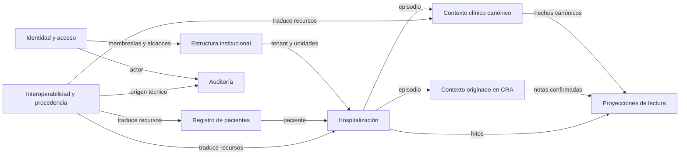
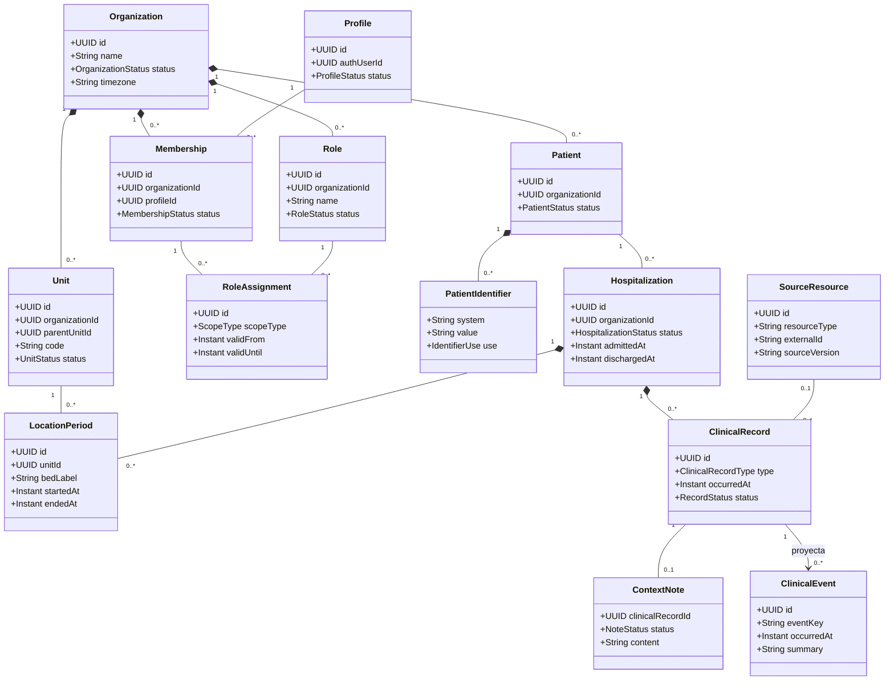
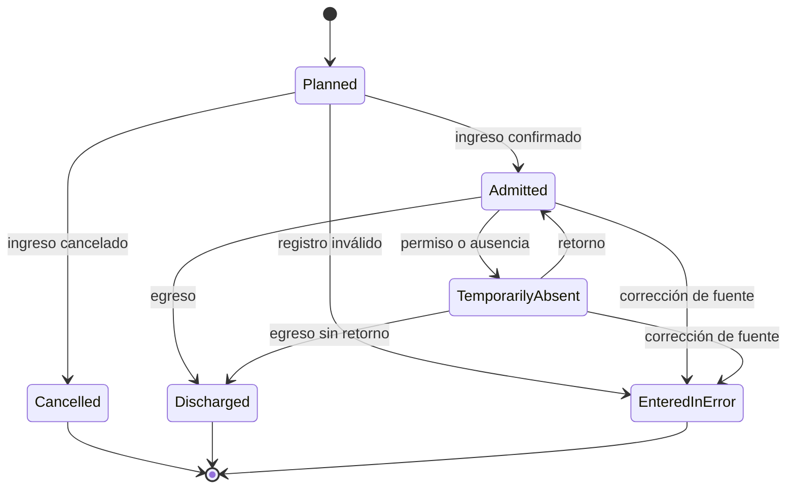
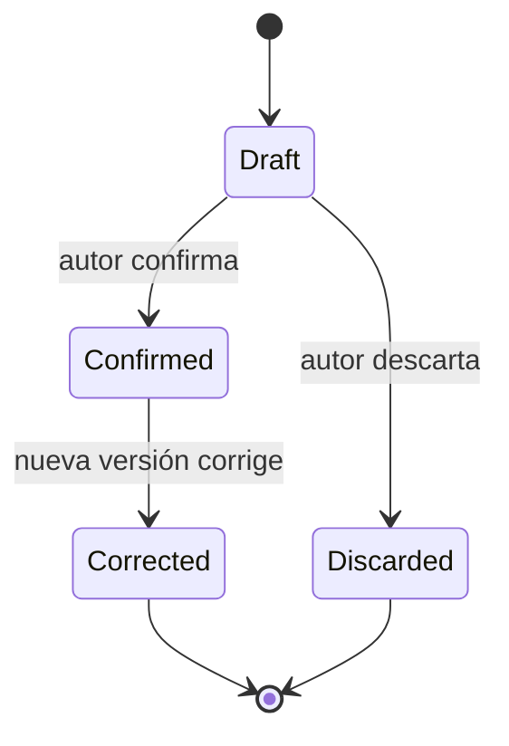
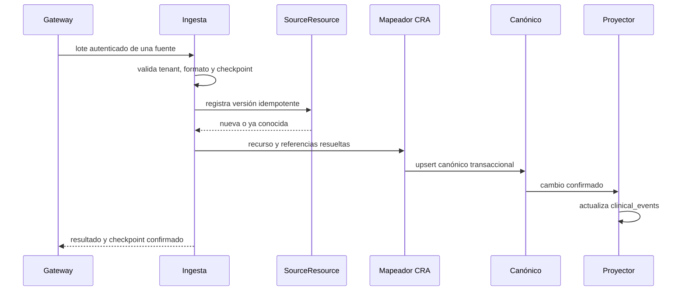

# Modelo de dominio

## Propósito

Este documento define el lenguaje ubicuo, los límites y los invariantes del dominio objetivo de Carer Record App (CRA). No describe literalmente las clases Dart ni el esquema PostgreSQL capturado en el baseline. La correspondencia relacional propuesta se detalla en [08-data-model.md](08-data-model.md).

CRA es una capa de contexto e integración para hospitalización. Su propósito es reunir información dispersa, mantener trazabilidad y facilitar continuidad asistencial, sin convertirse en FCE ni fuente primaria de registros formales (`../carer-record/carer-record.md:5-9`, `../carer-record/carer-record.md:37-50`). Por ello, “canónico CRA” significa la representación interna consistente que CRA utiliza para autorización, consulta y proyección; no significa que CRA reemplace la autoridad clínica del sistema hospitalario de origen.

## Distinción entre presente y objetivo

### Baseline histórico: modelo implementado entonces

La aplicación capturada en el baseline expone tres conceptos principales:

- `Practitioner`: perfil Auth con un rol y estado globales.
- `Patient`: identidad, RUT, unidad y cama en una sola entidad Dart (`app/lib/domains/patient/domain/entities/patient.dart:1-20`).
- `ClinicalEvent`: evento genérico con `kind`, fecha y un detalle que solo exige `summary` (`app/lib/domains/clinical_event/domain/entities/clinical_event.dart:1-23`).

PostgreSQL refleja esa forma: `practitioners`, `patients` y `clinical_events` (`supabase/migrations/20260910000000_initial_clinical_schema.sql:7-39`). La migración de timeline agregó ubicación directamente al paciente y una restricción de resumen al payload (`supabase/migrations/20260910110000_clinical_timeline.sql:1-5`, `supabase/migrations/20260910110000_clinical_timeline.sql:45-51`). Este modelo permite la demo de consulta, pero no expresa organización, episodio, historia de ubicación, procedencia completa ni recursos clínicos tipados.

### Estado actual acotado

El IAM actual separa perfiles, membresías y asignaciones de permisos efectivos; la autorización clínica se evalúa por hospitalización y asignación vigente, según [ADR-018](decisions/adr-018-modulo-ia-local-compartido.md) no altera este contrato. El dominio implementa hospitalizaciones, ubicaciones y asignaciones, y una lectura mínima del censo/paciente/timeline. También existen `context_notes` confirmadas e inmutables, incluidos hitos de audio que persisten solo texto confirmado. Esto no implica ingesta FHIR completa ni la entrega de las tablas canónicas tipadas descritas en el modelo objetivo.

### Modelo objetivo

El objetivo introduce explícitamente:

- identidad y acceso separados de la persona profesional;
- organización y unidades como límites de tenant y alcance;
- paciente como persona registrada, sin ubicación ni estado de hospitalización embebidos;
- hospitalización como agregado clínico central;
- períodos de ubicación dentro de la hospitalización;
- registros clínicos canónicos tipados y atribuibles a un episodio;
- recursos de origen e ingesta como procedencia;
- notas de contexto originadas en CRA y separadas del registro importado;
- `clinical_events` como proyección de lectura reconstruible.

## Lenguaje ubicuo

| Término                      | Significado preciso                                                              | No significa                                                  |
| ---------------------------- | -------------------------------------------------------------------------------- | ------------------------------------------------------------- |
| Organización                 | Institución/hospital que constituye un tenant de seguridad                       | Unidad clínica ni red suprainstitucional implícita            |
| Unidad                       | Área asistencial jerárquica perteneciente a una organización                     | Texto libre de ubicación                                      |
| Perfil                       | Persona de CRA vinculada a una identidad Supabase Auth                           | Rol, membresía o licencia institucional                       |
| Membresía                    | Vinculación de un perfil con una organización y su estado local                  | Sesión Auth                                                   |
| Rol                          | Conjunto nombrado de permisos configurado por una organización                   | Enum global ni permiso por sí mismo                           |
| Alcance                      | Parte de la organización cubierta por una asignación de rol                      | Sustituto de una asignación asistencial para Personal clínico |
| Asignación asistencial       | Relación temporal entre membresía y hospitalización que habilita lectura clínica | Asignación de rol, autoría o búsqueda de paciente             |
| Paciente                     | Persona clínica identificada dentro de una organización                          | Hospitalización actual                                        |
| Hospitalización              | Episodio asistencial institucional desde admisión hasta egreso/cancelación       | Paciente, consulta ambulatoria genérica ni ubicación puntual  |
| Ubicación de hospitalización | Período en que el episodio se asocia a una unidad/cama                           | Atributo permanente del paciente                              |
| Registro clínico             | Cabecera canónica CRA de un hecho o documento tipado                             | Evento de timeline                                            |
| Recurso de origen            | Versión inmutable de un payload recibido desde una fuente                        | Entidad de dominio directamente consumible por UI             |
| Procedencia                  | Evidencia de organización, fuente, recurso, versión, ejecución y tiempo          | Solo un string `external_id`                                  |
| Nota de contexto             | Registro complementario originado y confirmado en CRA                            | Nota oficial de FCE o dato importado                          |
| Evento clínico               | Fila derivada y ordenable del timeline                                           | Fuente canónica del hecho clínico                             |
| Fuente                       | Sistema institucional autorizado del que se ingieren recursos                    | Organización                                                  |
| Ejecución de ingesta         | Intento trazable de procesar un lote/checkpoint de una fuente                    | Recurso clínico individual                                    |

## Mapa de contextos

### Identidad y acceso

Responde quién es el actor, en qué organizaciones participa, qué permisos tiene, durante qué vigencia y con qué alcance. No conoce semántica FHIR ni contenido clínico; recibe del recurso objetivo la organización, unidad y hospitalización necesarias para decidir.

### Estructura institucional

Mantiene organizaciones y jerarquías de unidades. Es dueño de la identidad estable de una unidad. Los nombres visibles pueden cambiar sin alterar referencias históricas. Cerrar una unidad impide nuevas ubicaciones, pero no borra episodios anteriores.

### Registro de pacientes

Mantiene la identidad canónica CRA dentro de una organización y sus identificadores. No realiza un Master Patient Index entre organizaciones. La importación de dos pacientes con el mismo dato demográfico no los fusiona automáticamente.

### Contexto de hospitalización

Es el contexto clínico y de autorización principal. Controla el ciclo de vida del episodio, su organización, paciente, unidad responsable, ubicaciones y hitos. Una hospitalización pertenece exactamente a una organización y un paciente de esa organización.

### Contexto clínico canónico

Representa los conceptos que CRA necesita consultar: condiciones, alergias, solicitudes de medicación, observaciones, procedimientos e informes. Cada registro pertenece a una hospitalización. La cobertura crece por necesidad de producto, no por copiar todos los recursos FHIR disponibles.

### Contexto originado en CRA

Mantiene notas breves para continuidad de cuidado. Su responsabilidad profesional es explícita: borrador, confirmación y corrección trazable. No modifica ni suplanta la fuente hospitalaria. El producto histórico exige baja fricción, autoría, fecha y confirmación profesional (`../carer-record/carer-record.md:113-125`).

### Interoperabilidad y procedencia

Recibe FHIR u otros formatos, valida, conserva versiones, resuelve referencias y traduce al canónico CRA. Es una capa anticorrupción: términos de transporte no atraviesan directamente hacia reglas de dominio. La configuración histórica lista múltiples recursos FHIR (`../carer-record/backend/config/clinics/carer-record.json:3-37`), pero esa lista es evidencia de integración y no obliga a crear una tabla interna por cada recurso.

### Proyecciones de lectura

Construye representaciones optimizadas, inicialmente el timeline `clinical_events`. Una proyección puede borrarse y regenerarse sin perder hechos canónicos. No acepta mutaciones de usuarios.

### Auditoría

Registra quién u origen técnico hizo qué, sobre cuál organización/objeto, cuándo y con qué resultado. No participa en decisiones clínicas ni almacena payloads completos como sustituto de procedencia.

## Agregados y entidades

Las cardinalidades expresan propiedad conceptual. La eliminación física no se deriva automáticamente de `*--`: los datos clínicos y de auditoría se retienen o se corrigen según política, no mediante cascadas destructivas ordinarias.

## Organización

### Responsabilidad de la organización

Es la raíz institucional para aislamiento, configuración y trazabilidad. Cada dato institucional debe poder atribuirse inequívocamente a una organización.

### Invariantes de organización

- `slug` y nombre pueden ser visibles, pero `id` es la identidad estable.
- La zona horaria IANA es obligatoria para presentar tiempos; los instantes se almacenan en UTC.
- Una organización suspendida no admite nuevas sesiones de dominio, asignaciones ni ingesta.
- Suspender no borra datos ni reescribe historia.
- Ninguna relación puede conectar entidades de organizaciones distintas.

## Unidad

### Responsabilidad de la unidad

Representa un servicio, sala u otra división asistencial autorizable. La cama no es una unidad: es una etiqueta o recurso de ubicación dentro de un período.

### Invariantes de unidad

- Pertenece a una organización inmutable.
- Su padre, cuando existe, pertenece a la misma organización.
- La jerarquía no contiene ciclos.
- Su código es único dentro de la organización.
- Una unidad cerrada conserva historia, pero no recibe nuevas ubicaciones ni alcances salvo reactivación explícita.
- Renombrar una unidad no altera episodios; vistas históricas pueden mostrar nombre actual y, si se requiere fidelidad legal, un snapshot separado.

## Perfil, membresía, rol y asignación

### Perfil

Representa a una persona usuaria de CRA, vinculada uno a uno con `auth.users` cuando tiene acceso interactivo. Su estado global permite deshabilitarla en todas las instituciones. No contiene un rol.

### Membresía

Representa participación en una organización. Posee estado y vigencia locales, identificador profesional local y las asignaciones de rol. Suspenderla afecta solo a esa organización.

### Rol

Es una composición local de códigos del catálogo fijo. El nombre “Enfermería UCI” no tiene semántica para RLS; la autoridad proviene de sus permisos y asignaciones.

### Asignación de rol

Une membresía, rol, alcance y vigencia. Debe pertenecer a una sola organización. El alcance es exactamente uno de:

- organización completa;
- unidad, con la semántica jerárquica definida por la institución.

La asignación individual a una hospitalización es otra entidad (`CareAssignment`), no un tercer valor ambiguo de `scope_type`. ADR-013 la adelanta como condición obligatoria de lectura para Personal clínico: exige `clinical.assigned.read`, el permiso concreto del recurso y una relación vigente. El alta conserva acceso histórico mientras la relación siga vigente; cancelación/invalidación lo deniega, correcciones no heredan y traslados no la modifican. El Administrador de demo es una excepción explícita por `clinical.organization.read` reservado, no por nombre de rol ni Service Role.

### Invariantes

- Perfil activo, membresía activa, rol activo, asignación vigente y permiso presente son condiciones acumulativas.
- Ninguna autoridad IAM hereda permisos clínicos; el Administrador de demo solo los recibe mediante `clinical.organization.read` reservado, permisos concretos y alcance definidos por ADR-013.
- Ningún actor puede autoasignarse autoridad mediante una mutación directa.
- El tenant se deriva de las entidades persistidas, no de un parámetro confiado al cliente.

## Paciente

### Responsabilidad del paciente

Es la identidad clínica canónica que CRA usa dentro de una organización. Contiene demografía estable o lentamente cambiante; no contiene unidad, cama, admisión, diagnósticos primarios ni flag de hospitalización activa.

### Identificadores

Los identificadores son entidades con sistema, valor normalizado, uso, vigencia y procedencia. Un RUT es un identificador de tipo nacional, no la PK y no necesariamente está presente. El esquema del baseline normaliza y hace único globalmente el RUT (`supabase/migrations/20260910110000_clinical_timeline.sql:7-42`); el objetivo limita unicidad al espacio correcto y permite otros identificadores.

### Invariantes del paciente

- Pertenece a exactamente una organización.
- No se fusiona automáticamente con un paciente de otra organización.
- Un identificador activo no puede identificar dos pacientes dentro del mismo sistema/organización sin un estado explícito de conflicto.
- Cambios demográficos provenientes de fuentes distintas siguen reglas de precedencia; “último mensaje gana” no es una regla universal.
- La baja lógica impide nuevas hospitalizaciones sin eliminar episodios previos.
- El acceso a demografía clínica se deriva de una hospitalización autorizada; pertenecer a la organización no basta.

## Agregado Hospitalización

### Responsabilidad del episodio

Es el agregado central de CRA. Agrupa el episodio institucional, su período, estado, unidad responsable, ubicaciones, registros clínicos, contexto y timeline.

### Ciclo de vida

Los nombres son estados canónicos CRA. El adaptador mapea estados FHIR/locales sin exponerlos como regla directa. Reabrir un episodio egresado no es una actualización trivial: requiere una corrección trazable o una nueva hospitalización según la fuente.

### Invariantes de hospitalización

- Organización y paciente son inmutables y coinciden.
- `dischargedAt`, si existe, no antecede a `admittedAt`.
- Estados terminales requieren el motivo/tiempo aplicable.
- Una hospitalización activa tiene como máximo una ubicación vigente.
- Los períodos de ubicación del mismo episodio no se solapan.
- Unidad responsable y ubicaciones pertenecen a la misma organización.
- Un registro clínico publicado pertenece a la hospitalización y organización del paciente.
- Una referencia FHIR `Encounter` puede originar una hospitalización, pero el dominio decide si su clase corresponde al eje de hospitalización.

### Ubicación

Una transferencia cierra el período vigente y abre otro de forma atómica. Cambiar de cama dentro de la misma unidad también crea un período si se necesita historia. La ubicación actual se deriva del período sin `endedAt`, no se copia a `patients`.

## Registros clínicos canónicos

### Cabecera común

`ClinicalRecord` concentra identidad, tenant, paciente, hospitalización, tipo, tiempos, actor, estado y procedencia. Cada subtipo posee exactamente una fila de detalle. Esto permite aplicar autorización uniforme sin reducir todo a JSONB.

### Tipos del objetivo y secuencia

El primer corte de ingesta FHIR normaliza `Condition`, `AllergyIntolerance`, `MedicationRequest` y `Observation`, además de `Organization`, `Patient`, `Encounter` y `Location` en sus contextos respectivos. `Procedure` y `DiagnosticReport` son extensiones del modelo objetivo: se documentan para fijar sus límites, pero permanecen fuera del MVP FHIR hasta incorporar mapper, permisos, RLS y pruebas. Esta secuencia coincide con el alcance acordado en `docs/foundation/06-fhir-integration.md:9-17`.

| Tipo               | Significado                                                            | Invariantes destacadas                                                              |
| ------------------ | ---------------------------------------------------------------------- | ----------------------------------------------------------------------------------- |
| Condition          | Condición o diagnóstico relevante al episodio                          | Código/sistema o texto explícito; estados clínico y de verificación separados       |
| AllergyIntolerance | Riesgo/alergia conocido en contexto del episodio                       | Sustancia codificada o texto; criticidad y estado distinguibles                     |
| MedicationRequest  | Solicitud/orden de medicación, no administración inferida              | Estado, intención y medicación; dosis textual conserva origen sin fingir estructura |
| Observation        | Medición, resultado o afirmación observacional                         | Valor tipado; unidades conservadas; paneles usan componentes                        |
| Procedure          | Extensión futura para procedimiento realizado/planificado según estado | Período coherente; no se marca realizado solo por presencia                         |
| DiagnosticReport   | Extensión futura para informe diagnóstico y conclusión disponible      | Estado, fecha efectiva/emisión y referencias a observaciones cuando existan         |
| ContextNote        | Contexto complementario originado en CRA                               | Autoría, confirmación y corrección append-only                                      |

Los recursos FHIR que todavía no tengan uso de producto permanecen como recursos de origen procesados o pendientes; no se fuerzan dentro de un tipo incorrecto. El esquema histórico modeló tablas para condiciones, medicamentos, observaciones y otros recursos (`../carer-record/backend/app/core/init_db.sql:150-216`, `../carer-record/backend/app/core/init_db.sql:218-369`), lo que demuestra cobertura posible pero no integridad multiinstitución.

### Invariantes transversales

- Todo registro pertenece a organización, paciente y hospitalización coherentes.
- Un registro importado enlaza un `SourceResource`; un registro originado en CRA enlaza actor y contexto de creación. No puede quedar sin procedencia.
- Los timestamps son instantes UTC y conservan precisión/origen cuando sea necesario.
- `entered_in_error` o corrección no provoca borrado físico silencioso.
- Un estado clínico no se deduce de que el registro sea reciente.
- Los códigos conservan `system`, `code` y `display`; un display no es identidad terminológica.
- El JSONB de origen no sustituye los campos que sostienen autorización, orden temporal o invariantes.
- El paciente no se usa como único vínculo de autorización: la hospitalización es obligatoria para publicación clínica inicial.

## Nota de contexto

La nota de contexto pertenece a un `ClinicalRecord`, pero tiene ciclo de vida propio:

Reglas:

- Un borrador solo es visible para su autor y procesos autorizados de recuperación.
- Una nota confirmada no se edita destructivamente.
- Corregir crea una nueva nota que referencia la anterior; la anterior queda visible como sustituida según permiso.
- El autor, hospitalización, organización y timestamp de creación no cambian.
- Una transcripción o generación automática permanece borrador hasta confirmación humana.
- La nota no se representa como información importada ni se escribe de vuelta a la FCE en la fase inicial.

## Procedencia e ingesta

### Fuente

Una `SourceSystem` pertenece a una organización y representa un endpoint o canal autorizado. Su secreto no forma parte del agregado visible; se guarda en un gestor de secretos y la configuración solo conserva una referencia opaca.

### Ejecución

Una `IngestionRun` captura un intento desde checkpoint inicial a checkpoint final. Solo una ejecución activa por fuente puede avanzar el mismo cursor. Finalizar con éxito significa que las escrituras canónicas y el checkpoint fueron confirmados conforme a la política del lote.

### Recurso de origen

`SourceResource` es una versión inmutable de un recurso recibido. Su identidad externa es compuesta por organización, fuente, tipo e ID; su versión de deduplicación usa versión de origen o hash cuando la fuente no la entrega. El plan histórico ya exige preservar IDs/procedencia y preparar múltiples hospitales/fuentes (`../carer-record/infra/MIGRATION_TO_SUPABASE.md:52-62`, `../carer-record/infra/MIGRATION_TO_SUPABASE.md:121-145`).

### Flujo de traducción

## `clinical_events` como read model

`clinical_events` responde “qué mostrar y ordenar en el timeline”, no “cuál es el hecho clínico completo”. Puede combinar condiciones, observaciones, procedimientos, informes, notas confirmadas e hitos de hospitalización.

Propiedades:

- cada fila apunta a una entidad canónica o hito existente;
- `summary` es texto de presentación derivado, nunca la única copia del contenido;
- conserva `organization_id`, `patient_id` y `hospitalization_id` para filtrar, pero el proyector garantiza coherencia;
- tiene versión de proyección para permitir reconstrucciones;
- no se crea, edita ni elimina desde Flutter;
- una nueva versión canónica actualiza/reemplaza su proyección sin perder procedencia;
- eliminar y reconstruir el read model no afecta entidades canónicas;
- RLS aplica el permiso de timeline y el alcance de la hospitalización.

El esquema del baseline no cumple este contrato: almacena directamente el tipo y payload del evento (`supabase/migrations/20260910000000_initial_clinical_schema.sql:28-39`) y Flutter lo consume como entidad (`app/lib/domains/clinical_event/data/clinical_event_repository.dart:10-16`). La transición debe migrar primero fuentes canónicas y después cambiar el repositorio de lectura; no basta renombrar la tabla capturada.

## Servicios de dominio

### `AuthorizationDecision`

Determina si una membresía tiene un permiso y alcance aplicables a organización, unidad u hospitalización. Es una regla persistida y ejecutada por helpers RLS/RPC, no un servicio confiado a Flutter.

### `PatientIdentityResolver`

Resuelve un identificador dentro de organización/fuente. En presencia de conflicto no fusiona por heurística silenciosa: deja el recurso en revisión o crea identidad separada según política.

### `HospitalizationReconciler`

Traduce un encuentro externo a creación, transición o corrección de hospitalización. Valida tiempos, tenant, paciente y ubicaciones.

### `ClinicalRecordMapper`

Convierte recursos externos a tipos canónicos, conserva procedencia y reporta campos no mapeables. No genera datos clínicos faltantes.

### `TimelineProjector`

Transforma entidades canónicas confirmadas en eventos de lectura idempotentes. Su salida es reconstruible y tiene writer único.

## Eventos de dominio y técnicos

| Evento                       | Productor         | Consumidor             | Efecto esperado                               |
| ---------------------------- | ----------------- | ---------------------- | --------------------------------------------- |
| `MembershipSuspended`        | IAM               | Autorización/auditoría | Revocación efectiva en siguiente consulta     |
| `RoleCompositionChanged`     | IAM               | Autorización/auditoría | Recalcular decisiones sin refrescar JWT       |
| `HospitalizationAdmitted`    | Hospitalización   | Timeline/censo         | Publicar episodio y ubicación inicial         |
| `HospitalizationTransferred` | Hospitalización   | Censo/timeline         | Cerrar/abrir ubicación atómicamente           |
| `HospitalizationDischarged`  | Hospitalización   | Censo/timeline         | Retirar del censo activo y conservar historia |
| `ClinicalRecordUpserted`     | Mapeador canónico | Proyector              | Actualizar fila derivada idempotente          |
| `ContextNoteConfirmed`       | Contexto CRA      | Proyector/auditoría    | Hacer visible una versión confirmada          |
| `SourceResourceRejected`     | Ingesta           | Operación              | Cuarentena y error sanitizado                 |
| `ProjectionRebuilt`          | Operación         | Auditoría              | Registrar versión y reconciliación            |

No se requiere un bus distribuido en la demo. Estos nombres describen hechos y límites transaccionales; pueden implementarse con funciones, jobs y tablas de outbox si la entrega asíncrona llega a ser necesaria.

## Casos de uso principales

### Ver censo de una unidad

1. El profesional selecciona una organización activa.
2. Autorización exige `clinical.census.read` y un alcance que cubra la unidad.
3. Hospitalización filtra episodios activos cuya ubicación vigente pertenece a la unidad cubierta.
4. Registro de pacientes aporta demografía mínima.
5. No se revelan otras hospitalizaciones del paciente ni conteos de unidades fuera de alcance.

### Ver timeline de una hospitalización

1. Se autoriza `clinical.timeline.read` sobre la hospitalización.
2. La proyección devuelve eventos paginados y ordenados.
3. Abrir un evento consulta la tabla canónica correspondiente y exige su permiso granular.
4. La vista muestra procedencia cuando el usuario posee `clinical.provenance.read`.

### Procesar un Encounter FHIR

1. Interoperabilidad verifica organización/fuente y registra la versión del recurso.
2. Resuelve `Patient` por referencia dentro de la misma fuente/organización.
3. Hospitalización mapea clase, estado y período a estados canónicos.
4. Las ubicaciones se traducen a unidades conocidas; una referencia desconocida no crea una unidad clínica silenciosamente.
5. El cambio confirmado genera/actualiza hitos y read models.

### Registrar contexto futuro

1. Autorización exige `context.note.create` sobre la hospitalización.
2. Se crea un borrador con autoría inmutable.
3. Transcripción o IA puede proponer contenido, pero no confirmarlo.
4. El autor con `context.note.confirm` confirma.
5. El proyector publica el evento y auditoría registra la acción.

## Reglas temporales y de zona horaria

- Todos los instantes se almacenan con zona/UTC y se presentan en la zona IANA de la organización.
- Una fecha clínica sin hora no se inventa como medianoche; se conserva como fecha o precisión explícita.
- `occurredAt`, `recordedAt`, `sourceUpdatedAt`, `receivedAt` y `createdAt` son conceptos distintos.
- El orden del timeline usa el instante clínico cuando existe y un desempate estable; el instante de ingesta no sustituye al clínico.
- La UI no debe etiquetar “hoy” sin convertir primero a zona institucional. El baseline muestra que esa conversión aún no estaba implementada (`baseline/carer-record-app.md:123-127`).

## Alternativas descartadas

### Paciente como agregado de toda la historia

Descartado porque produciría un agregado enorme, mezclaría hospitalizaciones y dificultaría autorización por unidad. Paciente conserva identidad; hospitalización organiza el contexto asistencial.

### Unidad y cama en paciente

Descartado porque la ubicación es temporal, pertenece a un episodio y necesita historia. El esquema del baseline sirve para demo pero pierde transferencias y simultaneidad (`supabase/migrations/20260910110000_clinical_timeline.sql:1-5`).

### Un agregado por recurso FHIR

Descartado porque FHIR es el contrato externo, no el lenguaje del producto. CRA normaliza solo conceptos que necesita y conserva el resto como procedencia hasta definir uso.

### `clinical_events` como supertabla de hechos

Descartado porque el JSONB genérico impide invariantes y mezcla escritura con presentación. Se mantiene como proyección derivada por su utilidad para lectura.

### Fusión automática entre hospitales

Descartado por riesgo de identificación errónea y aislamiento. El plan histórico también excluía un MPI inicial y prohibía fusionar automáticamente pacientes de hospitales distintos (`../carer-record/infra/MIGRATION_TO_SUPABASE.md:64-73`, `../carer-record/infra/MIGRATION_TO_SUPABASE.md:137-145`).

### Rol como propiedad de perfil

Descartado porque una persona puede tener distintas responsabilidades por organización, unidad y período. Perfil representa persona; membresía y asignaciones representan autoridad.

## Criterios de consistencia del dominio

El modelo se considera correctamente implementado cuando:

- ninguna entidad clínica cruza organizaciones a través de sus relaciones;
- toda información publicada pertenece a una hospitalización autorizable;
- la ubicación actual se puede derivar y su historia no se pierde;
- un recurso importado siempre conduce a procedencia verificable;
- una nota CRA siempre conduce a autoría y confirmación;
- `clinical_events` puede eliminarse y reconstruirse sin pérdida clínica;
- estados, tiempos y códigos no se infieren desde etiquetas de presentación;
- la autorización usa permisos y alcance, no nombres de rol;
- el mismo modelo funciona con una o varias organizaciones sin caminos especiales.
