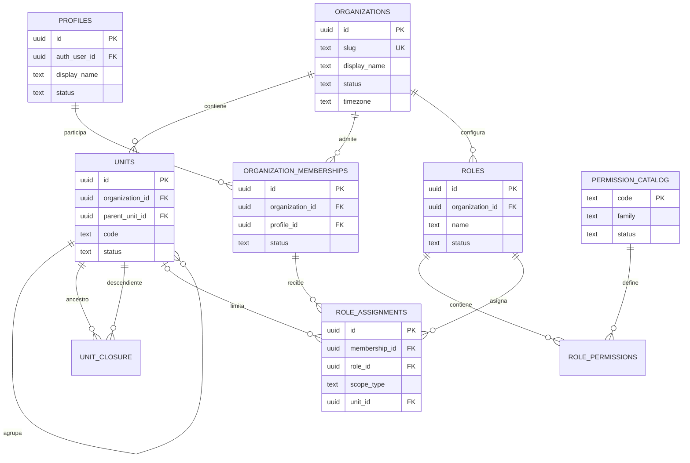
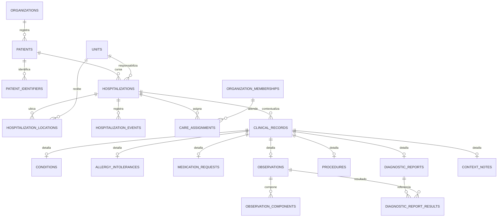
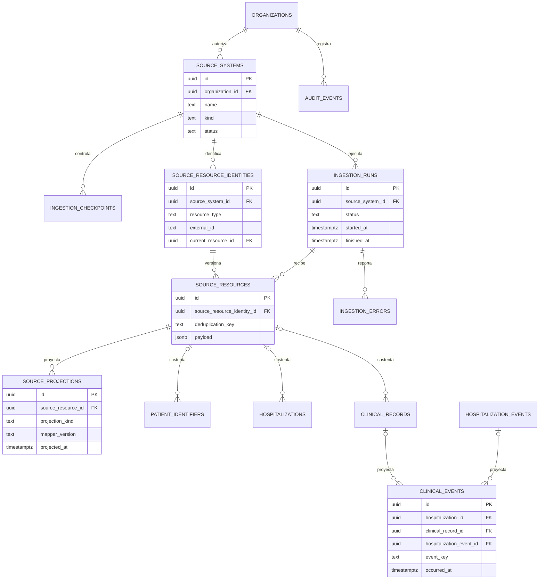

# Modelo de datos objetivo

## Alcance

Este documento propone el modelo relacional objetivo de CRA en PostgreSQL/Supabase. Es un diseño lógico detallado, no una migración y no contiene SQL ejecutable. Los nombres, constraints e índices descritos deben materializarse en migraciones aditivas revisadas y probadas cuando se implemente cada corte vertical.

La propuesta aplica las decisiones de [04-target-architecture.md](04-target-architecture.md), [05-access-control.md](05-access-control.md) y [07-domain-model.md](07-domain-model.md): modelo canónico CRA, hospitalización como eje, multiinstitución desde la demo, roles configurables sobre permisos fijos, FHIR en la frontera y `clinical_events` como read model.

Estado de implementación: las migraciones `20261011200000_hospitalizations_care_assignments.sql` y `20261011210000_harden_phase2_integrity.sql` materializan y endurecen el subconjunto mínimo de fase 2.1 (`units`, `hospitalizations`, `hospitalization_locations`, `care_assignments` y los vínculos tenant/hospitalización necesarios en `patients` y `clinical_events`). `20261011220000_transactional_care_assignment_operations.sql` añade las RPCs transaccionales tipadas de concesión/revocación y una bitácora mínima `audit_events`; `20261011230000_canonical_assignment_idempotency_and_runtime_privileges.sql` fija UTC en la firma RPC y revoca DML/TRUNCATE runtime, `20261011240000_normalize_open_assignment_request_timestamps.sql` completa la normalización independiente de timestamps históricos presentes, incluidos grants abiertos, `20261011250000_reauthorize_assignment_idempotent_replays.sql` revalida autoridad antes de revelar replay, y `20261011260000_require_unit_read_permission.sql` exige `org.unit.read` efectivo para lectura directa de unidades. No implementa el modelo de auditoría completo descrito aquí. Eventos enlazados validan también el paciente; ubicaciones y asignaciones impiden intervalos solapados para la misma clave. El censo organizacional exige `clinical.organization.read` y `clinical.census.read`, no `clinical.assignment.manage`. Las migraciones `20261011270000_clinical_rls_contracts.sql` y `20261011280000_harden_clinical_runtime_writes_and_views.sql` reemplazan las policies legacy y fijan lectura por episodio; el DML runtime de `patients` y `clinical_events` permanece denegado. Las notas `context_notes` admiten inserción autorizada y reconciliación de publicación controlada. La ingesta FHIR y las tablas clínicas canónicas objetivo continúan pendientes.

## Esquema del baseline: evidencia y límites

El esquema capturado en el baseline no es este modelo objetivo. Las migraciones observadas crean:

- `practitioners(id -> auth.users.id, display_name, role, license_number, status, timestamps)` (`supabase/migrations/20260910000000_initial_clinical_schema.sql:4-14`, `supabase/migrations/20260910010000_auth_administration.sql:2-5`);
- `patients(id, external_reference, names, birth_date, payload, timestamps, rut, care_unit, bed_label)` (`supabase/migrations/20260910000000_initial_clinical_schema.sql:16-26`, `supabase/migrations/20260910110000_clinical_timeline.sql:1-43`);
- `clinical_events(id, patient_id, recorded_by, kind, occurred_at, payload, created_at)` (`supabase/migrations/20260910000000_initial_clinical_schema.sql:28-39`).

El RUT y `external_reference` son únicos sin tenant; `clinical_events.patient_id` usa `ON DELETE CASCADE`; la unidad/cama no conserva historia; el rol es un enum global y el evento genérico contiene su único detalle clínico en JSONB. Las políticas capturadas autorizan por estado y tres nombres de rol, sin organización ni unidad (`supabase/migrations/20260910100000_patient_read_access.sql:3-23`, `supabase/migrations/20260910110000_clinical_timeline.sql:53-68`).

La aplicación depende de esas columnas hoy: lista pacientes desde `patients` (`app/lib/domains/patient/data/patient_repository.dart:9-28`) y obtiene el timeline directamente de `clinical_events` (`app/lib/domains/clinical_event/data/clinical_event_repository.dart:10-16`). Por tanto, la propuesta requiere transición compatible por cortes; no debe presentarse como si ya estuviera implementada.

## Convenciones globales

### Identidad y tenant

- Las PK internas son UUID opacos generados por servidor. Un ID FHIR, RUT, número de ficha o código de unidad nunca es PK.
- `organization_id` es obligatorio en toda tabla institucional, de acceso, ingesta o clínica, salvo `profiles` y `permission_catalog`, que son globales a la instancia.
- Cada tabla tenant-scoped declara unicidad auxiliar `(organization_id, id)`. Las relaciones críticas usan FK compuesta `(organization_id, foreign_id)` para impedir referencias entre organizaciones aunque una aplicación privilegiada se equivoque.
- La demo crea una sola organización, pero ninguna policy, FK, función o consulta depende de que sea única.
- En esta fase una organización representa un hospital/institución. No se agrega una tabla `hospitals` redundante.

### Tiempos

- Los instantes usan `timestamptz` y semántica UTC. La presentación usa `organizations.timezone` en formato IANA.
- `created_at` indica persistencia en CRA; `updated_at` indica última mutación canónica; `source_updated_at`, `occurred_at`, `recorded_at`, `received_at` y `authored_at` conservan significados distintos.
- Los intervalos son semiabiertos `[inicio, fin)`: `valid_until`/`ended_at` nulo significa vigente. El fin no puede anteceder al inicio.
- Una fecha sin hora se guarda como `date` o con precisión explícita; no se inventa medianoche.

### Estados y borrado

- Los estados de negocio usan dominios/check constraints o catálogos estables según su necesidad de evolución. Los roles no usan enum.
- Tablas clínicas, de procedencia y auditoría no se borran en cascada desde paciente u organización. Se corrigen, desactivan o retienen conforme a política.
- `ON DELETE RESTRICT` es la regla conceptual en relaciones clínicas y de tenant. `SET NULL` solo se permite donde perder una relación operacional no destruya procedencia, por ejemplo el actor Auth eliminado si se preserva su snapshot auditado.
- Borrado físico se reserva para datos sintéticos, retención aprobada o purga administrada fuera de las APIs de usuario.

### Procedencia

Toda fila importada debe responder:

1. ¿de qué organización y fuente provino?;
2. ¿qué tipo/ID/versión externa tenía?;
3. ¿en qué ejecución se recibió?;
4. ¿cuál fue el payload o hash recibido?;
5. ¿qué entidad canónica creó o actualizó?;
6. ¿cuándo ocurrió en origen y cuándo llegó a CRA?

`source_resource_identities` conserva la identidad lógica estable `(organization, source, resource_type, external_id)` y apunta a su versión vigente. `source_resources` conserva cada versión inmutable. `source_projections` registra cada vínculo entre una versión y la entidad canónica que produjo o actualizó; los punteros inicial/último en entidades son una optimización, no la historia completa. Las filas originadas en CRA enlazan membresía autora y auditoría; no inventan una fuente externa.

### JSONB

JSONB se permite para payload de procedencia inmutable, metadatos no clínicos limitados y detalles de auditoría sanitizados. Cada columna JSONB exige objeto como forma superior y tamaño/límites en el borde. No almacena organization ID, hospitalización, estado, tiempos, códigos de acceso ni valores clínicos que deban filtrarse, validarse u ordenarse.

Todo JSONB consumido por Flutter requiere un contrato Dart tipado; los payloads privados se validan en su frontera y no se exponen al cliente (`AGENTS.md:13-18`).

### RLS y exposición

- RLS está habilitado en toda tabla de `public` alcanzable por roles API.
- `anon` no recibe privilegios sobre tablas de dominio.
- `authenticated` recibe solo los grants necesarios; una policy no compensa un grant innecesario.
- Las tablas base sensibles pueden no exponerse directamente y ser consultadas mediante vistas/RPC que igualmente preservan RLS.
- Workers/Edge Functions tienen roles técnicos separados y mínimos. Service Role no se usa como identidad de negocio.
- Los índices comienzan por columnas de tenant y predicados frecuentes para que RLS no obligue a scans globales.

## Vista relacional

### Institución e identidad

### Hospitalización y registros

### Ingesta, proyección y auditoría

## Tablas de institución e identidad

### `organizations`

| Aspecto     | Definición                                                                                                                                              |
| ----------- | ------------------------------------------------------------------------------------------------------------------------------------------------------- |
| Propósito   | Tenant institucional equivalente a un hospital en el alcance inicial                                                                                    |
| PK          | `id uuid`                                                                                                                                               |
| Columnas    | `slug`, `display_name`, `status`, `timezone`, `created_at`, `updated_at`                                                                                |
| FK          | Ninguna de dominio; es raíz                                                                                                                             |
| Constraints | `slug` único global y normalizado; nombre no vacío; `status` en `active/suspended/closed`; timezone IANA válida mediante trigger; timestamps coherentes |
| Índices     | Único por `slug`; `(status)` solo si operación multi-tenant lo requiere                                                                                 |
| Mutabilidad | Nombre/timezone actualizables con auditoría; `id` inmutable; suspensión/cierre lógico; sin DELETE ordinario                                             |
| Procedencia | Configuración CRA creada por operador autorizado; auditoría registra actor                                                                              |
| RLS         | Visible a perfiles con membresía activa en la organización; gestión solo por operación de plataforma/institucional explícita                            |

La demo contiene una organización. No se agrega `is_demo` como bypass de seguridad; si se necesita etiquetar el entorno, se hace en configuración, no en policies.

### `units`

| Aspecto     | Definición                                                                                                                                          |
| ----------- | --------------------------------------------------------------------------------------------------------------------------------------------------- |
| Propósito   | Jerarquía autorizable de servicios/unidades dentro de una organización                                                                              |
| PK          | `id uuid` y unicidad auxiliar `(organization_id, id)`                                                                                               |
| Columnas    | `organization_id`, `parent_unit_id` nullable, `code`, `display_name`, `kind`, `status`, `created_at`, `updated_at`                                  |
| FK          | `organization_id -> organizations`; FK compuesta del padre `(organization_id, parent_unit_id) -> units`                                             |
| Constraints | Código único por organización; textos no vacíos; padre distinto de sí mismo; estados `active/closed`; prevención de ciclos por operación controlada |
| Índices     | Único `(organization_id, code)`; `(organization_id, parent_unit_id)`; `(organization_id, status, display_name)`                                     |
| Mutabilidad | Nombre, padre y estado mutables mediante operación auditada; tenant/ID inmutables; cierre lógico, no borrado si tiene historia                      |
| Procedencia | Configuración CRA o mapeo aprobado de ubicaciones; nunca se crea silenciosamente desde texto FHIR desconocido                                       |
| RLS         | Lectura por membresía activa cuando se necesita navegar o resolver alcance; gestión exige `org.unit.manage` con alcance organizacional              |

### `unit_closure`

| Aspecto     | Definición                                                                                                           |
| ----------- | -------------------------------------------------------------------------------------------------------------------- |
| Propósito   | Materializar ancestros/descendientes para evaluar alcance de unidad sin recursión costosa en cada policy             |
| PK          | `(organization_id, ancestor_unit_id, descendant_unit_id)`                                                            |
| Columnas    | `organization_id`, `ancestor_unit_id`, `descendant_unit_id`, `depth`                                                 |
| FK          | Dos FKs compuestas a `units` de la misma organización                                                                |
| Constraints | `depth >= 0`; profundidad cero solo cuando ancestro = descendiente; tenant coherente                                 |
| Índices     | PK cubre búsqueda por ancestro; índice `(organization_id, descendant_unit_id, ancestor_unit_id)` para camino inverso |
| Mutabilidad | Derivada; solo función/trigger de mantenimiento institucional; reconstruible desde `units.parent_unit_id`            |
| Procedencia | Proyección estructural CRA, sin origen FHIR                                                                          |
| RLS         | Misma visibilidad que `units`; sin DML de `authenticated`                                                            |

### `profiles`

| Aspecto     | Definición                                                                                                                                                  |
| ----------- | ----------------------------------------------------------------------------------------------------------------------------------------------------------- |
| Propósito   | Persona usuaria global de la instancia, separada de Auth y de sus organizaciones                                                                            |
| PK          | `id uuid`                                                                                                                                                   |
| Columnas    | `auth_user_id`, `display_name`, `status`, `created_at`, `updated_at`                                                                                        |
| FK          | `auth_user_id -> auth.users.id`, único; la FK sigue prácticas admitidas por Supabase                                                                        |
| Constraints | Un Auth user por perfil; nombre no vacío; estado `active/suspended`; Auth obligatorio para usuarios interactivos iniciales                                  |
| Índices     | Único por `auth_user_id`; `(status)` solo para operación                                                                                                    |
| Mutabilidad | Nombre/estado mutables y auditados; auth link e ID inmutables salvo procedimiento excepcional; sin rol ni tenant                                            |
| Procedencia | Alta coordinada por Edge Function; no se importa como practitioner clínico desde FHIR                                                                       |
| RLS         | El usuario lee su perfil; `iam.membership.read` permite metadatos mínimos de perfiles con membresía común; escritura privilegiada, no autoedición de estado |

Esta separación reemplaza el acoplamiento del baseline `practitioners.id = auth.users.id` (`supabase/migrations/20260910000000_initial_clinical_schema.sql:7-14`) y permite más de una organización por persona.

### `organization_memberships`

| Aspecto     | Definición                                                                                                                                                                                           |
| ----------- | ---------------------------------------------------------------------------------------------------------------------------------------------------------------------------------------------------- |
| Propósito   | Participación y estado de un perfil en una organización                                                                                                                                              |
| PK          | `id uuid` y unicidad auxiliar `(organization_id, id)`                                                                                                                                                |
| Columnas    | `organization_id`, `profile_id`, `local_identifier` nullable, `status`, `valid_from`, `valid_until`, `created_at`, `updated_at`                                                                      |
| FK          | A `organizations` y `profiles`                                                                                                                                                                       |
| Constraints | Una membresía por `(organization_id, profile_id)`; identificador local único por organización cuando existe; fin posterior al inicio; estado `invited/active/suspended/ended` coherente con vigencia |
| Índices     | Único `(organization_id, profile_id)`; único parcial `(organization_id, local_identifier)`; `(profile_id, status)`; `(organization_id, status)`                                                      |
| Mutabilidad | Estado/vigencia/identificador local mutables con auditoría; tenant y perfil inmutables; no borrado ordinario                                                                                         |
| Procedencia | Administración CRA; invitación/activación coordinada con Auth                                                                                                                                        |
| RLS         | Miembro lee la propia; `iam.membership.read` lista las de su organización; gestión solo por Edge Function/RPC con `iam.membership.manage`                                                            |

`local_identifier` puede representar número funcionario. Una licencia profesional más compleja debería evolucionar a una tabla de credenciales, no a JSONB ni a `profiles` global.

### `permission_catalog`

| Aspecto     | Definición                                                                                                                                                                                                                  |
| ----------- | --------------------------------------------------------------------------------------------------------------------------------------------------------------------------------------------------------------------------- |
| Propósito   | Universo fijo y versionado de capacidades que RLS entiende                                                                                                                                                                  |
| PK          | `code text`, por ejemplo `clinical.timeline.read`                                                                                                                                                                           |
| Columnas    | `family`, `description`, `status`, `delegation_policy`, `introduced_at`, `deprecated_at` nullable                                                                                                                           |
| FK          | Ninguna                                                                                                                                                                                                                     |
| Constraints | Código con formato estable y único; textos no vacíos; deprecación coherente; no permite códigos creados por tenant; `clinical.organization.read` usa `delegation_policy = system_only`                                      |
| Índices     | PK; `(family, status)` para UI administrativa                                                                                                                                                                               |
| Mutabilidad | Solo migraciones CRA, incluido frente a DML de Service Role; códigos no se renombran en sitio si existen asignaciones, se deprecan; un código `system_only` no se agrega, copia ni delega mediante administración ordinaria |
| Procedencia | Catálogo de plataforma versionado en repositorio                                                                                                                                                                            |
| RLS         | Lectura para perfiles activos que administran o necesitan representar permisos; sin DML de usuario/tenant                                                                                                                   |

### `roles`

| Aspecto     | Definición                                                                                                                                                                                                               |
| ----------- | ------------------------------------------------------------------------------------------------------------------------------------------------------------------------------------------------------------------------ |
| Propósito   | Rol nombrado y configurable dentro de una organización                                                                                                                                                                   |
| PK          | `id uuid` y unicidad auxiliar `(organization_id, id)`                                                                                                                                                                    |
| Columnas    | `organization_id`, `name`, `description`, `status`, `is_system`, `protected_kind` nullable, `created_by_membership_id`, `created_at`, `updated_at`                                                                       |
| FK          | Organización y membresía creadora de la misma organización                                                                                                                                                               |
| Constraints | Nombre único case-insensitive por organización; estado `active/inactive`; nombre no vacío; un rol inactivo no recibe asignaciones nuevas; un único `protected_kind = demo_administrator` activo por organización de demo |
| Índices     | Único `(organization_id, normalized_name)`; `(organization_id, status)`                                                                                                                                                  |
| Mutabilidad | Nombre/descripcion/composición mutables con auditoría si el rol no tiene `protected_kind`; `is_system` solo indica procedencia y bloquea renombrar y desactivar; tenant inmutable                                        |
| Procedencia | Configuración CRA del hospital; una plantilla seed no cambia su propiedad local                                                                                                                                          |
| RLS         | `iam.role.read` para lectura; creación/cambio mediante operación con `iam.role.manage`; sin acceso cruzado                                                                                                               |

No hay columna enum `role` en `profiles` o memberships. Los roles del baseline `administrator`, `physician`, `nurse`, `technician` son datos de transición, no el catálogo objetivo.

La migración aditiva crea el rol protegido `demo_administrator` y el permiso reservado antes de asignarlos. Para las cuentas sintéticas existentes, mapea `administrator` al rol protegido, `physician` y `nurse` activos a Personal clínico, y `technician` a una membresía sin permisos clínicos nuevos. Las asignaciones asistenciales se materializan con hospitalizaciones. Desde `20261011270000_clinical_rls_contracts.sql`, las filas sin episodio exacto y episodios cancelados o invalidados quedan ocultos. `20261011280000_harden_clinical_runtime_writes_and_views.sql` completa censo y timeline, y bloquea el DML runtime en tablas clínicas, incluido `service_role`. El contrato entrega `summary` como `text` derivado de `payload`, sin conceder acceso a JSONB. La transición se aplica también en upgrade y no depende de modificar migraciones ya aplicadas. `20261011400000_demote_clinician_role.sql` degrada además el rol seed `Personal clínico` a configuración del tenant con `is_system = false`, de modo que composición, nombre y estado sean administrables durante el onboarding; el Administrador de demo conserva ambas marcas.

### `role_permissions`

| Aspecto     | Definición                                                                                                                                                                                                                                                                                     |
| ----------- | ---------------------------------------------------------------------------------------------------------------------------------------------------------------------------------------------------------------------------------------------------------------------------------------------- |
| Propósito   | Composición many-to-many entre rol local y permiso fijo                                                                                                                                                                                                                                        |
| PK          | `(role_id, permission_code)`; se conserva `organization_id` para tenant/RLS                                                                                                                                                                                                                    |
| Columnas    | `organization_id`, `role_id`, `permission_code`, `granted_at`, `granted_by_membership_id`                                                                                                                                                                                                      |
| FK          | FK compuesta al rol de la organización; FK a `permission_catalog`; membresía otorgante de la misma organización                                                                                                                                                                                |
| Constraints | Sin duplicados; trigger exige rol activo y permiso activo para nuevas concesiones; las concesiones existentes a roles/permisos luego inactivados/deprecados se conservan pero no son efectivas; `clinical.organization.read` solo puede relacionarse con `protected_kind = demo_administrator` |
| Índices     | PK; `(organization_id, permission_code, role_id)` para resolver autorización; `(granted_by_membership_id)`                                                                                                                                                                                     |
| Mutabilidad | Insert/delete auditados; no update semántico; eliminar una fila revoca inmediatamente ese permiso del rol; la composición protegida no admite DML runtime, incluido Service Role, y solo cambia mediante migraciones CRA explícitas                                                            |
| Procedencia | Configuración CRA con actor institucional                                                                                                                                                                                                                                                      |
| RLS         | Lectura con `iam.role.read`; mutación solo por operación con `iam.role.manage` y control anti-escalamiento; sin operación ordinaria para copiar/delegar permisos `system_only`                                                                                                                 |

### `role_assignments`

| Aspecto     | Definición                                                                                                                                                                                                                                                                                                                                                     |
| ----------- | -------------------------------------------------------------------------------------------------------------------------------------------------------------------------------------------------------------------------------------------------------------------------------------------------------------------------------------------------------------- |
| Propósito   | Conceder un rol a una membresía durante una vigencia y alcance                                                                                                                                                                                                                                                                                                 |
| PK          | `id uuid` y unicidad auxiliar `(organization_id, id)`                                                                                                                                                                                                                                                                                                          |
| Columnas    | `organization_id`, `membership_id`, `role_id`, `scope_type`, `unit_id` nullable, `valid_from`, `valid_until`, `revoked_at`, `revoked_by_membership_id`, `created_at`, `created_by_membership_id`                                                                                                                                                               |
| FK          | Membresía, rol, unidad opcional y actores, todos de la misma organización mediante FKs compuestas                                                                                                                                                                                                                                                              |
| Constraints | `scope_type` en `organization/unit`; `unit_id` nulo solo para organización y obligatorio solo para unidad; fin posterior al inicio; revocación no anterior a creación; organización, perfil, rol y membresía activos al crear; no se solapan concesiones equivalentes no revocadas; el rol protegido solo se asigna mediante operación administrativa dedicada |
| Índices     | `(organization_id, membership_id, valid_from, valid_until)`; `(organization_id, role_id)`; `(organization_id, unit_id)`; exclusión GiST por organización/membresía/rol/alcance e intervalo no revocado                                                                                                                                                         |
| Mutabilidad | Vigencia puede acortarse o revocarse; no se cambia tenant/membresía/rol/alcance en sitio: se revoca y crea otra; la operación protegida impide autoasignación y dejar sin Administrador efectivo a la organización                                                                                                                                             |
| Procedencia | Configuración CRA con actor creador/revocador y auditoría                                                                                                                                                                                                                                                                                                      |
| RLS         | Miembro puede leer sus concesiones efectivas; `iam.role.read` lista; crear/revocar requiere `iam.role.assign` vía operación controlada, salvo el rol protegido que usa una operación dedicada                                                                                                                                                                  |

### `care_assignments`

| Aspecto     | Definición                                                                                                                                                                                                                                                                                                 |
| ----------- | ---------------------------------------------------------------------------------------------------------------------------------------------------------------------------------------------------------------------------------------------------------------------------------------------------------- |
| Propósito   | Relación individual entre profesional y hospitalización, frontera obligatoria de lectura para Personal clínico                                                                                                                                                                                             |
| PK          | `id uuid` y unicidad auxiliar `(organization_id, id)`                                                                                                                                                                                                                                                      |
| Columnas    | `organization_id`, `hospitalization_id`, `membership_id`, `relationship_code` nullable, `valid_from`, `valid_until`, `revoked_at`, `revoked_by_membership_id` nullable, `created_by_membership_id`, `created_at`                                                                                           |
| FK          | Hospitalización, membresía, actor creador y revocador opcional de la misma organización                                                                                                                                                                                                                    |
| Constraints | Intervalo semiabierto `[valid_from, valid_until)`; fin posterior a inicio; una asignación activa equivalente no se duplica; solo es vigente con membresía activa y sin revocación; alta conserva lectura histórica, cancelación/invalidación la deniega y un episodio de corrección no hereda asignaciones |
| Índices     | `(organization_id, membership_id, valid_from, valid_until)`; `(organization_id, hospitalization_id)`; parcial para vigentes/no revocadas                                                                                                                                                                   |
| Mutabilidad | Append/revocar; no se reasigna una fila a otra persona/episodio; un traslado conserva la asignación de la misma hospitalización; la operación registra actor y resultado sin contenido clínico                                                                                                             |
| Procedencia | CRA, creada por flujo futuro auditado; no se infiere automáticamente desde FHIR o autoría                                                                                                                                                                                                                  |
| RLS         | Sin INSERT/UPDATE directo de usuario; operación de servidor con `clinical.assignment.manage` efectivo para actor elegible del mismo tenant; no concede lectura sin `clinical.assigned.read` y permiso concreto                                                                                             |

## Tablas de interoperabilidad y procedencia

### `source_systems`

| Aspecto     | Definición                                                                                                                                                                         |
| ----------- | ---------------------------------------------------------------------------------------------------------------------------------------------------------------------------------- |
| Propósito   | Registrar una fuente institucional autorizada y su capacidad de ingesta                                                                                                            |
| PK          | `id uuid` y unicidad auxiliar `(organization_id, id)`                                                                                                                              |
| Columnas    | `organization_id`, `name`, `kind`, `status`, `base_url` nullable, `secret_reference` nullable, `configuration jsonb`, `created_at`, `updated_at`                                   |
| FK          | Organización                                                                                                                                                                       |
| Constraints | Nombre único por organización; kind controlado (`fhir_r4`, `hl7v2`, `file`, etc.); JSON objeto; no guardar secreto material; URL/protocolo validados                               |
| Índices     | Único `(organization_id, name)`; `(organization_id, status, kind)`                                                                                                                 |
| Mutabilidad | Configuración/status mutables con auditoría; ID/tenant inmutables; desactivación corta nuevas ejecuciones                                                                          |
| Procedencia | Configuración CRA aprobada por hospital; secreto real reside en secret manager                                                                                                     |
| RLS         | Metadatos sanitizados con `integration.source.read`; gestión vía Edge Function con `integration.source.manage`; nunca expone `secret_reference` si revela infraestructura sensible |

### `ingestion_checkpoints`

| Aspecto     | Definición                                                                                                                                                                      |
| ----------- | ------------------------------------------------------------------------------------------------------------------------------------------------------------------------------- |
| Propósito   | Mantener el watermark confirmado de cada tipo de recurso en una fuente, separado de intentos de ejecución                                                                       |
| PK          | `(organization_id, source_system_id, resource_type)`                                                                                                                            |
| Columnas    | `organization_id`, `source_system_id`, `resource_type`, `watermark_at` nullable, `watermark_token` nullable, `overlap_seconds`, `last_successful_run_id` nullable, `updated_at` |
| FK          | Fuente y última ejecución exitosa de la misma organización                                                                                                                      |
| Constraints | Tipo no vacío; solapamiento no negativo y limitado; ejecución referenciada terminal y exitosa; watermark/token solo avanzan al cerrar correctamente la paginación del tipo      |
| Índices     | PK; `(organization_id, updated_at)` para operación; no requiere un índice global por token                                                                                      |
| Mutabilidad | Solo el worker puede avanzar; una recuperación puede retroceder mediante operación auditada; no se reutilizan URLs de página como checkpoint permanente                         |
| Procedencia | Estado técnico derivado de `meta.lastUpdated`/capacidad de la fuente y de la ejecución confirmada                                                                               |
| RLS         | Metadatos sanitizados con `integration.run.read`; sin DML de usuario; writer técnico limitado a fuente/tipo                                                                     |

El checkpoint es por organización, fuente y tipo, no un cursor global. Conserva solapamiento para releer el borde temporal y depende de idempotencia para eliminar duplicados, conforme al contrato FHIR (`docs/foundation/06-fhir-integration.md:241-255`).

### `ingestion_runs`

| Aspecto     | Definición                                                                                                                                                                                                    |
| ----------- | ------------------------------------------------------------------------------------------------------------------------------------------------------------------------------------------------------------- |
| Propósito   | Ejecución trazable de una fuente y unidad transaccional de checkpoint                                                                                                                                         |
| PK          | `id uuid` y unicidad auxiliar `(organization_id, id)`                                                                                                                                                         |
| Columnas    | `organization_id`, `source_system_id`, `status`, `started_at`, `finished_at`, `checkpoint_before jsonb`, `checkpoint_after jsonb`, contadores, `correlation_id`, `error_summary` sanitizado                   |
| FK          | Fuente de la misma organización                                                                                                                                                                               |
| Constraints | Status `running/succeeded/partial/failed/cancelled`; fin posterior a inicio; checkpoint JSON objeto; solo una ejecución `running` por fuente mediante unicidad parcial/advisory lock; contadores no negativos |
| Índices     | `(organization_id, source_system_id, started_at desc)`; parcial por `status = running`; único por correlation ID dentro de organización si aplica                                                             |
| Mutabilidad | Se crea como running y solo actualiza estado/contadores/checkpoint; después de terminal es inmutable salvo anotación operativa separada                                                                       |
| Procedencia | Actor técnico y credencial de fuente; no sesión clínica                                                                                                                                                       |
| RLS         | `integration.run.read` ve estado/error sanitizado; sin DML de usuario; writer técnico limitado a su fuente                                                                                                    |

El repositorio histórico guardaba sincronización en una tabla sin hospital/fuente y el plan posterior identificó esta carencia (`../carer-record/docs/database-model.md:229-239`, `../carer-record/infra/MIGRATION_TO_SUPABASE.md:121-145`).

### `source_resource_identities`

| Aspecto     | Definición                                                                                                                                                                      |
| ----------- | ------------------------------------------------------------------------------------------------------------------------------------------------------------------------------- |
| Propósito   | Identidad externa estable de un recurso, separada de sus versiones recibidas                                                                                                    |
| PK          | `id uuid` y unicidad auxiliar `(organization_id, id)`                                                                                                                           |
| Columnas    | `organization_id`, `source_system_id`, `resource_type`, `external_id`, `current_resource_id` nullable, `first_seen_at`, `last_seen_at`                                          |
| FK          | Fuente de la misma organización; versión vigente opcional en `source_resources` con FK diferible/control transaccional                                                          |
| Constraints | Unicidad `(organization_id, source_system_id, resource_type, external_id)`; tipo e ID no vacíos; la versión vigente pertenece a esta identidad; `last_seen_at >= first_seen_at` |
| Índices     | Constraint única de identidad; `(organization_id, source_system_id, resource_type, last_seen_at)`; `(current_resource_id)`                                                      |
| Mutabilidad | Organización, fuente, tipo e ID externos son inmutables; solo cambian puntero vigente y `last_seen_at`; no se borra si tiene versiones/proyecciones                             |
| Procedencia | Se crea al observar por primera vez un `Resource.id` dentro de una fuente autenticada                                                                                           |
| RLS         | Sin exposición directa a usuarios clínicos; metadatos por vista/RPC con `clinical.provenance.read`; writer técnico por fuente                                                   |

La tupla única coincide con la identidad definida por la frontera FHIR (`docs/foundation/06-fhir-integration.md:162-181`). Separarla de las versiones permite conservar historia sin violar la unicidad de identidad.

### `source_resources`

| Aspecto     | Definición                                                                                                                                                                                                                                                             |
| ----------- | ---------------------------------------------------------------------------------------------------------------------------------------------------------------------------------------------------------------------------------------------------------------------- |
| Propósito   | Conservar cada versión recibida para idempotencia, trazabilidad y reproceso                                                                                                                                                                                            |
| PK          | `id uuid` y unicidad auxiliar `(organization_id, id)`                                                                                                                                                                                                                  |
| Columnas    | `organization_id`, `source_system_id`, `source_resource_identity_id`, `ingestion_run_id`, `source_version` nullable, `deduplication_key`, `source_updated_at` nullable, `received_at`, `content_hash`, `payload jsonb`, `processing_status`, `mapper_version` nullable |
| FK          | Identidad externa, fuente y ejecución de la misma organización; identidad y fuente deben coincidir                                                                                                                                                                     |
| Constraints | Unicidad `(source_resource_identity_id, deduplication_key)`; version/hash no ambiguos; payload objeto; hash/formato válidos; ejecución, fuente e identidad coherentes                                                                                                  |
| Índices     | La unicidad por identidad/versión; `(organization_id, source_system_id, processing_status, received_at)`; `(organization_id, source_resource_identity_id, received_at desc)`; GIN de payload solo si un caso operativo demostrado lo exige                             |
| Mutabilidad | Payload, hash, versión e identidad inmutables; solo cambia estado de procesamiento/metadatos de resolución; una nueva versión crea otra fila                                                                                                                           |
| Procedencia | Es la procedencia externa misma; contiene recurso FHIR u otro payload recibido                                                                                                                                                                                         |
| RLS         | Preferentemente en esquema privado fuera de PostgREST; sin grants a `authenticated`; RLS de defensa en profundidad; metadatos solo por vista/RPC con `clinical.provenance.read`; writer técnico por organización/fuente                                                |

`deduplication_key` usa versión externa estable cuando existe y hash canónico cuando no. No se confía solo en `external_id`, porque un recurso cambia y porque dos fuentes pueden reutilizarlo. Si una misma `source_version` llega con hashes distintos, se cuarentena como violación de integridad en vez de crear dos verdades. La clave lógica multi-fuente fue recomendada expresamente en el plan histórico (`../carer-record/infra/MIGRATION_TO_SUPABASE.md:125-145`).

### `source_projections`

| Aspecto     | Definición                                                                                                                                                                                                                                                                  |
| ----------- | --------------------------------------------------------------------------------------------------------------------------------------------------------------------------------------------------------------------------------------------------------------------------- |
| Propósito   | Registrar qué entidad canónica produjo, actualizó o corroboró cada versión externa y con qué mapper                                                                                                                                                                         |
| PK          | `id uuid` y unicidad auxiliar `(organization_id, id)`                                                                                                                                                                                                                       |
| Columnas    | `organization_id`, `source_resource_id`, `projection_kind`, `target_unit_id` nullable, `target_patient_id` nullable, `target_hospitalization_id` nullable, `target_clinical_record_id` nullable, `mapper_version`, `projection_status`, `projected_at`                      |
| FK          | Recurso fuente y cada destino opcional mediante FKs compuestas del mismo tenant; la organización es destino implícito para `projection_kind = organization`                                                                                                                 |
| Constraints | El kind determina exactamente un destino: ninguno para organization y exactamente uno para unit/patient/hospitalization/clinical_record; unicidad por `(source_resource_id, projection_kind, destino, mapper_version)`; mapper no vacío; status `projected/noop/superseded` |
| Índices     | `(organization_id, source_resource_id)`; índices inversos parciales por cada target; `(organization_id, projection_kind, projected_at desc)`                                                                                                                                |
| Mutabilidad | Append-only por ejecución de mapper; una reproyección agrega fila/version y puede marcar la anterior superseded sin reescribir su identidad                                                                                                                                 |
| Procedencia | Es el linaje explícito entre payload/version, mapper y canónico; complementa los punteros de conveniencia en entidades                                                                                                                                                      |
| RLS         | Esquema privado/sin grants a `authenticated`; metadatos mínimos mediante RPC con `clinical.provenance.read`; writer técnico únicamente                                                                                                                                      |

El uso de destinos nullable está acotado por un XOR comprobable y por FKs reales. Se descarta una pareja genérica `(target_type, target_id)` sin FK, porque permitiría linaje hacia filas inexistentes o de otro tenant.

### `ingestion_errors`

| Aspecto     | Definición                                                                                                                                                              |
| ----------- | ----------------------------------------------------------------------------------------------------------------------------------------------------------------------- |
| Propósito   | Cuarentena y diagnóstico por etapa/recurso sin contaminar entidades canónicas                                                                                           |
| PK          | `id uuid` y unicidad auxiliar `(organization_id, id)`                                                                                                                   |
| Columnas    | `organization_id`, `ingestion_run_id`, `source_resource_id` nullable, `stage`, `error_code`, `safe_detail`, `retryable`, `created_at`, `resolved_at`, `resolution_note` |
| FK          | Ejecución y recurso opcional de la misma organización                                                                                                                   |
| Constraints | Código/etapa no vacíos; resolución posterior a creación; detalle sin secretos y sujeto a límite; no almacenar stack/payload clínico completo                            |
| Índices     | `(organization_id, ingestion_run_id)`; `(organization_id, retryable, resolved_at)`; `(source_resource_id)`                                                              |
| Mutabilidad | Error append-only; solo se agregan resolución/fecha; no se reescribe el diagnóstico original                                                                            |
| Procedencia | Worker de ingesta, correlation ID heredado de ejecución                                                                                                                 |
| RLS         | Lectura sanitizada con `integration.run.read`; sin DML de usuarios; payload original se consulta separadamente y con mayor privilegio                                   |

## Tablas de paciente y hospitalización

### `patients`

| Aspecto     | Definición                                                                                                                                                                                                                                               |
| ----------- | -------------------------------------------------------------------------------------------------------------------------------------------------------------------------------------------------------------------------------------------------------- |
| Propósito   | Identidad canónica del paciente dentro de una organización                                                                                                                                                                                               |
| PK          | `id uuid` y unicidad auxiliar `(organization_id, id)`                                                                                                                                                                                                    |
| Columnas    | `organization_id`, `status`, `given_names`, `family_names`, `birth_date` nullable, `administrative_gender` nullable, `deceased_at` nullable, `created_from_resource_id` nullable, `last_source_resource_id` nullable, `created_at`, `updated_at`         |
| FK          | Organización; recursos de origen de la misma organización                                                                                                                                                                                                |
| Constraints | Al menos un nombre/identificador según política de admisión; estado `active/inactive/entered_in_error`; `last_source_resource` de tipo compatible; fallecimiento no anterior de forma imposible a nacimiento                                             |
| Índices     | `(organization_id, status, family_names, given_names)` para búsqueda acotada; `(organization_id, birth_date)` si hay caso; nunca búsqueda global entre tenants                                                                                           |
| Mutabilidad | Demografía mutable según precedencia y auditada; tenant/ID inmutables; baja/corrección lógica; sin DELETE cascada                                                                                                                                        |
| Procedencia | Recursos Patient y reconciliación; filas manuales futuras registran actor/auditoría en vez de fingir source resource                                                                                                                                     |
| RLS         | `clinical.patient.read` y al menos una hospitalización accesible; para Personal clínico, además `clinical.assigned.read` y asignación vigente; no DML de usuario inicial; búsquedas devuelven mínimo necesario y siempre dentro de organización/episodio |

No contiene `care_unit`, `bed_label`, `admission_date` ni “active hospitalization”. Esos datos pertenecen a hospitalizaciones y ubicaciones.

### `patient_identifiers`

| Aspecto     | Definición                                                                                                                                                                                                     |
| ----------- | -------------------------------------------------------------------------------------------------------------------------------------------------------------------------------------------------------------- |
| Propósito   | Identificadores múltiples, tipados, normalizados y con procedencia                                                                                                                                             |
| PK          | `id uuid` y unicidad auxiliar `(organization_id, id)`                                                                                                                                                          |
| Columnas    | `organization_id`, `patient_id`, `system`, `value`, `normalized_value`, `type_code`, `use`, `valid_from`, `valid_until`, `source_resource_id` nullable, `created_at`                                           |
| FK          | Paciente y source resource de la misma organización                                                                                                                                                            |
| Constraints | Valor/sistema no vacíos; fin posterior a inicio; unicidad activa `(organization_id, system, normalized_value)` salvo estado explícito de conflicto; RUT validado solo cuando el sistema lo identifica como RUT |
| Índices     | Único parcial de identificador activo; `(organization_id, patient_id)`; índice hash/btree de búsqueda exacta sobre normalizado; nunca índice de texto global sin tenant                                        |
| Mutabilidad | Un identificador no se cambia en sitio: se cierra/corrige y agrega otro; patient/tenant inmutables                                                                                                             |
| Procedencia | Recurso de origen o alta CRA auditada; conserva sistema externo, no solo etiqueta local                                                                                                                        |
| RLS         | Base no expuesta directamente por defecto; lectura completa exige `clinical.patient.identifier.read` y acceso a una hospitalización; vistas ordinarias enmascaran identificadores sensibles                    |

Esto evita la unicidad global del baseline para `rut` (`supabase/migrations/20260910110000_clinical_timeline.sql:33-42`) y la ambigüedad de un solo `external_reference` (`supabase/migrations/20260910000000_initial_clinical_schema.sql:16-25`).

### `hospitalizations`

La implementación de fase 2.1 es deliberadamente mínima: contiene `organization_id`, `patient_id`, `status`, `admitted_at`, `discharged_at` y `created_at`; las columnas de Encounter, unidad responsable y procedencia de la tabla objetivo siguen pendientes.

| Aspecto     | Definición                                                                                                                                                                                                                                                                                        |
| ----------- | ------------------------------------------------------------------------------------------------------------------------------------------------------------------------------------------------------------------------------------------------------------------------------------------------- |
| Propósito   | Episodio central de hospitalización y frontera de autorización clínica                                                                                                                                                                                                                            |
| PK          | `id uuid` y unicidad auxiliar `(organization_id, id)`                                                                                                                                                                                                                                             |
| Columnas    | `organization_id`, `patient_id`, `status`, `encounter_class`, `admitted_at`, `discharged_at` nullable, `responsible_unit_id` nullable, `reason_code/system/display` nullable, `created_from_resource_id`, `last_source_resource_id`, `created_at`, `updated_at`                                   |
| FK          | Paciente, unidad responsable y recursos de origen, todos de la misma organización                                                                                                                                                                                                                 |
| Constraints | Status canónico; egreso no anterior a ingreso; unidad pertenece al tenant; paciente/tenant inmutables; recurso Encounter compatible; estados terminales coherentes con tiempos                                                                                                                    |
| Índices     | `(organization_id, status, admitted_at desc)`; `(organization_id, patient_id, admitted_at desc)`; `(organization_id, responsible_unit_id, status)`; referencias de origen                                                                                                                         |
| Mutabilidad | Estado, fin, unidad responsable y datos mapeados mutables por reconciliación trazable; ID/paciente/tenant inmutables; sin DELETE ordinario                                                                                                                                                        |
| Procedencia | Encounter u origen equivalente; cada cambio apunta al último recurso conservado; alta CRA futura auditable                                                                                                                                                                                        |
| RLS         | Acceso mediante `can_access_hospitalization` y permiso solicitado; censo exige `clinical.census.read`; Personal clínico requiere asignación vigente, mientras el Administrador de demo requiere `clinical.organization.read` reservado y alcance organizacional; sin escritura directa de usuario |

### `hospitalization_locations`

La implementación de fase 2.1 contiene tenant, episodio, unidad opcional, etiqueta de cama e intervalo. Aplica intervalo positivo, exclusión GiST de períodos solapados por episodio y como máximo una ubicación abierta por episodio; la procedencia FHIR sigue pendiente.

| Aspecto     | Definición                                                                                                                                                                       |
| ----------- | -------------------------------------------------------------------------------------------------------------------------------------------------------------------------------- |
| Propósito   | Historia temporal de unidad y cama de una hospitalización                                                                                                                        |
| PK          | `id uuid` y unicidad auxiliar `(organization_id, id)`                                                                                                                            |
| Columnas    | `organization_id`, `hospitalization_id`, `unit_id`, `bed_label` nullable, `started_at`, `ended_at` nullable, `status`, `source_resource_id` nullable, `created_at`               |
| FK          | Hospitalización, unidad y recurso de la misma organización                                                                                                                       |
| Constraints | Fin posterior al inicio; exclusión de intervalos solapados por hospitalización; máximo una fila vigente; status `planned/active/completed/cancelled`; unidad activa al abrir     |
| Índices     | `(organization_id, hospitalization_id, started_at desc)`; parcial `(organization_id, unit_id, started_at)` para ubicaciones vigentes; soporte GiST/exclusion para rango temporal |
| Mutabilidad | Abrir/cerrar/cancelar de forma transaccional; no sobrescribir historia; tenant/hospitalización/unidad inmutables tras uso                                                        |
| Procedencia | Encounter/location externo o transferencia CRA futura; source resource por período                                                                                               |
| RLS         | Mismo acceso que hospitalización; el censo lee solo período vigente, pero la unidad no restringe la lectura de Personal clínico en la demo; sin DML de usuario inicial           |

### `hospitalization_events`

| Aspecto     | Definición                                                                                                                                                                             |
| ----------- | -------------------------------------------------------------------------------------------------------------------------------------------------------------------------------------- |
| Propósito   | Hitos canónicos del episodio que pueden proyectarse al timeline, como admisión, transferencia y egreso                                                                                 |
| PK          | `id uuid` y unicidad auxiliar `(organization_id, id)`                                                                                                                                  |
| Columnas    | `organization_id`, `hospitalization_id`, `event_type`, `occurred_at`, `unit_id` nullable, `source_resource_id` nullable, `details jsonb`, `created_at`                                 |
| FK          | Hospitalización, unidad y recurso de la misma organización                                                                                                                             |
| Constraints | Tipo fijo de hito; details objeto y sin duplicar campos de autorización; unicidad idempotente por episodio/tipo/instante/origen; unidad obligatoria para transferencias cuando aplique |
| Índices     | `(organization_id, hospitalization_id, occurred_at desc)`; único de idempotencia; `(source_resource_id)`                                                                               |
| Mutabilidad | Append/corrección mediante nuevo recurso y estado; no edición destructiva de hitos publicados                                                                                          |
| Procedencia | Derivada de transición canónica y enlazada al recurso/operación que la causó                                                                                                           |
| RLS         | Mismos permisos del episodio; no DML de usuario; writer de reconciliación/proyección                                                                                                   |

### Relación de `care_assignments` con hospitalización

Se definió en identidad porque participa en autorización, pero referencia `hospitalizations`. La migración de fase 2.1 la crea con FKs compuestas de tenant, intervalo semiabierto y revocación. `private.has_current_care_assignment(uuid)` representa la vigencia junto con perfil, membresía y organización activos, y excluye episodios cancelados o invalidados. No activa autorización sobre `patients` ni `clinical_events`; las policies legacy siguen vigentes. El alta conserva la relación histórica mientras siga vigente, una cancelación/invalidación deniega y una corrección con otro episodio requiere una nueva asignación; un traslado de unidad no la cambia.

El puente de fixtures versionado se limita a UUIDs explícitos del seed y asignaciones aprobadas para la demo. Filas preexistentes que no coinciden con el mapa permanecen con `organization_id`/`hospitalization_id` nulos; no se infiere hospitalización ni autoridad desde unidad, cama, `recorded_by` o autoría.

## Cabecera clínica canónica

### `clinical_records`

| Aspecto     | Definición                                                                                                                                                                                                                                                              |
| ----------- | ----------------------------------------------------------------------------------------------------------------------------------------------------------------------------------------------------------------------------------------------------------------------- |
| Propósito   | Cabecera uniforme de autorización, tiempo y procedencia para todo registro clínico tipado                                                                                                                                                                               |
| PK          | `id uuid` y unicidad auxiliar `(organization_id, id)`                                                                                                                                                                                                                   |
| Columnas    | `organization_id`, `patient_id`, `hospitalization_id`, `record_type`, `record_status`, `occurred_start`, `occurred_end` nullable, `recorded_at` nullable, `source_resource_id` nullable, `author_membership_id` nullable, `provenance_kind`, `created_at`, `updated_at` |
| FK          | Paciente, hospitalización, source resource y autor de la misma organización                                                                                                                                                                                             |
| Constraints | Paciente coincide con hospitalización; fin no anterior a inicio; `record_type` fijo; exactamente una procedencia inicial: source resource para `external` o autor para `cra`; un source resource/tipo no duplica registro salvo mapeo explícito                         |
| Índices     | `(organization_id, hospitalization_id, occurred_start desc, id)`; `(organization_id, patient_id)`; `(source_resource_id)`; `(author_membership_id)`; `(organization_id, record_type, record_status)`                                                                    |
| Mutabilidad | Tiempos/estado/última procedencia se actualizan por mapeo trazable; tenant/paciente/hospitalización/tipo inmutables; correcciones no borran historia de source resources                                                                                                |
| Procedencia | Enlace directo al recurso externo o membresía autora CRA; auditoría complementaria                                                                                                                                                                                      |
| RLS         | Permiso granular según `record_type` más acceso a hospitalización; no basta `clinical.timeline.read`; escritura de contexto solo por RPC/policy específica                                                                                                              |

La cabecera evita repetir lógica RLS en columnas incompatibles y evita una asociación polimórfica sin FK desde el timeline. Cada `clinical_record` debe tener exactamente una fila en la tabla de detalle que corresponde a `record_type`; esa integridad se garantiza mediante funciones de escritura transaccionales y pruebas, además de PK/FK uno a uno.

## Tablas clínicas tipadas

### `conditions`

| Aspecto     | Definición                                                                                                                                                                                     |
| ----------- | ---------------------------------------------------------------------------------------------------------------------------------------------------------------------------------------------- |
| Propósito   | Diagnóstico o condición clínica relevante al episodio                                                                                                                                          |
| PK          | `clinical_record_id uuid`, también FK uno a uno a `clinical_records`                                                                                                                           |
| Columnas    | `organization_id`, `clinical_status`, `verification_status`, `category_code`, `severity_code`, `code_system`, `code`, `display`, `onset_at/date`, `abatement_at/date`, `note_summary` nullable |
| FK          | Cabecera compuesta por tenant                                                                                                                                                                  |
| Constraints | Tipo de cabecera = condition; código+system o display no vacío; onset/abatement coherentes; estados no mezclados                                                                               |
| Índices     | `(organization_id, clinical_status, code_system, code)`; cabecera ya indexa episodio/tiempo                                                                                                    |
| Mutabilidad | Actualizable solo por mapeador canónico; estados/códigos conservan recursos fuente; no DELETE de usuario                                                                                       |
| Procedencia | Heredada de `clinical_records.source_resource_id`; texto no sustituye payload original                                                                                                         |
| RLS         | `clinical.condition.read` y acceso al episodio; writer técnico únicamente                                                                                                                      |

### `allergy_intolerances`

| Aspecto     | Definición                                                                                                                                                                                                       |
| ----------- | ---------------------------------------------------------------------------------------------------------------------------------------------------------------------------------------------------------------- |
| Propósito   | Alergia/intolerancia o riesgo documentado pertinente al contexto hospitalario                                                                                                                                    |
| PK          | `clinical_record_id`, FK uno a uno a cabecera                                                                                                                                                                    |
| Columnas    | `organization_id`, `clinical_status`, `verification_status`, `type`, `category`, `criticality`, `substance_system`, `substance_code`, `substance_display`, `reaction_summary` nullable, `onset_at/date` nullable |
| FK          | Cabecera del mismo tenant                                                                                                                                                                                        |
| Constraints | Tipo de cabecera correcto; sustancia codificada o display; criticality/estados en dominios conocidos; no inferir alergia desde reacción aislada                                                                  |
| Índices     | `(organization_id, clinical_status, criticality)`; `(organization_id, substance_system, substance_code)`                                                                                                         |
| Mutabilidad | Solo mapeo/reconciliación; cambios de estado trazables; sin borrado ordinario                                                                                                                                    |
| Procedencia | Cabecera/source resource AllergyIntolerance u origen equivalente                                                                                                                                                 |
| RLS         | Permiso `clinical.condition.read` inicialmente si el catálogo no separa alergias; se recomienda permiso específico antes de requerir una política distinta                                                       |

La decisión inicial agrupa lectura de condiciones y alergias para no inventar un permiso no acordado. Si el hospital necesita separación, se agrega un código fijo y pruebas antes de exponerla.

### `medication_requests`

| Aspecto     | Definición                                                                                                                                                                                           |
| ----------- | ---------------------------------------------------------------------------------------------------------------------------------------------------------------------------------------------------- |
| Propósito   | Solicitud/orden de medicación; no representa administración por sí sola                                                                                                                              |
| PK          | `clinical_record_id`, FK uno a uno                                                                                                                                                                   |
| Columnas    | `organization_id`, `status`, `intent`, `medication_system`, `medication_code`, `medication_display`, `authored_on`, `valid_from`, `valid_until`, `dosage_text`, `route_system/code/display` nullable |
| FK          | Cabecera del mismo tenant                                                                                                                                                                            |
| Constraints | Tipo correcto; medicación codificada o display; fin no anterior a inicio; status/intent explícitos; dosage text no se interpreta como dosis estructurada sin mapper                                  |
| Índices     | `(organization_id, status, medication_system, medication_code)`; `(organization_id, authored_on desc)`                                                                                               |
| Mutabilidad | Solo mapeador; una actualización externa conserva nuevas versiones de procedencia; no escritura clínica móvil inicial                                                                                |
| Procedencia | MedicationRequest u origen equivalente mediante cabecera                                                                                                                                             |
| RLS         | `clinical.medication.read` y acceso a hospitalización                                                                                                                                                |

### `observations`

| Aspecto     | Definición                                                                                                                                                                                                                                                                                             |
| ----------- | ------------------------------------------------------------------------------------------------------------------------------------------------------------------------------------------------------------------------------------------------------------------------------------------------------ |
| Propósito   | Observación, signo vital o resultado con valor simple o componentes                                                                                                                                                                                                                                    |
| PK          | `clinical_record_id`, FK uno a uno                                                                                                                                                                                                                                                                     |
| Columnas    | `organization_id`, `status`, `category_code`, `code_system`, `code`, `display`, `effective_at`, `issued_at` nullable, `value_type`, columnas de valor (`value_quantity`, `value_text`, `value_boolean`, `value_code_*`, `value_date/time`), `unit_system/code/display`, `interpretation_code` nullable |
| FK          | Cabecera del mismo tenant                                                                                                                                                                                                                                                                              |
| Constraints | Tipo correcto; código/display presente; exactamente un valor simple o componentes, salvo estado que permita ausencia; unidad solo con cantidad; effective coherente con cabecera                                                                                                                       |
| Índices     | `(organization_id, code_system, code, effective_at desc)`; `(organization_id, category_code, effective_at desc)`; no indexar cada valor sin caso de uso                                                                                                                                                |
| Mutabilidad | Solo mapeador; correcciones externas actualizan canónico y procedencia; sin DML de usuario                                                                                                                                                                                                             |
| Procedencia | Observation mediante cabecera/source resource                                                                                                                                                                                                                                                          |
| RLS         | `clinical.observation.read` y acceso a hospitalización                                                                                                                                                                                                                                                 |

No se usa una única columna string como el esquema histórico (`../carer-record/backend/app/core/init_db.sql:194-216`), porque perdería tipo, unidad y capacidad de validación.

### `observation_components`

| Aspecto     | Definición                                                                                                                           |
| ----------- | ------------------------------------------------------------------------------------------------------------------------------------ |
| Propósito   | Componentes repetibles de una observación/panel                                                                                      |
| PK          | `id uuid`; unicidad auxiliar `(organization_id, id)`                                                                                 |
| Columnas    | `organization_id`, `observation_id`, `position`, código/display, `value_type`, columnas de valor y unidad equivalentes a observation |
| FK          | FK compuesta a `observations(clinical_record_id)` del tenant                                                                         |
| Constraints | Posición única por observación; código presente; exactamente un valor válido; tenant heredado y coherente                            |
| Índices     | `(organization_id, observation_id, position)` único; índice por código solo si se consulta componentes directamente                  |
| Mutabilidad | Reemplazo transaccional por mapeador al cambiar la versión canónica; no DML de usuario                                               |
| Procedencia | Heredada del SourceResource de la observación; no requiere recurso independiente                                                     |
| RLS         | Igual a observation padre; policy basada en cabecera/hospitalización                                                                 |

### Extensiones clínicas posteriores al MVP FHIR

Las siguientes tres tablas pertenecen al modelo objetivo, pero no a la primera normalización FHIR. `Procedure` y `DiagnosticReport` están expresamente diferidos por el alcance de integración (`docs/foundation/06-fhir-integration.md:122-130`). No deben crearse ni exponerse hasta entregar mapper, catálogo de permisos, RLS, fixtures y pruebas del corte vertical correspondiente.

#### `procedures`

| Aspecto     | Definición                                                                                                                                                           |
| ----------- | -------------------------------------------------------------------------------------------------------------------------------------------------------------------- |
| Propósito   | Procedimiento planificado, en curso o realizado según estado explícito                                                                                               |
| PK          | `clinical_record_id`, FK uno a uno                                                                                                                                   |
| Columnas    | `organization_id`, `status`, `code_system`, `code`, `display`, `performed_start`, `performed_end`, `body_site_system/code/display` nullable, `outcome_text` nullable |
| FK          | Cabecera del mismo tenant                                                                                                                                            |
| Constraints | Tipo correcto; código/display presente; fin no anterior a inicio; no marcar completado por tener fecha solamente                                                     |
| Índices     | `(organization_id, status, performed_start desc)`; `(organization_id, code_system, code)`                                                                            |
| Mutabilidad | Solo mapeo/reconciliación; sin borrado ni escritura clínica móvil inicial                                                                                            |
| Procedencia | Procedure u origen equivalente mediante cabecera                                                                                                                     |
| RLS         | `clinical.procedure.read` y acceso a hospitalización                                                                                                                 |

#### `diagnostic_reports`

| Aspecto     | Definición                                                                                                                                                        |
| ----------- | ----------------------------------------------------------------------------------------------------------------------------------------------------------------- |
| Propósito   | Informe diagnóstico con estado, conclusión y referencias a resultados                                                                                             |
| PK          | `clinical_record_id`, FK uno a uno                                                                                                                                |
| Columnas    | `organization_id`, `status`, `category_code`, `code_system`, `code`, `display`, `effective_at`, `issued_at`, `conclusion` nullable, `document_reference` nullable |
| FK          | Cabecera del mismo tenant; `document_reference` apunta a identificador/objeto privado mediante contrato futuro, no URL pública                                    |
| Constraints | Tipo correcto; código/display; tiempos coherentes; referencia documental no contiene URL firmada persistente; status explícito                                    |
| Índices     | `(organization_id, status, effective_at desc)`; `(organization_id, code_system, code)`                                                                            |
| Mutabilidad | Solo mapeador; cambios externos conservan recursos; objetos adjuntos privados y versionados                                                                       |
| Procedencia | DiagnosticReport mediante cabecera; documentos conservan metadatos y fuente                                                                                       |
| RLS         | `clinical.document.read` y acceso a hospitalización; descarga de objeto requiere autorización adicional y URL efímera                                             |

#### `diagnostic_report_results`

| Aspecto     | Definición                                                                                                             |
| ----------- | ---------------------------------------------------------------------------------------------------------------------- |
| Propósito   | Relación ordenada entre informe y observaciones resultado                                                              |
| PK          | `(diagnostic_report_id, observation_id)` con `organization_id`                                                         |
| Columnas    | `organization_id`, `diagnostic_report_id`, `observation_id`, `position`                                                |
| FK          | FKs compuestas a `diagnostic_reports` y `observations` del mismo tenant                                                |
| Constraints | Informe y observación deben pertenecer al mismo paciente/hospitalización; posición única por informe                   |
| Índices     | PK; único `(organization_id, diagnostic_report_id, position)`; inverso `(organization_id, observation_id)`             |
| Mutabilidad | Mapeador agrega/reemplaza relaciones transaccionalmente; no DML de usuario                                             |
| Procedencia | Heredada del DiagnosticReport; la Observation conserva la suya                                                         |
| RLS         | Requiere acceso al informe y a la observación; las consultas no deben usar la relación para eludir el permiso granular |

### `context_notes`

> **Decidido — desviación consciente del objetivo.** La implementación observada en `supabase/migrations/20261012000000_context_note_milestones.sql` y `20261012010000_context_note_local_transcription.sql` se aparta del diseño objetivo de esta tabla en cuatro puntos, de forma deliberada:
>
> 1. La clave primaria es un `id uuid` propio con `gen_random_uuid()`, no una FK uno a uno a `clinical_record_id`.
> 2. No existe la cabecera `clinical_records`: la tabla es canónica por sí misma y su cabecera es `(organization_id, hospitalization_id, patient_id)`.
> 3. No existe `corrects_note_id`: la corrección no se modela todavía y `context.note.correct` permanece en el catálogo sin flujo.
> 4. La publicación es de un solo paso con `status = 'confirmed'`, en lugar de borrador más transición; la inmutabilidad se consigue sin `UPDATE` ni `DELETE` en runtime.
>
> Consecuencia asumida: la composición con `clinical_records` y la corrección append-only siguen pendientes para un corte futuro que las introduzca como migración aditiva.

| Aspecto     | Definición                                                                                                                                                                                                                               |
| ----------- | ---------------------------------------------------------------------------------------------------------------------------------------------------------------------------------------------------------------------------------------- |
| Propósito   | Nota complementaria originada en CRA, confirmada por su autor e inmutable                                                                                                                                                                |
| PK          | `id uuid` con `gen_random_uuid()`                                                                                                                                                                                                        |
| Columnas    | `organization_id`, `hospitalization_id`, `patient_id`, `author_id`, `status`, `input_method`, `content`, `transcription_metadata jsonb` nullable, `client_event_id`, `occurred_at`, `confirmed_at`, `created_at`                         |
| FK          | Cabecera compuesta `(organization_id, hospitalization_id, patient_id)` a `hospitalizations` del mismo tenant                                                                                                                             |
| Constraints | Un solo camino: `text` con `content` no vacío y sin metadata, o `audio` con `content` no vacío y metadata válida; `content` hasta 20000 caracteres; metadata objeto, hasta 4096 bytes, solo claves técnicas permitidas y sin texto libre |
| Índices     | `(organization_id, hospitalization_id, occurred_at desc, id)`; único `(organization_id, client_event_id)`                                                                                                                                |
| Mutabilidad | Inserción única en `confirmed`; sin `UPDATE`, `DELETE` ni `TRUNCATE` en runtime; la corrección futura crea una fila nueva                                                                                                                |
| Procedencia | `author_id = auth.uid()`, `client_event_id` para idempotencia y `transcription_metadata` como auditoría técnica del ASR local, nunca autoría                                                                                             |
| RLS         | Inserción con perfil y membresía activos, `context.note.create` y `context.note.confirm`, alcance sobre el episodio y `author_id = auth.uid()`; lectura del autor o de confirmados con `context.note.read` y episodio                    |

## Read model y auditoría

### `clinical_events`

| Aspecto     | Definición                                                                                                                                                                                                                                                 |
| ----------- | ---------------------------------------------------------------------------------------------------------------------------------------------------------------------------------------------------------------------------------------------------------- |
| Propósito   | Timeline paginable y uniforme derivado de registros/hitos canónicos                                                                                                                                                                                        |
| PK          | `id uuid` y unicidad auxiliar `(organization_id, id)`                                                                                                                                                                                                      |
| Columnas    | `organization_id`, `patient_id`, `hospitalization_id`, `clinical_record_id` nullable, `hospitalization_event_id` nullable, `event_key`, `event_kind`, `occurred_at`, `title`, `summary`, `sort_priority`, `projection_version`, `created_at`, `updated_at` |
| FK          | Paciente, hospitalización y exactamente uno entre clinical record/hospitalization event, todos del mismo tenant                                                                                                                                            |
| Constraints | XOR de orígenes; paciente/episodio coinciden con origen; unicidad `(organization_id, origin, event_key)`; resumen/título no vacíos cuando se publican; versión positiva                                                                                    |
| Índices     | `(organization_id, hospitalization_id, occurred_at desc, sort_priority desc, id)` para keyset pagination; `(organization_id, patient_id, occurred_at desc)` solo si existe caso autorizado; únicos de origen/event key                                     |
| Mutabilidad | Solo proyector: upsert idempotente, borrado/reconstrucción técnica; ningún DML de usuario o ingesta directa                                                                                                                                                |
| Procedencia | Heredada navegando al origen canónico; no almacena payload fuente como verdad                                                                                                                                                                              |
| RLS         | `clinical.timeline.read` y acceso a hospitalización; abrir detalle exige además permiso granular de la entidad fuente                                                                                                                                      |

Esta tabla cambia de semántica respecto del baseline, donde era el único almacén del evento y exigía un `payload.summary` (`supabase/migrations/20260910110000_clinical_timeline.sql:45-51`). En el objetivo, `summary` puede regenerarse desde una entidad canónica y nunca se usa para reconstruirla.

### `audit_events`

| Aspecto     | Definición                                                                                                                                                                           |
| ----------- | ------------------------------------------------------------------------------------------------------------------------------------------------------------------------------------ |
| Propósito   | Bitácora append-only de operaciones administrativas, escrituras CRA y acciones técnicas sensibles                                                                                    |
| PK          | `id uuid` y unicidad auxiliar `(organization_id, id)`                                                                                                                                |
| Columnas    | Modelo objetivo: actor humano/técnico y correlation ID. Fase 2.2: tenant, timestamp, actor Auth/membresía, acción, target, resultado, idempotency key y metadata sanitizada.         |
| FK          | Organización; perfil/membresía cuando aplica, preservando coherencia de tenant                                                                                                       |
| Constraints | Exactamente un actor humano o técnico según tipo; acción/target/result no vacíos; metadata objeto, limitada y sin secretos/payload clínico completo; timestamp inmutable             |
| Índices     | `(organization_id, occurred_at desc, id)`; `(organization_id, target_type, target_id, occurred_at desc)`; `(organization_id, actor_membership_id, occurred_at desc)`; correlation ID |
| Mutabilidad | Solo INSERT por funciones/servicios; sin UPDATE/DELETE para usuarios; corrección mediante evento adicional                                                                           |
| Procedencia | Es evidencia de la operación, firmada lógicamente por contexto servidor; no acepta actor arbitrario del body                                                                         |
| RLS         | `audit.read` de la organización mediante vista/RPC minimizada; writers no confían en campos de actor enviados por cliente                                                            |

Una auditoría de lecturas clínicas puede requerir captura fuera de RLS/PostgREST o una API específica para garantizar que cada acceso quede registrado. Esa decisión operativa debe resolverse antes de producción; no se afirma que una tabla por sí sola intercepte todos los SELECT.

## Tablas no propuestas en la primera normalización

Los recursos FHIR `Procedure`, `DiagnosticReport`, `DocumentReference`, `Immunization`, `ImagingStudy`, `CarePlan`, `CareTeam` y `Device` aparecen en el repositorio o configuración históricos (`../carer-record/backend/config/clinics/carer-record.json:3-35`). No se crean tablas canónicas iniciales sin un caso de uso de hospitalización y una matriz de permisos definidos. Las tablas objetivo de Procedure/DiagnosticReport se especifican arriba para evitar un futuro diseño genérico, pero permanecen diferidas; los demás tipos todavía no tienen tabla propuesta.

Su tratamiento inicial es:

1. recibirlos en `source_resources` si la fuente autorizada los envía;
2. validarlos y marcar su estado de procesamiento;
3. no publicarlos en `clinical_events` ni entregarlos a Flutter;
4. agregar una tabla tipada, permiso fijo, mapper, RLS y pruebas cuando el producto los consuma.

Esto evita tanto perder procedencia como copiar íntegramente FHIR antes de conocer las consultas e invariantes necesarias.

## Coherencia entre tablas

### FKs compuestas de tenant

Toda relación tenant-scoped importante incluye `organization_id` en ambos lados. Ejemplos conceptuales:

- hospitalization a patient;
- location a hospitalization y unit;
- clinical record a patient/hospitalization/source/author;
- role assignment a membership/role/unit;
- clinical event a hospitalization/origen.

Una FK solo por UUID sería insuficiente como defensa estructural: UUID reduce colisiones, pero no demuestra pertenencia institucional.

### Integridad de paciente y hospitalización

Las constraints/FKs garantizan tenant; una función de escritura garantiza además que `clinical_records.patient_id` sea exactamente el paciente de `hospitalizations.patient_id`. Esta duplicación se conserva para filtrado e índices, pero nunca se acepta del cliente como dos valores independientes.

### Integridad de subtipos clínicos

Una operación canónica crea cabecera y detalle en la misma transacción. Debe rechazar:

- cabecera `observation` con detalle `condition`;
- más de un detalle del mismo tipo;
- cabecera publicada sin detalle;
- detalle cuyo tenant difiera;
- source resource de otra organización.

Como una FK estándar no comprueba por sí sola el valor de `record_type`, la escritura queda detrás de mapeadores/RPCs y se protege con constraint trigger o validación equivalente, además de pruebas de integridad.

### Integridad temporal de alcance

RLS considera asignaciones cuya ventana contiene el instante de consulta y que no están revocadas. La autorización de una lectura actual se evalúa con autoridad actual, no con el rol que el usuario tenía cuando el dato se creó. Historia de asignaciones se conserva para auditoría.

## Mapeo desde el esquema del baseline

| Actual                         | Destino conceptual                                              | Regla de transición                                                             |
| ------------------------------ | --------------------------------------------------------------- | ------------------------------------------------------------------------------- |
| `practitioners.id`             | `profiles.auth_user_id` y nuevo `profiles.id`                   | Conservar vínculo Auth; crear membresía en organización demo                    |
| `practitioners.display_name`   | `profiles.display_name`                                         | Copia inicial auditada                                                          |
| `practitioners.role`           | `roles`, `role_permissions`, `role_assignments`                 | Mapear a plantilla demo, no conservar enum como autoridad futura                |
| `practitioners.status`         | `profiles` o membership según significado                       | Para demo puede inicializar ambos; después cada estado tiene semántica separada |
| `practitioners.license_number` | `organization_memberships.local_identifier` o futura credential | No asumir que la licencia es global ni del mismo tipo para todos                |
| `patients` demografía          | `patients`                                                      | Añadir organization y preservar UUID cuando sea seguro                          |
| `patients.external_reference`  | `patient_identifiers`                                           | Crear sistema explícito de demo/fuente; unicidad deja de ser global             |
| `patients.rut`                 | `patient_identifiers`                                           | Sistema nacional, valor normalizado y política de máscara                       |
| `patients.care_unit/bed_label` | `units`, `hospitalizations`, `hospitalization_locations`        | Crear episodio demo explícito; no copiar de vuelta al paciente                  |
| `patients.payload`             | Campos tipados o procedencia                                    | Migrar solo claves conocidas; no perpetuar bolsa JSON sin contrato              |
| `clinical_events`              | Tablas canónicas + nuevo `clinical_events` derivado             | Interpretar cada kind/payload; conservar evidencia; proyectar después           |
| `clinical_events.recorded_by`  | Autor/source según semántica                                    | No asumir que todo evento fue originado en CRA                                  |

Esta tabla es una estrategia conceptual, no una autorización para editar migraciones aplicadas. El repositorio exige migraciones aditivas (`AGENTS.md:16`).

## Orden de implementación recomendado

1. Crear organización demo, unidades, perfiles/membresías y catálogos de acceso sin cambiar inicialmente las lecturas del baseline.
2. Sembrar roles demo desde el catálogo fijo y probar RLS multi-tenant/alcance.
3. Crear fuentes, ejecuciones y recursos de procedencia.
4. Crear pacientes/identificadores objetivo y hospitalizaciones/ubicaciones; backfill sintético verificable.
5. Cambiar el censo Flutter a hospitalizaciones mediante contrato estable.
6. Crear cabecera y tablas clínicas por el primer corte vertical de ingesta.
7. Construir el nuevo read model y reconciliarlo contra eventos actuales.
8. Cambiar Flutter al timeline derivado.
9. Retirar grants/policies y luego tablas/columnas antiguas en migraciones posteriores, solo después de verificar ausencia de consumidores.

Cada etapa requiere casos pgTAP permitidos y denegados. La estrategia canónica exige pruebas para políticas, roles, estados y funciones privilegiadas ([testing y validación](11-testing-validation.md#pgtap-y-base-de-datos)).

## Índices y rendimiento de RLS

Los índices propuestos responden a caminos concretos:

- sesión a profile: `profiles(auth_user_id)`;
- profile a membership: `organization_memberships(profile_id, status)`;
- membership a grants: `role_assignments(organization_id, membership_id, vigencia)`;
- grant a permiso: `role_permissions(organization_id, permission_code, role_id)`;
- alcance a descendiente: `unit_closure(organization_id, ancestor_unit_id, descendant_unit_id)`;
- censo: ubicación vigente por organization/unit y hospitalization status;
- timeline: organization/hospitalization/occurred_at con keyset pagination;
- idempotencia: organization/source/type/external ID/dedup key.

No se agregan índices GIN indiscriminados a payloads FHIR ni índices globales de nombres/RUT. Antes de producción se deben medir policies con cardinalidades multiinstitución y confirmar que los helpers no causen recursión RLS ni scans por tenant completo.

## Mutabilidad resumida

| Categoría                   | Patrón                                                           |
| --------------------------- | ---------------------------------------------------------------- |
| Configuración institucional | Update auditado y cierre lógico                                  |
| Perfil/membresía            | Update de estado/vigencia auditado; sin cambio de tenant         |
| Roles                       | Composición mutable y auditada; asignaciones revocables          |
| Recurso de origen           | Inmutable por versión; nueva recepción crea fila                 |
| Paciente/hospitalización    | Canónico mutable por reconciliación con historial de procedencia |
| Ubicaciones/hitos           | Períodos append/cierre; no sobrescribir historia                 |
| Registro clínico importado  | Upsert canónico con source versions retenidas                    |
| Nota CRA                    | Borrador mutable; confirmada inmutable; corrección append-only   |
| `clinical_events`           | Proyección reemplazable/reconstruible por writer único           |
| Auditoría                   | Append-only                                                      |

## Alternativas descartadas

### Agregar solo `organization_id` a las tres tablas actuales

Descartado porque no resuelve hospitalización, historia de ubicación, permisos configurables, procedencia ni el carácter derivado del timeline.

### Una tabla clínica universal con JSONB

Descartado porque desplaza constraints y consultas a código, dificulta permisos granulares y repite el problema de `clinical_events.payload`. JSONB queda para la frontera de procedencia, no para el núcleo consultable.

### Una tabla por recurso FHIR disponible

Descartado porque acopla el dominio a una interfaz externa y crea tablas sin caso de uso. Se normalizan conceptos que CRA necesita y se conserva el resto en `source_resources`.

### Identificador externo como PK

Descartado porque su unicidad depende de organización, fuente y tipo, puede cambiar o faltar y no es controlado por CRA. El plan histórico ya detectó colisiones multihospital (`../carer-record/infra/MIGRATION_TO_SUPABASE.md:121-145`).

### Un rol enum por usuario

Descartado porque una persona puede tener roles distintos por hospital, unidad y vigencia. La autorización necesita relaciones, no una columna.

### Cascada al borrar paciente

Descartado para el objetivo clínico porque borraría hospitalizaciones, procedencia y auditoría. La cascada vigente desde patient a clinical events (`supabase/migrations/20260910000000_initial_clinical_schema.sql:28-37`) no se replica.

### `clinical_events` como vista SQL sin persistencia

No se elige como única opción porque un timeline unificado puede requerir resumen derivado, orden estable, paginación y reconstrucción versionada. Se propone tabla de proyección persistida. Una vista sigue siendo viable en una fase pequeña si cumple rendimiento y mantiene el mismo contrato de no-canonicidad.

### Tabla física separada por organización

Descartado como modelo lógico inicial por complejidad operativa. Tenant explícito, FKs compuestas y RLS permiten despliegue compartido; un proyecto Supabase dedicado puede usarse para una institución que exija aislamiento físico sin cambiar entidades.

## Criterios de aceptación del esquema

- No existe una relación tenant-scoped que pueda apuntar válidamente a otra organización.
- Un paciente no almacena ubicación ni hospitalización actual.
- Toda fila clínica publicada referencia una hospitalización.
- Toda fila importada navega hasta fuente, recurso y ejecución; toda fila CRA navega hasta autor/auditoría.
- Reprocesar la misma versión externa no duplica pacientes, episodios, registros ni eventos.
- Un profesional con acceso a una unidad no obtiene por joins datos de otra unidad u organización.
- Un administrador sin permisos clínicos no puede leer tablas clínicas.
- `clinical_events` puede truncarse/reconstruirse por operación técnica sin pérdida canónica.
- No hay DML clínico concedido por el mero permiso de lectura.
- La demo de una organización no introduce nulos, constantes ni bypasses que impidan una segunda organización.
- Constraints, índices, RLS y pruebas se entregan juntos por cada corte vertical implementado.
  Runtime IAM mutations are exposed only through typed PostgreSQL operations; direct DML (including `service_role`) on memberships, roles, role composition and role assignments is blocked. Each operation records sanitized append-only audit metadata and supports stable idempotent replay after re-authorizing the actor.
