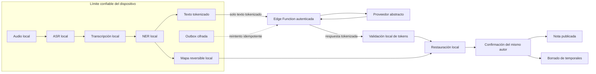
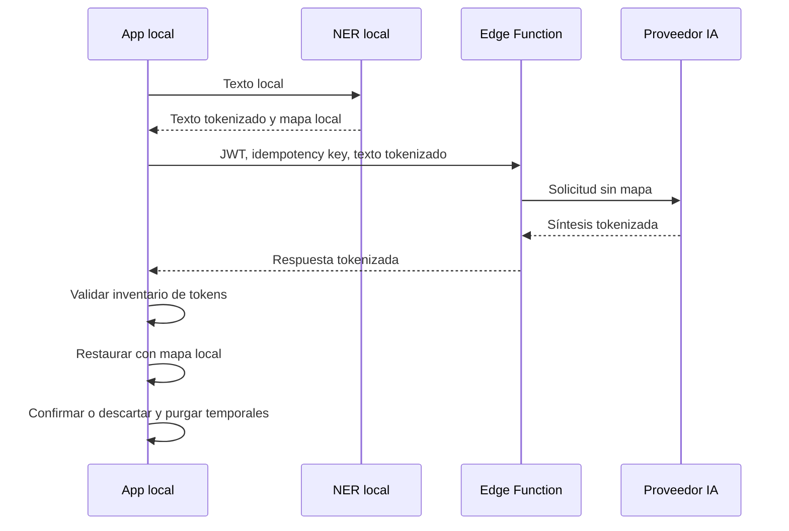

# Audio, IA y NER local

## Propósito y estado

Este documento define el contrato de privacidad y la arquitectura objetivo para captura de audio, reconocimiento de voz (ASR), reconocimiento de entidades (NER), tokenización reversible y síntesis asistida. No describe funcionalidad ya disponible: en el baseline, `clinical-summary` solo contenía un límite autenticado que respondía `501 not_implemented`.

La implementación y todas sus pruebas deben usar exclusivamente datos sintéticos. Audio, transcripciones, mapas de tokens, prompts y respuestas con datos reales no se aceptan en fixtures, logs, telemetría ni entornos de desarrollo.

## Decisiones vinculantes

1. El audio permanece en el dispositivo y nunca se carga a Supabase, una Edge Function ni un proveedor de IA.
2. El ASR es local y queda condicionado a aprobar un spike de Sherpa ONNX. Hasta aprobarlo, el flujo de nota de audio no se habilita.
3. El NER se ejecuta localmente antes de cualquier llamada cloud.
4. La tokenización es reversible. Usa tokens opacos, aleatorios y específicos de cada operación; el mapa token-valor nunca sale del límite confiable.
5. La síntesis cloud se invoca mediante una Edge Function y un adaptador de proveedor abstracto. Flutter no conoce credenciales ni SDKs del proveedor. En el prototipo, un guard técnico admite únicamente procedencia íntegramente sintética; habilitar datos reales, incluso tokenizados, exige una ADR sustitutiva y revisión legal y de seguridad.
6. La respuesta se acepta solo si supera la validación de integridad de tokens. La restauración de entidades se hace localmente.
7. La misma persona que inició la nota debe confirmar o descartar el resultado. No existe el estado `awaiting_review` ni una bandeja de revisión por terceros.
8. Al confirmar o descartar se eliminan audio, transcripción, mapa de tokens y demás artefactos temporales locales.
9. Sin conexión, una outbox local conserva el trabajo pendiente y aplica reintentos idempotentes. Ningún reintento puede cargar audio, transcripción sin tokenizar ni el mapa.
10. Una nota textual puede publicarse directamente, sin IA, o usar opcionalmente el mismo pipeline de síntesis.
11. Un resumen de periodo es una vista temporal configurable y cacheable, no una nota clínica ni un evento publicado.

## Límite de confianza

Para custodia del mapa, el límite confiable local comprende la aplicación instalada, su sandbox, los módulos locales de ASR y NER y el almacenamiento local cifrado por la plataforma. Esto no convierte al dispositivo en autoridad de autorización: Flutter, sus parámetros y su caché siguen siendo entradas no confiables para Supabase. PostgreSQL puede persistir la nota final o un snapshot restaurado bajo RLS, pero la Edge Function y el proveedor reciben solo material tokenizado; el mapa nunca sale del dispositivo. La Edge Function es un límite servidor confiable para autenticar, autorizar, custodiar secretos y validar el contrato, no para restaurar entidades.

Aunque las entidades se reemplacen, el contexto clínico restante puede permitir inferencias. La tokenización reduce exposición, pero no vuelve anónimo el texto. Por eso se debe minimizar el contenido enviado, prohibir retención y entrenamiento por parte del proveedor, evitar logs de cuerpo y revisar contractualmente el tratamiento de datos antes de producción.

## Spike obligatorio de Sherpa ONNX

Sherpa ONNX dispone de ejemplos Flutter de reconocimiento offline y soporta Android e iOS. Esa disponibilidad no demuestra que un modelo en español cumpla las restricciones clínicas, de tamaño y rendimiento de este producto. El spike debe ejecutarse antes de seleccionar modelo o habilitar captura de audio.

### Condiciones de aprobación

- Integración reproducible en las versiones de Android, iOS, Flutter y arquitecturas soportadas por la aplicación.
- Funcionamiento completamente offline, verificado bloqueando red durante descarga ya completada, captura y transcripción.
- Modelo con español y licencia compatible; modelo, tokens y librerías nativas se versionan o descargan con integridad verificable según la estrategia de distribución aprobada.
- Calidad medida con un corpus sintético representativo de dictado clínico chileno: abreviaturas, fármacos ficticios, dosis sintéticas, números y ruido ambiental controlado.
- Umbrales de error, latencia, factor de tiempo real, memoria, tamaño de aplicación, batería y temperatura definidos antes de medir y aprobados por producto e ingeniería.
- Cancelación, interrupción del sistema, falta de espacio, permisos de micrófono y archivos corruptos no dejan artefactos fuera del sandbox ni bloquean un nuevo intento.
- Confirmación de que ni el plugin ni los binarios emiten telemetría o tráfico de audio.

Si el spike falla, el producto conserva notas textuales y no sustituye ASR local por un servicio cloud sin una nueva decisión de arquitectura y privacidad.

## NER y tokenización reversible

NER debe identificar localmente, como mínimo, nombres, identificadores, fechas directamente identificables, teléfonos, correos, direcciones y referencias institucionales configuradas. La lista final y las métricas se validan con datos sintéticos; no se presume que un modelo genérico cubra vocabulario clínico o formatos chilenos.

Cada entidad se reemplaza por un token aleatorio de al menos 128 bits de entropía, por ejemplo `[CR_7F3...Q9]`. Apariciones que el detector considere la misma entidad pueden compartir token dentro de una operación para conservar relaciones; el token no codifica tipo, valor, posición, paciente ni autor. El mapa local conserva el valor original, el tipo y, cuando pueda determinarse con confianza, el rol contextual (`patient`, `practitioner`, `related_person`, `other_patient` o `unknown`). Los tokens no se reutilizan entre operaciones.

La validación comprueba que todo token de salida exista exactamente en el inventario de entrada y que ninguna secuencia con apariencia de token haya sido fragmentada o modificada. Una síntesis puede omitir una entidad irrelevante o repetir una referencia, por lo que no se exige multiplicidad idéntica; sí se aplican límites de repetición, tamaño y formato y se rechazan tokens desconocidos. Solo después de validar se restaura localmente mediante coincidencia exacta, nunca por sustitución parcial ni por interpretación del modelo.

## Edge Function y proveedor abstracto

La Edge Function debe validar método, JWT, perfil y membresía activos, permisos y alcance, procedencia sintética, tamaño, esquema, idempotency key e inventario de tokens antes de invocar `SynthesisProvider.synthesize(request)`. El adaptador de proveedor se selecciona en servidor. Sus credenciales se obtienen del entorno y nunca llegan a Flutter.

La función crea un cliente Supabase con el `Authorization` del llamador para que las lecturas autorizadas sigan bajo RLS. La Service Role Key no se usa para ampliar acceso clínico. Si una operación administrativa futura la requiere, debe permanecer en un cliente separado y no participar en este pipeline.

El contrato de salida incluye versión de prompt, versión del proveedor/modelo, texto tokenizado, inventario de tokens y un identificador de operación; no incluye mapa ni texto restaurado. Los timeouts, `429` y errores transitorios son reintentables. Errores de autenticación, autorización, esquema o integridad no se reintentan automáticamente.

## Outbox y ciclo de vida local

La outbox se cifra mediante capacidades seguras de la plataforma y se asocia a usuario, instalación e idempotency key. Puede almacenar audio local, transcripción local, mapa local y solicitud tokenizada solo mientras la operación siga pendiente; únicamente la solicitud tokenizada cruza el límite de red. Al cerrar sesión se bloquea el acceso al material de otro usuario y se aplica la política de purga definida para cambio de cuenta.

Estados conceptuales permitidos: `local_draft`, `processing_local`, `queued_offline`, `synthesizing`, `ready_to_confirm`, `syncing`, `published`, `failed` y `discarded`. `ready_to_confirm` es local y pertenece al autor; no equivale a `awaiting_review` ni se persiste como una tarea para terceros.

La confirmación persiste solo la nota final y metadatos de procedencia no sensibles. El descarte no crea nota. Ambos caminos purgan audio, transcripción, mapa, prompt, respuesta intermedia y entrada de outbox. Un proceso de mantenimiento elimina temporales vencidos después de interrupciones, sin esperar una reapertura indefinida.

## Controles de seguridad y auditoría

- RLS es la autoridad sobre pacientes, fuentes, notas y cachés compartidas; los guards de Flutter solo mejoran navegación.
- Cada publicación verifica en base de datos que perfil y membresía están activos, que los permisos y el alcance cubren la hospitalización y que el actor autenticado coincide con `author_id`.
- La idempotency key impide notas duplicadas después de timeout o reintento.
- La auditoría registra actor, paciente, operación, resultado, timestamps, versión de pipeline y hashes técnicos; nunca audio, transcripción, texto clínico, tokens, mapa, prompt ni respuesta.
- Los logs de aplicación, Edge Function y proveedor deben aplicar redacción por defecto y límites de retención.
- No se habilita telemetría de teclado, portapapeles, captura de pantalla o contenido para estos artefactos.
- La publicación final es inmutable; una corrección se modela como una nueva acción auditada según la política clínica futura.

## Verificación mínima

- Pruebas unitarias locales para detección sintética, opacidad, no reutilización, reversibilidad y validación estricta de tokens.
- Pruebas de lifecycle que demuestren purga al confirmar, descartar, expirar, cerrar sesión y recuperarse de un cierre inesperado.
- Pruebas de outbox con desconexión, backoff, reinicio, timeout y respuesta duplicada.
- pgTAP con casos permitidos y denegados para escritura clínica, misma autoría, suspensión y separación del rol administrador.
- Comprobaciones de Edge Function para autenticación, autorización, límites, idempotencia, timeout y errores del proveedor, usando dobles y datos sintéticos.
- Pruebas negativas que intenten exfiltrar audio, transcripción o mapa y que inspeccionen solicitudes y logs.
- Spike medido en dispositivos representativos antes de aceptar Sherpa ONNX.

## Evidencia y referencias

### Evidencia del baseline

- [`clinical-summary`](../../supabase/functions/clinical-summary/index.ts#L3-L18) valida una sesión, pero difiere la integración de IA y responde `501`.
- En el baseline, [`create-practitioner`](../../supabase/functions/create-practitioner/index.ts#L74-L100) muestra la separación entre el cliente del llamador y un cliente con Service Role exclusivo de servidor.
- [Control de acceso](05-access-control.md) establece RLS, permisos y separación entre autoridad administrativa y clínica.
- [Testing y validación](11-testing-validation.md) exige pgTAP para contratos de autorización y validación HTTP de Edge Functions nuevas.
- [Arquitectura objetivo](04-target-architecture.md#L9-L20) fija hospitalización, permisos configurables y entidades canónicas como límites del diseño.
- [ADR-008](decisions/adr-008-ner-tokenizacion-reversible.md) y [ADR-009](decisions/adr-009-sintesis-cloud-proveedor-abstracto.md) limitan mapa y restauración al entorno local y el cloud del prototipo a datos sintéticos.

### Documentación oficial

- [Sherpa ONNX: ejemplo Flutter de VAD y ASR offline desde archivo](https://github.com/k2-fsa/sherpa-onnx/tree/master/flutter-examples/vad-non-streaming-asr-from-file) documenta soporte para Android e iOS y varios modelos; justifica evaluar, no asumir, su adecuación.
- [Sherpa ONNX: ejemplo Flutter de ASR no streaming](https://github.com/k2-fsa/sherpa-onnx/tree/master/flutter-examples/non_streaming_vad_asr) muestra la creación de `OfflineRecognizer` con modelos locales.
- [Supabase: autorización en Edge Functions](https://supabase.com/docs/guides/functions/auth) documenta autenticación de funciones y clientes asociados al contexto del llamador.
- [Supabase: Row Level Security](https://supabase.com/docs/guides/database/postgres/row-level-security) establece que grants y políticas RLS deben proteger las tablas expuestas.
- [Supabase: secrets de Edge Functions](https://supabase.com/docs/guides/functions/secrets) documenta el uso de variables de entorno para credenciales de servidor.
