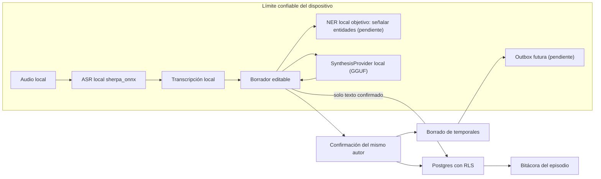

# Audio, IA y NER local

## Propósito y estado

Este documento define el contrato de privacidad y la arquitectura del pipeline de captura de audio, reconocimiento de voz (ASR), señalización de entidades (NER) y síntesis asistida, tal como quedaron tras ADR-016 y ADR-017.

La inferencia local no envía audio, transcripción, borradores ni prompts a Supabase ni a proveedores de IA. Al confirmar, solo el texto final del hito y metadatos técnicos permitidos se publican en Supabase; por tanto, no se afirma ausencia total de egreso. ADR-016 y ADR-017 sustituyen las prescripciones cloud/reversibles de ADR-008 y ADR-009; sus textos permanecen como registro histórico.

La implementación y todas sus pruebas usan exclusivamente datos sintéticos. Audio, transcripciones, prompts y respuestas con datos reales no se aceptan en fixtures, logs, telemetría ni entornos de desarrollo.

## Decisiones vinculantes

1. El audio, la transcripción y los borradores permanecen en el dispositivo y nunca se cargan a Supabase, a una Edge Function ni a un proveedor de IA. La publicación deliberada del texto confirmado sí llega a Supabase.
2. El ASR es local (`sherpa_onnx`) y falla cerrado: si el motor o el modelo no están disponibles, se informa el fallo y se ofrece el hito textual. No existe fallback a ASR cloud.
3. La detección NER local y su UI siguen siendo requisitos objetivo: cuando se implemente, solo señalará entidades al autor, sin sustituir texto ni construir mapas. La UI NER no está implementada.
4. No existe tokenización reversible en el flujo vigente (ADR-017 sustituye a ADR-008); esta decisión no significa que el texto confirmado no se publique.
5. La síntesis es íntegramente local con un modelo GGUF. No existe proveedor cloud, ni credenciales de proveedor, ni Edge Function de síntesis (ADR-017 sustituye a ADR-009).
6. La misma persona que inició la nota la confirma o la descarta. No existe el estado `awaiting_review` ni una bandeja de revisión por terceros.
7. Al confirmar o descartar se purgan audio, transcripción, borrador y demás artefactos temporales locales; no hay outbox offline implementada.
8. La publicación requiere conexión. Restauración offline mediante outbox cifrada y reintentos con backoff permanece como requisito pendiente; no se implementa todavía.
9. Una nota textual puede publicarse directamente, sin IA, o usar opcionalmente la mejora local de redacción. La asistencia nunca bloquea la publicación.
10. Un resumen de periodo es una vista temporal configurable y cacheable, no una nota clínica ni un evento publicado; permanece pendiente y no está expuesto como capacidad.

## Límite de confianza

El límite local comprende la aplicación instalada, su sandbox, los módulos locales de ASR y síntesis y el almacenamiento de temporales. Esto no convierte al dispositivo en autoridad de autorización: Flutter, sus parámetros y su caché siguen siendo entradas no confiables para Supabase. PostgreSQL persiste únicamente la nota confirmada por su autor y sus metadatos técnicos no sensibles, bajo RLS. El hook de limpieza se conecta desde la raíz; no implica una garantía general de recuperación tras crash.

La garantía vigente cubre la inferencia y los artefactos locales: audio, transcripción y borradores no se envían. La publicación intencional transmite el texto confirmado. No hay bucket, política ni columna capaz de transportar audio o transcripción.

## Modelo de reconocimiento y su manifiesto

El motor `sherpa_onnx` (Apache-2.0) está en `app/lib/domains/on_device_ai/data/sherpa_asr_engine.dart`, detrás del puerto compartido `on_device_ai/domain/asr_engine.dart`; `context_note` consume la capacidad y no contiene el motor. El modelo español se distribuye con versión y checksum verificable en `app/assets/asr_model_manifest.json`. Los pesos no se versionan en el repositorio: se instalan en el directorio de soporte y se verifican antes de usarse.

Si el archivo descargado no coincide con el checksum del manifiesto, el instalador lo descarta y el motor queda no disponible. Un modelo ausente no rompe la app: el hito textual sigue publicado.

La transcripción es un borrador editable. Cuando el motor entrega confianza por segmento, el borrador marca los tramos inciertos para el autor. Una transcripción errónea no puede cambiar el significado clínico de un hito sin que la persona lo vea.

## Señalización de entidades

El requisito objetivo de NER local es señalar nombres, identificadores, fechas directamente identificables, teléfonos, correos, direcciones y referencias institucionales configuradas sin alterar texto ni generar mapa. La UI no está implementada; cobertura y métricas con datos sintéticos siguen pendientes.

La lista final y las métricas se validan con datos sintéticos; no se presume que un modelo genérico cubra vocabulario clínico ni formatos chilenos.

## Síntesis local

ASR, síntesis, adaptadores y gestión de modelos están en `app/lib/domains/on_device_ai/` (ADR-018); los casos de uso de negocio y controladores permanecen en `context_note`. Los leases genéricos coordinan capacidades y `LocalCapabilityRepository` es la única frontera de provisioning. El fake permite pruebas de negocio; no se afirma que el fake y el adaptador nativo compartan pruebas contractuales completas. La cancelación solicitada desde la app no garantiza hard cancellation nativa.

El modelo declara origen, licencia, checksum y tamaño en `app/assets/llm_model_manifest.json`. Se descarga en el primer arranque con progreso explícito, se verifica por checksum y, si falla la verificación, el archivo se borra.

La app modela por separado las capacidades de transcripción y asistencia de texto: cada una tiene estado, identidad de modelo y operación de instalación/verificación/limpieza independiente. En cada arranque consulta los archivos y el registro local `.verified-model.json`; ese registro solo se escribe después de verificar los pesos. Si hay archivos utilizables sin registro (instalación anterior), los verifica antes de adoptarlos. La comprobación ordinaria compara identidad, existencia y tamaños, no recalcula hashes; por ello no detecta corrupción que conserve el tamaño. La verificación explícita de gestión vuelve a comprobar integridad.

La pantalla inicial «Preparar el dispositivo» permite omitir la descarga para esa ejecución; esto no instala modelos ni evita comprobarlos en el siguiente arranque. Desde «Ajustes > IA» se pueden verificar, limpiar o volver a descargar los modelos individualmente; esta gestión no es el flujo inicial de preparación. La ruta `/models` permanece disponible para una sesión autenticada aunque una limpieza deje modelos ausentes. Al salir de gestión tras una limpieza exitosa se registra un skip solo en memoria para evitar redirigir a onboarding durante esa ejecución. No se persiste esa decisión ni se cambia la disponibilidad real de los modelos. Una limpieza fallida no inicia la reinstalación, aunque se hubiera elegido descargar después. La descarga informa etapa y progreso; el resumen de periodo no está expuesto como capacidad de producto.

Los usos, en orden: mejorar la redacción del hito escrito a mano, señalar entidades y, como última adición, el resumen de periodo (ADR-011).

Cuando el motor falla o el modelo no está instalado, el hito se publica directamente. La asistencia nunca bloquea la escritura clínica.

El motor de síntesis queda cargado durante la sesión y la ayuda de redacción está disponible en las dos formas de entrada de la nota, con el mismo contrato: su salida es un borrador que el autor revisa y edita antes de confirmar. El presupuesto de tiempo de la síntesis local es de tres minutos, que cubre la carga de los pesos y la generación en el objetivo más lento soportado; al agotarse, el texto del autor se conserva. El runtime no recalcula el checksum de los pesos en cada carga, porque la instalación ya lo verificó y el arranque comprueba identidad y tamaño.

## Outbox y ciclo de vida local

La outbox cifrada con restauración, reintentos y backoff es un requisito pendiente, no comportamiento implementado. Publicar manualmente requiere red. La aprobación del TTL de Q-PRIV-03 sigue pendiente: cualquier valor por defecto de 24 h en código no es una decisión aprobada de producto.

Estados conceptuales permitidos: `idle`, `recording`, `transcribing_local`, `ready_to_confirm`, `queued_offline`, `synthesizing`, `publishing`, `published`, `failed` y `discarded`. `ready_to_confirm` es local y pertenece al autor.

La confirmación persiste solo la nota final y metadatos de procedencia no sensibles. El descarte no crea nota. La limpieza se registra antes de capturar, se espera al confirmar/descartar y se purga; ante fallo se conserva registro para reintentar. El cierre explícito de sesión solicita purga; el dispose de ruta es best effort. El barrido de expiración es oportunista al inicializar el vault: no garantiza recuperación tras crash ni ejecución en background. TTL y restauración tras crash siguen pendientes.

## Controles de seguridad y auditoría

- RLS es la autoridad sobre pacientes, fuentes, notas y cachés compartidas; los guards de Flutter solo mejoran navegación.
- Cada publicación verifica en base de datos que perfil y membresía están activos, que los permisos y el alcance cubren la hospitalización y que el actor autenticado coincide con `author_id`.
- `client_event_id` impide notas duplicadas después de timeout o reintento.
- La auditoría registra actor, paciente, hospitalización, operación, resultado, timestamps, versión de pipeline y hashes técnicos; nunca audio, transcripción, texto clínico ni prompts.
- Los logs de aplicación y del runtime deben aplicar redacción por defecto y límites de retención.
- No se habilita telemetría de teclado, portapapeles, captura de pantalla o contenido para estos artefactos.
- La publicación final es inmutable; una corrección se modela como una nueva nota auditada según la política clínica futura.

## Verificación mínima

- Pruebas unitarias del contrato `AsrEngine` y `SynthesisProvider`: fallo cerrado, límites, cancelación y códigos de error estables.
- Pruebas de lifecycle que demuestren purga al confirmar, descartar, expirar, cerrar sesión y recuperarse de un cierre inesperado.
- Pruebas de outbox con desconexión, backoff, reinicio, timeout y respuesta duplicada.
- pgTAP con casos permitidos y denegados para escritura clínica, misma autoría, suspensión y separación del rol administrador.
- Prueba de privacidad que falle si existe bucket, política o columna capaz de transportar audio o transcripción.
- Medición sobre corpus sintético en español clínico: latencia, factor de tiempo real, RAM, batería, temperatura y tamaño de descarga.
- Comprobación de que ni los plugins ni los binarios emiten telemetría o tráfico de audio o texto.

## Evidencia y referencias

### Evidencia implementada

- `supabase/migrations/20261012010000_context_note_local_transcription.sql`: `transcription_metadata` con constraint de forma y tamaño, retiro de columnas y grants, eliminación del bucket, funciones y políticas de Storage, y proyección del texto confirmado.
- `supabase/migrations/20261012020000_context_note_publication_reconciliation.sql`: RPC read-only `context_note_publication_matches`, que reautoriza y solo devuelve true para autor y payload exactos.
- `supabase/tests/context_note_publication_reconciliation.test.sql`: autorización y coincidencia exacta; un `23505` sin coincidencia no se toma como éxito.
- `supabase/tests/context_notes_milestones.test.sql`: contrato RLS, idempotencia, rechazo de metadata con texto libre y prueba de privacidad.
- `app/lib/domains/context_note/`: vault, modelo, repositorio y UI/controladores del hito.
- `app/lib/domains/on_device_ai/`: puertos, motores locales y gestión compartida de capacidades/modelos.
- `app/assets/asr_model_manifest.json` y `app/assets/llm_model_manifest.json`: origen, licencia, versión y checksums.
- `app/lib/domains/on_device_ai/data/fake_synthesis_provider.dart`: adaptador fake disponible para pruebas.

### Documentación oficial

- [Sherpa ONNX: ejemplo Flutter de VAD y ASR offline desde archivo](https://github.com/k2-fsa/sherpa-onnx/tree/master/flutter-examples/vad-non-streaming-asr-from-file) documenta soporte para Android e iOS y varios modelos; justifica evaluar, no asumir, su adecuación.
- [Sherpa ONNX: modelos ASR preentrenados](https://k2-fsa.github.io/sherpa/onnx/pretrained_models/index.html) permite evaluar modelos, idiomas y artefactos durante el spike.
- [Supabase: Row Level Security](https://supabase.com/docs/guides/database/postgres/row-level-security) establece que grants y políticas RLS deben proteger las tablas expuestas.
- [Qwen3](https://huggingface.co/Qwen/Qwen3-1.7B-GGUF) publica los pesos GGUF usados por la síntesis local bajo licencia Apache-2.0.
