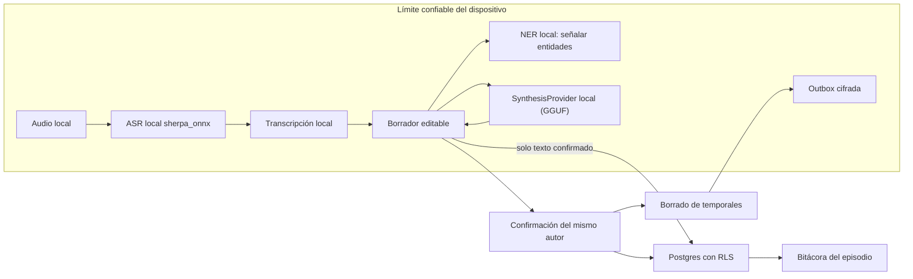

# Audio, IA y NER local

## Propósito y estado

Este documento define el contrato de privacidad y la arquitectura del pipeline de captura de audio, reconocimiento de voz (ASR), señalización de entidades (NER) y síntesis asistida, tal como quedaron tras ADR-016 y ADR-017.

El principio que ordena todo el documento es uno solo: **el texto/audio del hito de bitácora no sale del dispositivo**. Ese principio es la razón por la que la tokenización reversible y el proveedor cloud de síntesis ya no existen: no hay egreso que reducir.

La implementación y todas sus pruebas usan exclusivamente datos sintéticos. Audio, transcripciones, prompts y respuestas con datos reales no se aceptan en fixtures, logs, telemetría ni entornos de desarrollo.

## Decisiones vinculantes

1. El audio permanece en el dispositivo y nunca se carga a Supabase, a una Edge Function ni a un proveedor de IA.
2. El ASR es local (`sherpa_onnx`) y falla cerrado: si el motor o el modelo no están disponibles, se informa el fallo y se ofrece el hito textual. No existe fallback a ASR cloud.
3. El NER se ejecuta localmente y solo señala entidades al autor. No sustituye texto ni construye ningún mapa.
4. No existe tokenización reversible: al no salir nada del dispositivo, no hay mapa token-valor que custodiar (ADR-017 sustituye a ADR-008).
5. La síntesis es íntegramente local con un modelo GGUF. No existe proveedor cloud, ni credenciales de proveedor, ni Edge Function de síntesis (ADR-017 sustituye a ADR-009).
6. La misma persona que inició la nota la confirma o la descarta. No existe el estado `awaiting_review` ni una bandeja de revisión por terceros.
7. Al confirmar o descartar se eliminan audio, transcripción, borrador, outbox y demás artefactos temporales locales.
8. Sin conexión, una outbox local conserva el trabajo pendiente y aplica reintentos idempotentes. Ningún reintento puede cargar audio ni transcripción.
9. Una nota textual puede publicarse directamente, sin IA, o usar opcionalmente la mejora local de redacción. La asistencia nunca bloquea la publicación.
10. Un resumen de periodo es una vista temporal configurable y cacheable, no una nota clínica ni un evento publicado.

## Límite de confianza

El límite confiable local comprende la aplicación instalada, su sandbox, los módulos locales de ASR y NER y el almacenamiento local cifrado por la plataforma. Esto no convierte al dispositivo en autoridad de autorización: Flutter, sus parámetros y su caché siguen siendo entradas no confiables para Supabase. PostgreSQL persiste únicamente la nota confirmada por su autor y sus metadatos técnicos no sensibles, bajo RLS.

La ausencia de egreso es la garantía principal y es comprobable: por inspección de código, por captura de red y por una prueba de pgTAP que falla si reaparece cualquier bucket, política o columna capaz de transportar audio o transcripción.

## Modelo de reconocimiento y su manifiesto

El motor es `sherpa_onnx` (Apache-2.0), invocado detrás de la interfaz `AsrEngine`; el dominio no conoce SDK, formato nativo ni ruta de modelo. El modelo español se distribuye con versión y checksum verificable declarados en `app/assets/asr_model_manifest.json`. Los pesos no se versionan en el repositorio: se instalan en el directorio de soporte de la aplicación y se verifican antes de usarse.

Si el archivo descargado no coincide con el checksum del manifiesto, el instalador lo descarta y el motor queda no disponible. Un modelo ausente no rompe la app: el hito textual sigue publicado.

La transcripción es un borrador editable. Cuando el motor entrega confianza por segmento, el borrador marca los tramos inciertos para el autor. Una transcripción errónea no puede cambiar el significado clínico de un hito sin que la persona lo vea.

## Señalización de entidades

El NER local identifica, como mínimo, nombres, identificadores, fechas directamente identificables, teléfonos, correos, direcciones y referencias institucionales configuradas. Su único efecto es señalar: el texto del autor no se modifica y no se genera ningún mapa.

La lista final y las métricas se validan con datos sintéticos; no se presume que un modelo genérico cubra vocabulario clínico ni formatos chilenos.

## Síntesis local

`SynthesisProvider` es el puerto del dominio. Hay un adaptador GGUF real (`llamadart`) y un fake determinista; cambiar uno por otro no modifica ningún caso de uso ni sus pruebas. El caso de uso controla timeout, cancelación, idempotencia, versión de prompt y de modelo y códigos de error estables.

El modelo declara origen, licencia, checksum y tamaño en `app/assets/llm_model_manifest.json`. Se descarga en el primer arranque con progreso explícito, se verifica por checksum y, si falla la verificación, el archivo se borra.

La app modela por separado las capacidades de transcripción y asistencia de texto: cada una tiene estado, identidad de modelo y operación de instalación/verificación/limpieza independiente. En cada arranque consulta los archivos y el registro local `.verified-model.json`; ese registro solo se escribe después de verificar los pesos. Si hay archivos utilizables sin registro (instalación anterior), los verifica antes de adoptarlos. La comprobación ordinaria compara identidad, existencia y tamaños, no recalcula hashes; por ello no detecta corrupción que conserve el tamaño. La verificación explícita de gestión vuelve a comprobar integridad.

La pantalla inicial «Preparar el dispositivo» permite omitir la descarga para esa ejecución; esto no instala modelos ni evita comprobarlos en el siguiente arranque. Desde «Ajustes > IA» se pueden verificar, limpiar o volver a descargar los modelos individualmente; esta gestión no es el flujo inicial de preparación. La ruta `/models` permanece disponible para una sesión autenticada aunque una limpieza deje modelos ausentes. Al salir de gestión tras una limpieza exitosa se registra un skip solo en memoria para evitar redirigir a onboarding durante esa ejecución. No se persiste esa decisión ni se cambia la disponibilidad real de los modelos. Una limpieza fallida no inicia la reinstalación, aunque se hubiera elegido descargar después. La descarga informa etapa y progreso; el resumen de periodo no está expuesto como capacidad de producto.

Los usos, en orden: mejorar la redacción del hito escrito a mano, señalar entidades y, como última adición, el resumen de periodo (ADR-011).

Cuando el motor falla o el modelo no está instalado, el hito se publica directamente. La asistencia nunca bloquea la escritura clínica.

## Outbox y ciclo de vida local

La outbox se cifra mediante las capacidades seguras de la plataforma y se asocia a usuario, instalación e identificador de operación. Puede guardar transcripción y borrador mientras la operación siga pendiente; solo el texto confirmado cruza el límite de red. Al cerrar sesión se bloquea el acceso al material de otro usuario y se aplica la política de purga.

Estados conceptuales permitidos: `idle`, `recording`, `transcribing_local`, `ready_to_confirm`, `queued_offline`, `synthesizing`, `publishing`, `published`, `failed` y `discarded`. `ready_to_confirm` es local y pertenece al autor.

La confirmación persiste solo la nota final y metadatos de procedencia no sensibles. El descarte no crea nota. Ambos caminos purgan audio, transcripción, borrador, prompt, respuesta intermedia y entrada de outbox. Un proceso de mantenimiento elimina temporales vencidos después de interrupciones, sin esperar una reapertura indefinida.

## Controles de seguridad y auditoría

- RLS es la autoridad sobre pacientes, fuentes, notas y cachés compartidas; los guards de Flutter solo mejoran navegación.
- Cada publicación verifica en base de datos que perfil y membresía están activos, que los permisos y el alcance cubren la hospitalización y que el actor autenticado coincide con `author_id`.
- `client_event_id` impide notas duplicadas después de timeout o reintento.
- La auditoría registra actor, paciente, hospitalización, operación, resultado, timestamps, versión de pipeline y hashes técnicos; nunca audio, transcripción, texto clínico ni prompts.
- Los logs de aplicación y del runtime deben aplicar redacción por defecto y límites de retención.
- No se habilita telemetría de teclado, portapapeles, captura de pantalla o contenido para estos artefactos.
- La publicación final es inmutable; una corrección se modela como una nueva nota auditada según la política clínica futura.

## Verificación mínima

- Pruebas unitarias del contrato `AsrEngine` y `SynthesisProvider`: fallo cerrado, límites, cancelación y códigos de error estables.
- Pruebas de lifecycle que demuestren purga al confirmar, descartar, expirar, cerrar sesión y recuperarse de un cierre inesperado.
- Pruebas de outbox con desconexión, backoff, reinicio, timeout y respuesta duplicada.
- pgTAP con casos permitidos y denegados para escritura clínica, misma autoría, suspensión y separación del rol administrador.
- Prueba de privacidad que falle si existe bucket, política o columna capaz de transportar audio o transcripción.
- Medición sobre corpus sintético en español clínico: latencia, factor de tiempo real, RAM, batería, temperatura y tamaño de descarga.
- Comprobación de que ni los plugins ni los binarios emiten telemetría o tráfico de audio o texto.

## Evidencia y referencias

### Evidencia implementada

- `supabase/migrations/20261012010000_context_note_local_transcription.sql`: `transcription_metadata` con constraint de forma y tamaño, retiro de columnas y grants, eliminación del bucket, funciones y políticas de Storage, y proyección del texto confirmado.
- `supabase/tests/context_notes_milestones.test.sql`: contrato RLS, idempotencia, rechazo de metadata con texto libre y prueba de privacidad.
- `app/lib/domains/context_note/`: dominio, motor local, vault de temporales, modelo, repositorio y UI del hito.
- `app/assets/asr_model_manifest.json` y `app/assets/llm_model_manifest.json`: origen, licencia, versión y checksums.
- `app/lib/domains/context_note/data/fake_synthesis_provider.dart` y `app/lib/domains/context_note/domain/usecases/synthesis_usecases.dart`: el fake y el adaptador cumplen el mismo contrato.

### Documentación oficial

- [Sherpa ONNX: ejemplo Flutter de VAD y ASR offline desde archivo](https://github.com/k2-fsa/sherpa-onnx/tree/master/flutter-examples/vad-non-streaming-asr-from-file) documenta soporte para Android e iOS y varios modelos; justifica evaluar, no asumir, su adecuación.
- [Sherpa ONNX: modelos ASR preentrenados](https://k2-fsa.github.io/sherpa/onnx/pretrained_models/index.html) permite evaluar modelos, idiomas y artefactos durante el spike.
- [Supabase: Row Level Security](https://supabase.com/docs/guides/database/postgres/row-level-security) establece que grants y políticas RLS deben proteger las tablas expuestas.
- [Qwen3](https://huggingface.co/Qwen/Qwen3-1.7B-GGUF) publica los pesos GGUF usados por la síntesis local bajo licencia Apache-2.0.
