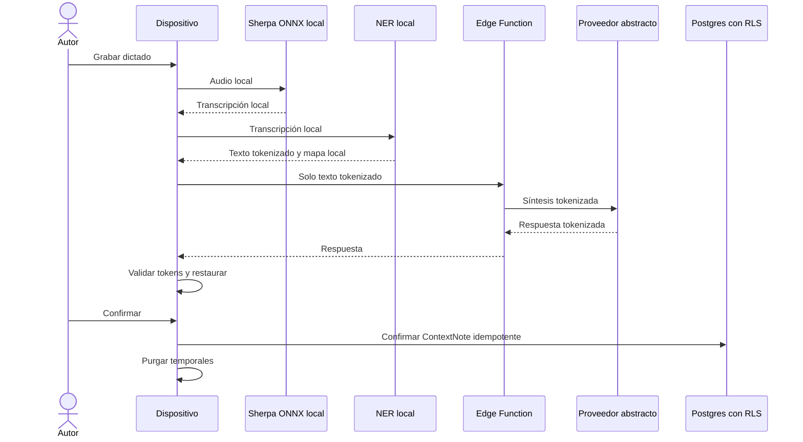

# Flujo de nota de audio

## Estado y objetivo

Este flujo es un contrato objetivo y permanece bloqueado hasta aprobar el spike de Sherpa ONNX. Su objetivo es convertir un dictado capturado y transcrito localmente en una nota clínica confirmada por su autor, sin que el audio, la transcripción identificable o el mapa NER salgan del dispositivo.

No existe fallback a ASR cloud. Si el ASR local no cumple el spike, la nota de audio no se habilita y se conserva el flujo textual. Solo se usan voces, pacientes y contenido sintéticos durante desarrollo y pruebas.

No debe confundirse con los hitos de bitácora de audio ([ADR-015](../decisions/adr-015-hitos-bitora-audio.md)): en ese corte, ya implementado, la grabación confirmada se publica íntegra en un bucket privado y se reproduce desde la bitácora, sin ASR, NER ni síntesis.

## Actores

- Perfil con membresía activa y permisos `context.note.create`/`context.note.confirm` dentro del alcance de la hospitalización.
- Micrófono, sandbox y almacenamiento cifrado del dispositivo.
- Sherpa ONNX como candidato de ASR local, condicionado al spike.
- NER local y outbox local.
- Edge Function de síntesis y proveedor abstracto.
- Postgres con RLS para publicar la nota final.

## Permisos

- Una membresía activa con `context.note.create` puede iniciar dictado para una hospitalización dentro de su alcance y con permiso de micrófono concedido.
- Solo el mismo autor puede reanudar, confirmar o descartar la operación local.
- Una autoridad IAM sin `context.*`, suspendidos, asignaciones vencidas, perfiles ausentes y anónimos no capturan ni confirman desde este flujo.
- En este flujo, el audio nunca tiene permiso de subida y ningún endpoint lo acepta; la única excepción es el audio de hitos de bitácora (ADR-015), con bucket privado y políticas propias.
- La nota publicada es inmutable y solo contiene el resultado final, no audio ni transcripción intermedia.

## Precondiciones

- Spike de Sherpa ONNX aprobado en dispositivos y versiones soportados, con modelo español, licencia y umbrales documentados.
- Sesión válida, perfil/membresía activos, permisos de crear/confirmar y hospitalización visible dentro del alcance.
- Permiso de micrófono, espacio local y capacidad de cifrado disponibles.
- NER local y validación reversible inicializados.
- Edge Function/proveedor configurados para recibir solo texto tokenizado.
- Guard de procedencia que rechaza datos reales o desconocidos; el cloud del prototipo procesa únicamente corpus sintético.
- Matriz RLS de escritura clínica e idempotencia desplegadas.

## Flujo principal

1. El autor abre una hospitalización autorizada y elige nota de audio.
2. La app solicita permiso de micrófono en contexto y comienza a grabar dentro del sandbox.
3. Al detener, Sherpa ONNX procesa localmente el audio y produce una transcripción local.
4. La transcripción permanece como artefacto técnico local y pasa directamente al NER; no se presenta como campo principal de edición.
5. NER local reemplaza entidades por tokens opacos y crea un mapa reversible local.
6. La app envía únicamente la transcripción tokenizada a la Edge Function con JWT e idempotency key.
7. La Edge Function valida perfil/membresía, permisos, hospitalización, procedencia sintética, esquema, límites e inventario y llama al proveedor abstracto.
8. La app recibe la síntesis tokenizada, valida tokens conocidos y restaura entidades localmente.
9. El mismo autor escucha el audio, revisa y puede editar la síntesis restaurada, y confirma o descarta.
10. Al confirmar se crea o transiciona una única `ContextNote` canónica a `Confirmed`; el proyector genera el `clinical_event`. Al descartar no queda una nota confirmada.
11. Ambos caminos eliminan audio, transcripción, mapa, solicitudes, respuestas y entrada de outbox.

## Flujos alternativos y errores

- Permiso de micrófono denegado: no se graba; se explica cómo habilitarlo y se ofrece nota textual.
- Interrupción por llamada, cambio de app o cierre: se detiene de forma segura y se conserva o descarta el fragmento según elección explícita del autor.
- Falta de espacio, audio corrupto o ASR fallido: no se llama al cloud; se permite reintentar ASR, pasar a texto manual o descartar.
- Confianza/calidad insuficiente: no se llama al cloud; se permite volver a grabar, cambiar a nota textual o descartar. La transcripción no se publica automáticamente.
- Sin conexión tras transcribir: audio, transcripción, mapa y outbox siguen cifrados localmente; solo la solicitud tokenizada se reintenta cuando vuelve la red.
- Timeout, `429` o `5xx`: reintento con backoff e idempotency key. No se vuelve a grabar ni se duplica publicación.
- Token alterado o respuesta con token desconocido: se rechaza por completo y no se restaura parcialmente.
- Suspensión de perfil/membresía, revocación de permiso o pérdida de alcance sobre la hospitalización antes de confirmar: RLS deniega; no se exporta nada y solo se permite descartar de forma segura.
- Reinicio del dispositivo: el mismo usuario puede reanudar artefactos no vencidos; otro usuario no puede abrirlos.
- Vencimiento local: un recolector purga audio, transcripción y mapa aunque el flujo no haya vuelto a abrirse.

## Estados

| Estado               | Significado                                           |
| -------------------- | ----------------------------------------------------- |
| `local_draft`        | Operación creada, aún sin grabación final             |
| `recording`          | Captura local activa                                  |
| `transcribing_local` | ASR local en ejecución                                |
| `processing_local`   | NER y tokenización local                              |
| `queued_offline`     | Espera red manteniendo artefactos cifrados localmente |
| `synthesizing`       | Solicitud tokenizada en curso                         |
| `ready_to_confirm`   | Resultado restaurado para el mismo autor              |
| `syncing`            | Publicación final en curso                            |
| `published`          | Nota final persistida y temporales purgados           |
| `failed`             | Error recuperable o terminal                          |
| `discarded`          | Sin publicación y temporales purgados                 |

No existe `awaiting_review`; no se sube un borrador para que otra persona lo confirme.

## Datos

- Audio: archivo temporal local cifrado, formato y frecuencia definidos por el spike; en este flujo nunca se transmite ni persiste en Supabase.
- Transcripción: artefacto técnico local; nunca se envía sin tokenizar, se presenta como nota final ni se persiste en servidor.
- NER: entidades y mapa token-valor exclusivamente locales.
- Cloud: texto tokenizado, inventario de tokens, configuración de síntesis, versión e idempotency key.
- Publicación: `ClinicalRecord`/`ContextNote` canónicos con organización, hospitalización, autor, contenido final y procedencia `audio_synthesized`; la proyección `clinical_events` no incluye ruta de audio, transcript ni mapa.
- Auditoría: actor, paciente, operación, versiones, duración/resultado técnico agregado e identificadores; nunca contenido ni audio.

## RLS y auditoría

La política de publicación objetivo exige perfil/membresía activos, `context.note.create`, `context.note.confirm`, alcance sobre la hospitalización y `author_id = auth.uid()`. No se permite edición destructiva de la nota confirmada ni escritura directa del timeline. La Edge Function vuelve a verificar usuario y acceso con el JWT del llamador; no usa Service Role para leer datos clínicos.

Los eventos auditables son inicio/fin de captura, resultado ASR agregado, solicitud de síntesis, integridad de tokens, confirmación, descarte, publicación y purga. Las métricas de calidad del spike se recolectan solo sobre corpus sintético. Logs, crash reports y analytics excluyen audio, transcripción, nota, entidades, tokens, mapa y nombres de archivo reveladores.

## Criterios de aceptación

- La feature permanece deshabilitada hasta aprobar el spike y falla cerrada si el ASR local no está disponible.
- Inspección de red demuestra que nunca se transmite audio, transcripción original o mapa.
- ASR y NER funcionan sin red en plataformas soportadas.
- Solo texto tokenizado llega a Edge/proveedor y toda respuesta se valida antes de restaurar.
- El mismo autor confirma o descarta; no existe revisión por terceros ni `awaiting_review`.
- Modo avión y reintentos no pierden el trabajo ni duplican la nota.
- Confirmar, descartar, cerrar sesión con política de purga o vencer elimina todos los temporales.
- RLS deniega confirmación sin permiso, con membresía suspendida, a otro autor y fuera del alcance de la hospitalización.
- Toda prueba utiliza voces y casos clínicos sintéticos.

## Pruebas

- Spike: compatibilidad Android/iOS, español sintético, error de palabra, latencia, factor de tiempo real, RAM, batería, temperatura, tamaño y licencia.
- Plataforma: permiso concedido/denegado, llamada entrante, background, cierre forzado, poco espacio y audio corrupto.
- Privacidad: proxy de red y revisión de logs para demostrar ausencia de audio, transcript, mapa y texto restaurado.
- Unitarias: NER, tokenización, reversibilidad, alteraciones y tokens desconocidos.
- Outbox: modo avión, reinicio, backoff, timeout, `429`, `5xx`, duplicados, vencimiento y aislamiento entre usuarios.
- pgTAP: confirmación permitida con permisos/alcance y denegada por otra organización, membresía suspendida, permiso ausente, asignación vencida, autor ajeno y hospitalización oculta.
- Edge Function: auth, autorización, límites, inventario de tokens y proveedor simulado.
- Manual: reproducción de audio, edición de síntesis, confirmación, descarte y comparación de nota publicada con la vista confirmada.

## Evidencia y referencias

- [Arquitectura de audio, IA y NER](../09-audio-ai-ner.md) fija el límite de confianza, spike, tokenización, outbox y purga.
- En el baseline, [`clinical-summary`](../../../supabase/functions/clinical-summary/index.ts#L3-L18) solo implementaba un límite autenticado y no integraba proveedor.
- [Control de acceso](../05-access-control.md) exige permisos y pruebas explícitos antes de habilitar escritura clínica.
- [Modelo de dominio](../07-domain-model.md#nota-de-contexto) separa la nota canónica confirmada del `clinical_events` reconstruible.
- [Sherpa ONNX: VAD y ASR offline en Flutter](https://github.com/k2-fsa/sherpa-onnx/tree/master/flutter-examples/vad-non-streaming-asr-from-file) documenta ejemplo y plataformas soportadas.
- [Sherpa ONNX: modelos ASR preentrenados](https://k2-fsa.github.io/sherpa/onnx/pretrained_models/index.html) permite evaluar modelos, idiomas y artefactos durante el spike.
- [Supabase: autorización en Edge Functions](https://supabase.com/docs/guides/functions/auth) documenta la validación de llamadas y el contexto del usuario.
- [Supabase: Row Level Security](https://supabase.com/docs/guides/database/postgres/row-level-security) documenta políticas de lectura y escritura por fila.
