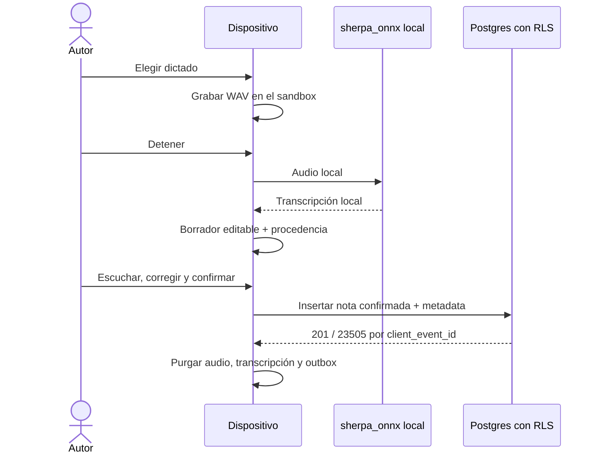

# Flujo de nota de audio

## Estado y objetivo

Convierte un dictado capturado y transcrito en el dispositivo en un hito de bitácora confirmado por su autor. El audio, su transcripción y cualquier artefacto intermedio son técnicos y locales: nada de eso sale del teléfono ni se persiste en Supabase (ADR-016). El único registro es el texto que la persona revisó y confirmó.

El motor es `sherpa_onnx` con un modelo español instalado en el dispositivo. No existe fallback a ASR cloud: si el motor local no está disponible, el flujo falla cerrado y se ofrece el hito textual.

El dictado dejó de ser un experimento paralelo: es la forma en que se captura el hito de audio. La distinción temporal con ADR-015 ya no aplica, porque el audio almacenado fue retirado.

## Actores

- Perfil con membresía activa y permisos `context.note.create`/`context.note.confirm` dentro del alcance de la hospitalización.
- Micrófono, sandbox y almacenamiento cifrado del dispositivo.
- `sherpa_onnx` como motor de ASR local y `just_audio` para la escucha previa.
- `DraftVault` para los temporales cifrados y la purga.
- Postgres con RLS para publicar la nota final.

## Permisos

- Una membresía activa con `context.note.create` puede iniciar dictado para una hospitalización dentro de su alcance y con permiso de micrófono concedido.
- Solo el mismo autor puede revisar, confirmar o descartar la operación local.
- Una autoridad IAM sin `context.*`, suspendidos, asignaciones vencidas, perfiles ausentes y anónimos no capturan ni confirman desde este flujo.
- En este flujo el audio no tiene permiso de subida y ningún endpoint lo acepta. No existe bucket, política ni columna capaz de transportar audio.
- La nota publicada es inmutable y contiene solo el resultado final, no audio ni transcripción intermedia.

## Precondiciones

- Sesión válida, perfil y membresía activos, permisos de crear y confirmar, y hospitalización visible dentro del alcance.
- Permiso de micrófono, espacio local y capacidad de cifrado disponibles.
- Modelo ASR instalado y verificado por checksum en el manifiesto versionado, o su ausencia reconocida para fallar cerrado.
- Matriz RLS de escritura clínica e idempotencia desplegadas.

## Flujo principal

1. El autor abre una hospitalización autorizada y elige el modo dictado.
2. La app comprueba que el motor local está disponible; si no, informa y ofrece escribir el hito en texto.
3. La app solicita permiso de micrófono en contexto y graba un WAV PCM16 mono en un directorio del sandbox propio de la operación.
4. Al detener, `sherpa_onnx` transcribe localmente el archivo.
5. La transcripción se muestra en un campo editable como borrador, junto con la procedencia técnica del motor.
6. El autor escucha la grabación local con `just_audio`, corrige lo que el reconocimiento no entendió y confirma.
7. Solo entonces la app inserta una única fila `context_notes` con `input_method = 'audio'`, `content` confirmado y `transcription_metadata` no sensible; RLS es la autoridad.
8. El hito aparece en la bitácora como texto confirmado.
9. En ambos caminos se eliminan audio, transcripción, borrador y entrada de outbox.

## Flujos alternativos y errores

- Permiso de micrófono denegado: no se graba; se explica cómo habilitarlo y se ofrece nota textual.
- Interrupción por llamada, cambio de app o cierre: se detiene de forma segura y la operación pendiente vence y se purga sola.
- Falta de espacio, audio corrupto o ASR fallido: no se envía nada a la red; se permite reintentar localmente, pasar a texto manual o descartar.
- Transcripción vacía: no se publica; se informa y se ofrece repetir la grabación o escribir a mano.
- Confianza baja en algún segmento: el borrador lo señala para que el autor lo revise antes de confirmar.
- Modelo no instalado: el botón de dictado no ofrece grabar y el hito textual sigue disponible.
- Suspensión de perfil o membresía, revocación de permiso o pérdida de alcance antes de confirmar: RLS deniega; no se exporta nada y solo se permite descartar.
- Reinicio del dispositivo: un barrido elimina las operaciones vencidas sin depender de que el flujo vuelva a abrirse.

## Estados

| Estado               | Significado                                |
| -------------------- | ------------------------------------------ |
| `idle`               | Nada capturado                             |
| `recording`          | Captura local activa                       |
| `transcribing_local` | ASR local en ejecución                     |
| `ready_to_confirm`   | Transcripción editable para el mismo autor |
| `publishing`         | Inserción idempotente en curso             |
| `published`          | Nota confirmada y temporales purgados      |
| `failed`             | Error recuperable o terminal               |
| `discarded`          | Sin publicación y temporales purgados      |

No existe `awaiting_review`; no se sube un borrador para que otra persona lo confirme.

## Datos

- Audio: archivo WAV PCM16 mono en un directorio del sandbox propiedad de la operación. Nunca se transmite ni se persiste en Supabase.
- Transcripción: artefacto técnico local; se presenta como borrador editable y nunca se persiste en servidor.
- Procedencia: `transcription_metadata` con motor, modelo, versión, checksum, duración, parámetros, confianza media, segmentos de baja confianza y versión del pipeline. Sin texto.
- Publicación: `context_notes` con organización, hospitalización, autor, contenido confirmado y `input_method = 'audio'`.
- La proyección `clinical_timeline_by_hospitalization` muestra el texto confirmado y no expone audio ni metadatos.
- Auditoría: actor, paciente, hospitalización, resultado y procedencia técnica; nunca contenido.

## RLS y auditoría

La política de publicación exige perfil y membresía activos, `context.note.create`, `context.note.confirm`, alcance sobre la hospitalización y `author_id = auth.uid()`. La base de datos también rechaza un hito de audio sin `content`, un hito de texto con metadatos y cualquier `transcription_metadata` mal formada, sobredimensionada o con texto libre.

Los eventos auditables son inicio y fin de captura, resultado agregado del ASR, confirmación, descarte, publicación y purga. Logs y crash reports excluyen audio, transcripción, nota, entidades y nombres de archivo reveladores.

## Criterios de aceptación

- La función falla cerrada si el ASR local no está disponible.
- Inspección de red demuestra que nunca se transmiten audio, transcripción ni mapa.
- El ASR funciona sin red en las plataformas soportadas.
- El mismo autor confirma o descarta; no existe revisión por terceros.
- Confirmar, descartar, cerrar sesión o vencer elimina todos los temporales.
- RLS deniega publicación sin permiso, con membresía suspendida, a otro autor, fuera de alcance o en otro tenant.
- Toda prueba utiliza audio y casos clínicos sintéticos.

## Pruebas

- Spike SP-01: compatibilidad Android, español sintético, latencia, factor de tiempo real, RAM, tamaño de descarga, licencia y checksum.
- Plataforma: permiso concedido o denegado, llamada entrante, cierre forzado, poco espacio y audio corrupto.
- Privacidad: pgTAP falla si reaparece un bucket, una política o una columna capaz de transportar audio o transcripción.
- Unitarias: contrato de `AsrEngine`, fallo cerrado sin modelo, y forma de `transcription_metadata` sin claves que puedan llevar texto.
- App: el flujo graba, transcribe, permite revisar y purga; el hito de texto no regresa.
- Manual: comparación entre la transcripción, el texto corregido y la nota confirmada en la bitácora.

## Evidencia y referencias

- [ADR-016](../decisions/adr-016-asr-local-transcripcion-confirmada.md) define la transcripción confirmada, la procedencia y el retiro del audio almacenado.
- [ADR-017](../decisions/adr-017-sintesis-local.md) define la síntesis local asociada al mismo hito.
- [Arquitectura de audio, IA y NER](../09-audio-ai-ner.md) fija el límite de confianza, el spike y la purga.
- `app/lib/domains/context_note/domain/asr_engine.dart`: puerto del motor, sin SDK ni rutas de modelo.
- `app/lib/domains/context_note/data/sherpa_asr_engine.dart`: adaptador local y procedencia no sensible.
- `app/lib/domains/context_note/data/draft_vault.dart`: temporales cifrados y purga idempotente.
- `app/assets/asr_model_manifest.json`: origen, licencia, versión y checksums del modelo.
- `supabase/tests/context_notes_milestones.test.sql`: RLS, idempotencia y prueba de privacidad.
- [Sherpa ONNX: modelos ASR preentrenados](https://k2-fsa.github.io/sherpa/onnx/pretrained_models/index.html) permite evaluar modelos, idiomas y artefactos durante el spike.
- [Supabase: Row Level Security](https://supabase.com/docs/guides/database/postgres/row-level-security) documenta las políticas de lectura y escritura por fila.
