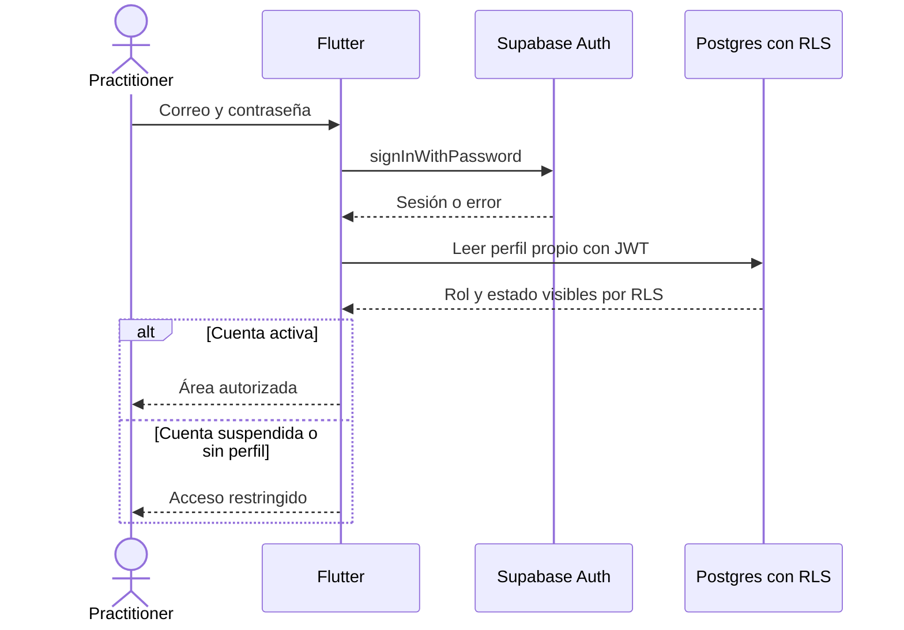

# Flujo de autenticación

## Estado y objetivo

El baseline registra acceso por correo y contraseña, cierre de sesión y recuperación. El objetivo es autenticar una identidad institucional y resolver perfil, membresías, permisos y alcances vigentes, sin convertir el guard de interfaz en autoridad de autorización. La navegación capturada usa estado y rol global del practitioner.

Todo ejemplo, cuenta y prueba descritos aquí usa exclusivamente datos sintéticos.

## Actores

- Practitioner con cuenta precreada.
- Supabase Auth.
- Aplicación Flutter y su guard de navegación.
- Administrador activo, únicamente como creador de cuentas mediante el flujo administrativo.
- Servicio de correo y sistema operativo, para el enlace de recuperación.

## Permisos

- Una persona anónima puede acceder a login y solicitar recuperación, pero no consultar perfiles ni datos clínicos.
- No existe registro público; las cuentas se crean por administración.
- Una cuenta autenticada puede leer su propio perfil.
- En el baseline, una cuenta activa continúa al área permitida por su rol; en el objetivo, elige una membresía activa y la UI deriva capacidades de permisos vigentes.
- Una cuenta suspendida solo ve la pantalla de suspensión y puede cerrar sesión; RLS debe negar acceso administrativo y clínico.
- Solo una sesión en evento de recuperación puede definir una nueva contraseña.

## Precondiciones

- Supabase Auth está disponible y el proveedor email/contraseña está habilitado con registro público deshabilitado.
- La cuenta tiene un perfil `practitioners` con rol y estado válidos.
- El deep link exacto `io.carerrecord.app://login-callback/recover` está configurado en Supabase, Android e iOS.
- El dispositivo dispone de fecha razonable y almacenamiento seguro para la sesión.
- En desarrollo se usan cuentas y correos sintéticos bajo dominios reservados.

## Flujo principal

1. La persona abre la aplicación sin sesión y es dirigida a `/login`.
2. Ingresa correo y contraseña; el correo se normaliza con `trim` y la contraseña no se registra.
3. Flutter llama `signInWithPassword` y espera el cambio de estado de Auth.
4. Con sesión válida, la aplicación consulta por RLS el perfil cuyo `id` coincide con `auth.uid()`.
5. En el baseline, el router deriva a administración para `administrator` o a pacientes para un rol asistencial. En el objetivo, la app selecciona una membresía activa y presenta solo operaciones cuyos permisos puedan evaluarse, sin tratarlos como autoridad.
6. Cada consulta posterior conserva el JWT del usuario; RLS vuelve a evaluar autorización en servidor.
7. Al cerrar sesión, Supabase elimina la sesión y la aplicación vuelve a `/login`; cualquier dato clínico temporal y outbox del usuario se bloquea o purga según su ciclo de vida.

## Flujos alternativos y errores

- Credenciales inválidas: se presenta un mensaje no enumerativo y no se crea sesión.
- Auth o red no disponibles: se conserva el formulario, se permite reintentar y no se simula acceso offline.
- Perfil inexistente: la sesión no concede acceso funcional; se muestra error seguro y se permite cerrar sesión.
- Perfil suspendido: se redirige a `/suspended`; una política RLS deniega datos aunque se intente evitar el router.
- Recuperación: la persona solicita el correo, recibe siempre una respuesta no enumerativa, abre el deep link, Auth emite `passwordRecovery`, define una contraseña válida y `updateUser` finaliza el flujo.
- Deep link expirado, inválido o ya usado: no se permite actualizar contraseña y se ofrece solicitar otro enlace.
- Recuperación abierta con la aplicación cerrada o abierta: ambos escenarios deben llevar a `/update-password`; esta validación manual sigue pendiente en el repositorio.
- Sesión expirada: se intenta la renovación normal del SDK; si no es posible, se purga la vista sensible y se solicita autenticación.
- Cambio de cuenta con outbox local: una cuenta nunca puede ver ni enviar artefactos pertenecientes a otra.

## Estados

| Estado                | Significado                                            | Salida válida                           |
| --------------------- | ------------------------------------------------------ | --------------------------------------- |
| `signed_out`          | No hay sesión                                          | Login o solicitud de recuperación       |
| `authenticating`      | Auth valida credenciales                               | `signed_in` o `auth_error`              |
| `signed_in_resolving` | Existe sesión y se carga perfil                        | `active`, `suspended` o `profile_error` |
| `active`              | Perfil activo                                          | Área autorizada o cierre de sesión      |
| `suspended`           | Perfil suspendido                                      | Solo cierre de sesión                   |
| `recovery_requested`  | Se solicitó correo sin revelar existencia de la cuenta | Espera del deep link                    |
| `password_recovery`   | Auth emitió evento válido de recuperación              | Actualizar contraseña o expirar         |
| `auth_error`          | Falló autenticación, red o renovación                  | Reintento                               |
| `profile_error`       | Sesión válida sin perfil utilizable                    | Reintento controlado o cierre de sesión |

## Datos

- Entrada: correo y contraseña. La contraseña es efímera y nunca se persiste por la aplicación.
- Supabase Auth: usuario, sesión, access token, refresh token y token de recuperación bajo los mecanismos del SDK.
- Baseline de perfil: `id`, `display_name`, `role`, `status`; el objetivo separa perfil, membresías, roles configurables, asignaciones y alcance.
- Deep link: ruta de recuperación sin registrar tokens ni query strings en logs.
- Almacenamiento local: sesión según el SDK y, por separado, artefactos clínicos cifrados ligados al usuario. No se mezclan.

## RLS y auditoría

La política del baseline permite a cada practitioner leer su perfil y a un administrador activo listar perfiles. Las funciones `is_administrator`, `can_read_patients` y `can_read_clinical_events` ejecutan con `security definer`, `search_path` vacío y privilegios revocados para `anon`.

El router aplica experiencia de usuario, pero las políticas de base de datos y validaciones de Edge Functions son la autoridad. Autenticarse no implica autorización clínica: el rol, estado y operación se comprueban en cada límite.

La auditoría de seguridad debe registrar éxito o fallo, usuario cuando sea conocido, timestamp, instalación y motivo normalizado, nunca contraseña, token, URL completa de recuperación ni datos clínicos. Los mensajes públicos no distinguen correo inexistente de existente. El baseline no incorpora una bitácora de autenticación propia; Supabase Auth y la observabilidad futura deben revisarse antes de producción.

## Criterios de aceptación

- Una sesión ausente solo puede navegar a login o recuperación.
- Credenciales válidas resuelven el perfil y dirigen según rol y estado.
- Un administrador activo no obtiene acceso clínico por autenticarse.
- Una cuenta suspendida no lee pacientes, eventos ni otros practitioners y puede cerrar sesión.
- La recuperación funciona con la app cerrada y abierta, usa el deep link exacto y solo permite actualizar durante el evento válido.
- Las respuestas de recuperación no permiten enumerar cuentas.
- El cierre o expiración de sesión elimina contenido sensible de pantalla y evita envíos de una outbox ajena.
- Ningún secreto, contraseña o token aparece en logs o fixtures; toda prueba usa datos sintéticos.

## Pruebas

- Manual: login exitoso y fallido para cada rol, cuenta suspendida, perfil ausente, cierre de sesión y sesión expirada.
- Manual: recuperación con app cerrada, abierta, enlace expirado, enlace reutilizado y contraseña inválida.
- pgTAP: perfil propio permitido; perfiles ajenos denegados a no administradores; administrador suspendido sin elevación; anónimo sin acceso.
- Integración local: `enable_signup = false`, redirect exacto y evento `passwordRecovery` antes de `updateUser`.
- Privacidad: inspección de logs para comprobar ausencia de credenciales, tokens y URL completa.
- Regresión: cambio de cuenta con outbox local pendiente no muestra ni envía datos del usuario anterior.

## Evidencia y referencias

- [`AuthRepository`](../../../app/lib/domains/auth/data/auth_repository.dart#L8-L27) implementa sesión, login, logout, recuperación y actualización de contraseña.
- [`AuthGate`](../../../app/lib/domains/auth/presentation/auth_providers.dart#L22-L43) escucha `onAuthStateChange` y distingue `passwordRecovery`.
- [`app_router.dart`](../../../app/lib/core/router/app_router.dart#L16-L45) protege rutas y separa cuenta activa, suspendida, administrador y rol asistencial.
- [`config.toml`](../../../supabase/config.toml#L18-L30) deshabilita registro público y permite el redirect de recuperación.
- [`auth_administration.sql`](../../../supabase/migrations/20260910010000_auth_administration.sql#L12-L32) define perfil propio y autoridad administrativa por RLS.
- [Control de acceso objetivo](../05-access-control.md#vocabulario-de-seguridad) separa identidad Auth, perfil, membresía, rol, permiso y alcance.
- [Supabase Auth: password-based authentication](https://supabase.com/docs/guides/auth/passwords) documenta `signInWithPassword`, `resetPasswordForEmail`, redirect y actualización de contraseña.
- [Supabase Auth: native mobile deep linking](https://supabase.com/docs/guides/auth/native-mobile-deep-linking) documenta los redirects móviles usados en recuperación.
