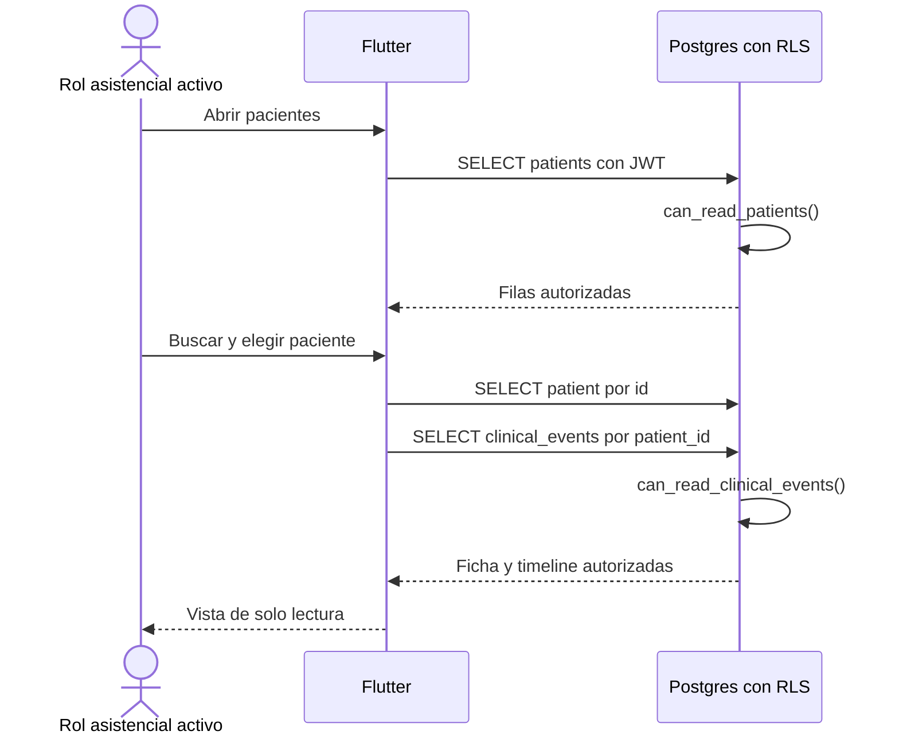

# Flujo de consulta clínica

## Estado y objetivo

El listado, búsqueda local de pacientes, ficha y timeline de eventos están implementados en modo de solo lectura con roles globales. El objetivo mantiene la consulta de solo lectura, pero la centra en hospitalizaciones autorizadas por organización, permiso y alcance, con RLS como autoridad.

El baseline cargaba el listado permitido y filtraba nombre, RUT y unidad en Flutter; la timeline consultaba por `patient_id` y ordenaba por `occurred_at` descendente. Los entornos de desarrollo y pruebas contenían solo datos sintéticos.

## Actores

- Baseline: `physician`, `nurse` o `technician` en estado `active`.
- Objetivo: perfil/membresía activos con permisos clínicos y alcance aplicable.
- Aplicación Flutter.
- PostgREST y Postgres con RLS.
- Administrador, cuenta suspendida, usuario sin perfil o anónimo como actores explícitamente denegados.

## Permisos

- En el baseline, los tres roles asistenciales activos pueden listar y buscar pacientes, abrir una ficha y leer sus eventos.
- En el objetivo, `clinical.census.read`, `clinical.patient.read`, `clinical.timeline.read` y permisos granulares permiten solo hospitalizaciones/unidades dentro del alcance.
- `administrator` no tiene acceso clínico implícito.
- Una cuenta suspendida, sin perfil o anónima no puede leer pacientes ni eventos.
- Ningún rol puede crear, actualizar o eliminar pacientes o eventos en este flujo.
- La búsqueda no amplía el conjunto devuelto por RLS; solo filtra hospitalizaciones y filas ya autorizadas.

## Precondiciones

- Existe una sesión válida; en el objetivo, perfil y membresía están activos y las asignaciones/permisos están vigentes.
- El paciente y sus eventos fueron ingeridos por un proceso autorizado; la app no los crea.
- RLS está habilitado en todas las tablas expuestas; el objetivo deriva acceso al paciente y recursos desde una hospitalización autorizada, no desde `patient_id` aislado.
- El identificador de paciente proviene de una fila visible o se trata como entrada no confiable.
- La zona horaria de presentación debe implementar la decisión UTC + zona IANA antes de considerar finalizada la experiencia; el baseline no lo hacía.

## Flujo principal

1. El practitioner elige una organización/membresía activa y abre el censo.
2. En el objetivo, Flutter consulta hospitalizaciones bajo `clinical.census.read`; el baseline solicitaba directamente las columnas necesarias de `patients`.
3. Postgres evalúa membresía, permiso y alcance objetivo; el baseline todavía usa `can_read_patients()`.
4. La persona filtra por nombre o RUT y opcionalmente por unidad; en el baseline, el filtro ocurría localmente sobre el conjunto autorizado.
5. La lista muestra nombre, ubicación y RUT enmascarado.
6. La persona abre la hospitalización; cada consulta de demografía o recurso vuelve a evaluar alcance.
7. Flutter solicita `clinical_events` con `hospitalization_id` y orden descendente; el baseline todavía filtra por `patient_id`.
8. Postgres exige `clinical.timeline.read` y alcance; el baseline evalúa `can_read_clinical_events()`.
9. Si se abre Información del paciente, se muestran los campos autorizados de la ficha, incluido el RUT completo solo en esa vista deliberada.

## Flujos alternativos y errores

- Sin resultados: se muestra un estado vacío sin inferir si existen pacientes fuera del alcance.
- UUID inexistente o fila oculta por RLS: se presenta “Paciente no encontrado” sin distinguir ambas causas.
- Sesión expirada o cuenta suspendida: se retira el contenido visible y se dirige al flujo de autenticación o suspensión.
- Error de red/servidor: se conserva una pantalla segura, se permite reintentar y no se presenta información parcial como vigente.
- Error al cargar eventos con ficha visible: la ficha puede mostrarse con un estado de error independiente para la timeline, sin fabricar eventos.
- RUT ausente o inválido: se muestra “No registrado” o una máscara segura; no se reconstruye.
- Dataset mayor al límite de PostgREST: la futura paginación debe mantener RLS y búsqueda del lado servidor. El baseline no paginaba y su configuración local limitaba respuestas a 1000 filas.
- Filtro temporal o zona horaria: hasta definir conversión, no se deben usar rótulos relativos como evidencia clínica exacta.
- Sin conexión: no se promete consulta offline. Solo podría mostrarse un caché clínico si una política futura define cifrado, expiración, invalidación y cierre de sesión.

## Estados

| Estado           | Descripción                         | Transición                                |
| ---------------- | ----------------------------------- | ----------------------------------------- |
| `loading`        | Se solicita lista, ficha o timeline | `ready`, `empty`, `not_found` o `error`   |
| `ready`          | Datos autorizados visibles          | Filtrar, abrir detalle, refrescar o salir |
| `empty`          | Consulta autorizada sin filas       | Cambiar filtro o refrescar                |
| `not_found`      | UUID inexistente o no visible       | Volver al listado                         |
| `error`          | Fallo de red, Auth o servidor       | Reintentar o cerrar sesión                |
| `access_revoked` | Rol/estado ya no permite acceso     | Retirar datos y redirigir                 |

Los estados pertenecen a la presentación; no se persisten como estado clínico.

## Datos

- Baseline: paciente con `id`, `external_reference`, `rut`, nombres, fecha de nacimiento, unidad y cama.
- Objetivo: organización, hospitalización, ubicación vigente e identidad/demografía mínima separadas; unidad/cama no pertenecen al paciente.
- Lista: usa RUT enmascarado mediante una regla de dominio; la búsqueda normaliza nombre y RUT localmente.
- Evento: `id`, `patient_id`, `recorded_by`, `kind`, `occurred_at`, `payload.summary`, `created_at`.
- Filtros del baseline: texto, unidad y categorías derivadas de `kind`.
- No se incluyen contraseñas, tokens Auth, audio, mapas NER ni contenido de outbox en consultas clínicas.
- Logs y auditoría identifican recursos mediante UUID y metadatos mínimos; no copian `payload.summary` ni RUT.

## RLS y auditoría

En el baseline, `can_read_patients()` exige perfil activo con rol `physician`, `nurse` o `technician`, y `can_read_clinical_events()` delega en ese criterio. El objetivo exige membresía, permiso y alcance sobre la hospitalización. La autoridad IAM no hereda acceso clínico. La fotografía no contiene policies de escritura clínica, y sus pruebas verifican que las mutaciones no cambian filas.

La aplicación selecciona columnas explícitas para pacientes, pero el repositorio de eventos usa `select()`; al evolucionar el schema debe adoptar selección explícita para minimizar exposición y evitar acoplamiento accidental.

La auditoría de lectura clínica no está implementada en el repositorio. Antes de producción se debe decidir qué consultas requieren evento auditado, retención y acceso a esa bitácora. Si se incorpora, registra actor, paciente, tipo de vista, timestamp y resultado, nunca el texto de eventos ni identificadores personales en claro.

## Criterios de aceptación

- El baseline conserva lectura por rol; el objetivo lista hospitalizaciones y abre fichas/timelines solo con permisos y alcance vigentes.
- Administradores, suspendidos, usuarios sin perfil y anónimos reciben cero filas o denegación en API directa.
- La lista enmascara RUT y la vista completa solo lo revela en el detalle deliberado.
- Buscar o manipular un UUID no permite detectar ni abrir una fila oculta.
- La timeline se ordena por `occurred_at` descendente y sus filtros no alteran datos.
- Insert, update y delete clínicos permanecen denegados en este flujo.
- Errores, vacíos y revocación retiran datos sin filtrar contenido a logs.
- Toda demostración y prueba usa pacientes y eventos sintéticos.

## Pruebas

- pgTAP: baseline por rol y objetivo por tenant, membresía, permiso, vigencia, unidad/hospitalización cubierta y ajena.
- pgTAP: insert, update y delete denegados y filas sin cambios después del intento.
- Unit test de dominio: búsqueda por nombre/RUT y enmascaramiento de RUT, por ser reglas de privacidad observables.
- Manual: estados loading, vacío, no encontrado, error de red, sesión expirada y suspensión durante una sesión.
- Manual: orden y filtros de timeline, campos de ficha y navegación directa con UUID sintético no visible.
- Escala: comprobar límite y paginación antes de usar datasets que puedan superar `max_rows`.
- Privacidad: inspeccionar logs y errores para confirmar ausencia de RUT completo y `payload.summary`.

## Evidencia y referencias

- [`PatientRepository`](../../../app/lib/domains/patient/data/patient_repository.dart#L9-L29) selecciona columnas y consulta lista/detalle.
- [`Patient`](../../../app/lib/domains/patient/domain/entities/patient.dart#L22-L71) implementa búsqueda normalizada, máscara de RUT y ubicación.
- [`PatientsScreen`](../../../app/lib/domains/patient/presentation/patient_screens.dart#L23-L186) filtra localmente el conjunto y presenta estados; la timeline se encuentra en el mismo archivo.
- [`ClinicalEventRepository`](../../../app/lib/domains/clinical_event/data/clinical_event_repository.dart#L10-L17) consulta por paciente y ordena por fecha descendente.
- [`patient_read_access.sql`](../../../supabase/migrations/20260910100000_patient_read_access.sql#L3-L23) y [`clinical_timeline.sql`](../../../supabase/migrations/20260910110000_clinical_timeline.sql#L53-L68) definen la lectura clínica por RLS.
- [`patients_rls.test.sql`](../../../supabase/tests/patients_rls.test.sql#L29-L169) cubre casos permitidos, denegados y solo lectura.
- [Arquitectura objetivo](../04-target-architecture.md#consulta-de-pacientes-hospitalizados) define la consulta centrada en hospitalización y el timeline como read model.
- [Supabase: Row Level Security](https://supabase.com/docs/guides/database/postgres/row-level-security) documenta autorización por fila dentro de Postgres.
- [Supabase Dart: filtros](https://supabase.com/docs/reference/dart/using-filters) documenta que los filtros se agregan a la consulta; no sustituyen RLS.
