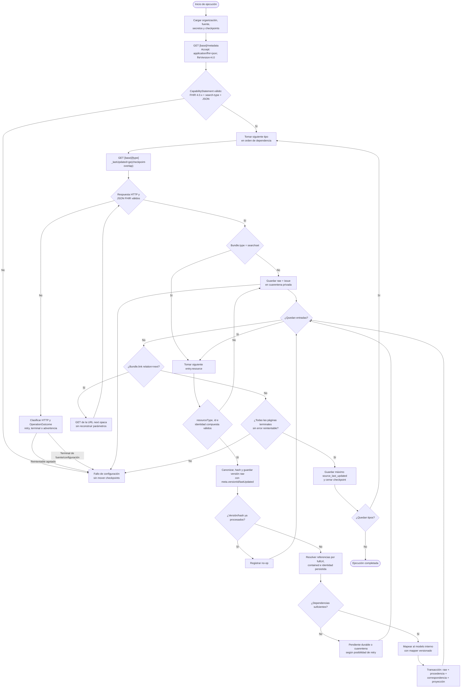

# Flujo de ingesta FHIR R4

## 1. Objetivo

Este flujo operacionaliza la decisión de [Integración FHIR R4](../06-fhir-integration.md). Describe una importación de solo lectura desde una FCE simulada con datos sintéticos hacia el modelo interno. No describe funcionalidad ya presente: `scripts/data_pipeline/main.py:1-15` es todavía un scaffold y no contiene cliente, parser ni persistencia FHIR.

El flujo acepta los recursos de dominio `Organization`, `Patient`, `Encounter`, `Location`, `Condition`, `Observation`, `AllergyIntolerance` y `MedicationRequest`; usa `CapabilityStatement`, `Bundle` y `OperationOutcome` como infraestructura. La lista es cerrada para la demo. Un tipo distinto se cuenta como no soportado y no se proyecta.

Este flujo es el diseño objetivo de ingesta. La lectura directa de la demo (ADR-019) no implementa ninguno de sus estados: ver la sección 19.

## 2. Precondiciones

Antes de una ejecución deben existir:

- una organización interna estable;
- una fuente registrada con identificador inmutable, base URL permitida y versión esperada `4.0.x`;
- credenciales de solo lectura en secretos de ejecución, si la FCE simulada las exige;
- política de timeout, páginas, reintentos, solapamiento y retención;
- reglas por fuente para sistemas de identificadores, perfiles y terminologías;
- almacenamiento privado para raw, issues y cuarentena;
- mappers versionados y migraciones internas compatibles;
- checkpoint independiente para cada tipo seleccionado.

La fuente nunca entrega directamente el `organization` interno. La asociación entre tenant y fuente es configuración confiable. Un `Organization` FHIR describe una entidad externa y puede vincularse a esa asociación, pero no tiene autoridad para cambiar tenancy, RLS o permisos.

## 3. Estados de una ejecución

| Estado          | Significado                                            | Salida permitida                                       |
| --------------- | ------------------------------------------------------ | ------------------------------------------------------ |
| `discovering`   | Se consulta y valida metadata.                         | Snapshot privado de `CapabilityStatement`.             |
| `fetching`      | Se buscan recursos y siguen páginas.                   | Bundles y métricas por página.                         |
| `staging`       | Se valida identidad y se guarda raw.                   | Versión raw o cuarentena durable.                      |
| `resolving`     | Se resuelven referencias y dependencias.               | Grafo local de correspondencias o pendiente explícito. |
| `projecting`    | Se traduce al modelo interno.                          | Paciente/evento/ubicación y linaje.                    |
| `committing`    | Se confirma la unidad transaccional.                   | Resultado tipado por entrada.                          |
| `checkpointing` | Se cierra el tipo después de todas sus páginas.        | Watermark nuevo.                                       |
| `completed`     | Todos los tipos finalizaron según política.            | Resumen de ejecución sin datos clínicos.               |
| `failed`        | Un error terminal o reintentable impide cierre seguro. | Diagnóstico redacted y checkpoint anterior intacto.    |

Los resultados por entrada son `projected`, `noop`, `quarantined` y `retryable_error`. Solo los tres primeros son terminales para una página; `retryable_error` aborta el cierre del tipo.

## 4. Flujo principal



## 5. Orden de adquisición

El orden reduce referencias pendientes, aunque la corrección no depende de que el servidor entregue recursos ordenados:

1. `Organization`
2. `Location`
3. `Patient`
4. `Encounter`
5. `Condition`
6. `Observation`
7. `AllergyIntolerance`
8. `MedicationRequest`

`Location` puede referenciar `Organization` y otra `Location`; `Patient` puede referenciar `Organization`; `Encounter` enlaza paciente, organización y ubicaciones; los restantes suelen enlazar paciente y encuentro. Los ciclos o referencias aún no disponibles se guardan como pendientes. No se descarta un recurso solo porque la referencia llegue en otra página o ejecución.

El antecedente procesaba primero pacientes dentro de un bundle y luego recursos clínicos (`../carer-record/backend/app/fhir/fhir_adapter.py:280-380`), pero omitía silenciosamente un recurso si no encontraba al paciente. El nuevo flujo desacopla adquisición y resolución mediante raw durable.

## 6. Descubrimiento de capacidades

La primera solicitud de cada ejecución o de una ventana de caché es:

```http
GET [base]/metadata
Accept: application/fhir+json; fhirVersion=4.0
```

El cliente valida:

- `resourceType == CapabilityStatement`;
- `fhirVersion` compatible con R4 4.0.x;
- formato JSON FHIR;
- modo REST de servidor;
- cada tipo requerido y su interacción `search-type`;
- parámetros `_lastUpdated` y `_count`, y `_sort` si se pretende usar;
- política de versionado por tipo (`no-version`, `versioned` o `versioned-update`);
- perfiles soportados que condicionen el mapper;
- límites o documentación de paginación disponible.

Una fuente puede omitir un recurso seleccionado. La demo falla tempranamente si falta uno exigido por su fixture; una futura operación real podría desactivar selectivamente tipos mediante configuración revisada. Nunca se reemplaza el descubrimiento por booleanos asumidos como hace `../carer-record/backend/config/clinics/carer-record.json:9-12`.

El snapshot de `CapabilityStatement` se guarda con hash y fecha. Un cambio de capacidades genera advertencia y exige revalidar compatibilidad antes de proyectar.

Referencia oficial: [CapabilityStatement](https://hl7.org/fhir/R4/capabilitystatement.html) y [interacción capabilities](https://hl7.org/fhir/R4/http.html#capabilities).

## 7. Construcción de la búsqueda

### 7.1 Carga inicial

Sin checkpoint se solicita cada tipo con un tamaño de página conservador:

```http
GET [base]/Observation?_count=50&_sort=_lastUpdated
```

`_count` es una solicitud de máximo, no una garantía del número devuelto. `Bundle.total` es informativo y no controla el loop. La terminación depende de la ausencia de un enlace `next`.

### 7.2 Carga incremental

Con checkpoint:

```http
GET [base]/Observation?_count=50&_sort=_lastUpdated&_lastUpdated=ge2026-09-27T11:55:00Z
```

La fecha corresponde a `watermark - overlap`, no al reloj de inicio. Se prefiere `ge` y un solapamiento porque varios recursos pueden compartir timestamp, un servidor puede hacer visibles cambios con retraso y una ejecución puede repetirse. La deduplicación absorbe la relectura.

No se presupone soporte para ordenar por `_id` ni estabilidad fuera de las URLs emitidas por el servidor. Si el `CapabilityStatement` no documenta `_sort`, se omite y se mantiene el mismo esquema de solapamiento. El máximo observado se calcula al procesar las entradas, independientemente del orden.

La especificación oficial de búsqueda está en [FHIR R4 Search](https://hl7.org/fhir/R4/search.html), incluidas `_count`, `_sort`, `_lastUpdated` y paginación.

## 8. Procesamiento de Bundle

Una respuesta de búsqueda válida debe ser un `Bundle` con `type=searchset`. Por página se conserva:

- URL de solicitud sanitizada;
- `Bundle.id`, `timestamp`, `total` si existen;
- índice y `fullUrl` de cada entrada;
- enlaces `self` y `next`;
- fecha de recuperación y hash de respuesta según política de retención.

Cada `entry.resource` se valida independientemente. `entry.search.mode=include` no transforma un recurso incluido en resultado principal; ambos pueden alimentar resolución, pero solo los tipos seleccionados se proyectan. Un `entry.response` pertenece normalmente a batch/transaction y no se espera en `searchset`.

La siguiente página se obtiene de la URL exacta cuyo `relation` sea `next`. Esa URL se trata como opaca: puede contener un token de servidor y no debe mezclarse con los parámetros originales. Antes de seguirla se verifica esquema HTTPS o local permitido, host y prefijo contra la fuente registrada.

Referencias oficiales: [Bundle](https://hl7.org/fhir/R4/bundle.html) y [paginación de búsqueda](https://hl7.org/fhir/R4/http.html#paging).

## 9. Identidad, versión e idempotencia

### 9.1 Identidad

La búsqueda de correspondencia usa exclusivamente:

```text
(organization, data_source, resource_type, external_id)
```

`external_id` es `Resource.id`. `Bundle.entry.fullUrl` ayuda a resolver referencias, pero no reemplaza la identidad persistente. `Identifier` es identidad de negocio y puede cambiar o repetirse entre sistemas; se conserva completo y solo participa en conciliación con reglas explícitas.

### 9.2 Decisión de versión

| Estado local                               | Entrada                          | Acción                                                     |
| ------------------------------------------ | -------------------------------- | ---------------------------------------------------------- |
| No existe identidad                        | Cualquier versión válida         | Insertar raw, correspondencia y proyección.                |
| Existe mismo `versionId` y mismo hash      | Repetida                         | `noop`; actualizar solo telemetría de “vista nuevamente”.  |
| Existe mismo `versionId` y hash distinto   | Fuente inconsistente             | Cuarentena de integridad; no reemplazar proyección.        |
| Existe `versionId` distinto                | Nueva revisión                   | Insertar versión raw y reproyectar atómicamente.           |
| Servidor `no-version`, mismo hash          | Repetida                         | `noop`.                                                    |
| Servidor `no-version`, hash distinto       | Cambio observable                | Insertar revisión local; comparar `lastUpdated` si existe. |
| `lastUpdated` anterior a la versión actual | Posible versión tardía/histórica | Guardar raw; no hacerla current sin regla verificable.     |

El hash se calcula sobre JSON canónico, no sobre bytes con whitespace arbitrario. La versión del algoritmo de canonización se registra. No se usa orden numérico para `versionId`, porque FHIR lo define como opaco.

### 9.3 Unidad transaccional

Para cada entrada, una transacción local contiene:

1. versión raw;
2. metadata y procedencia;
3. correspondencia externa;
4. referencias resueltas o pendientes;
5. proyección interna;
6. vínculo exacto entre versión fuente y versión de mapper/proyección;
7. resultado terminal.

Una restricción única hace que dos workers concurrentes converjan. Tras un conflicto de unicidad, el worker vuelve a leer y aplica la tabla anterior; no asume que el otro resultado fue equivalente.

## 10. Resolución de referencias

El resolutor consulta en este orden:

1. fragmento `#id` dentro de `contained` del recurso actual;
2. coincidencia exacta de `Reference.reference` con `Bundle.entry.fullUrl`;
3. referencia relativa `ResourceType/id` en la misma fuente;
4. referencia versionada `ResourceType/id/_history/version`;
5. URL absoluta cuya base pertenezca a la fuente registrada;
6. correspondencia por `Reference.identifier` solo si existe una regla específica y no ambigua.

Una referencia con solo `display` no se considera resuelta. No se extrae el último segmento como en `../carer-record/backend/app/fhir/fhir_adapter.py:112-120`, porque eso confunde bases, tipos, historia y URNs.

Las dependencias obligatorias para proyección son:

- `Patient`: ninguna referencia clínica obligatoria para crear la correspondencia; `managingOrganization` puede quedar pendiente.
- `Encounter`: paciente resuelto; ubicaciones y organización pueden completarse posteriormente sin inventar texto estructurado.
- `Condition`, `Observation`, `AllergyIntolerance` y `MedicationRequest`: paciente resuelto; encuentro opcional si el recurso lo declara y aún no llegó.
- `Location`: jerarquía `partOf` puede resolverse diferidamente.

Una referencia a paciente desconocido nunca se ignora. Se clasifica como pendiente reintentable si el paciente puede llegar en la misma ejecución; al cerrar todos los tipos, se cuarentena con causa `unresolved-subject` si sigue ausente.

## 11. Mapeo y proyección

El mapper recibe un recurso raw inmutable y un contexto de referencias. Produce un resultado tipado con:

- campos normalizados;
- resumen clínico sintético derivado de elementos estructurados;
- advertencias de pérdida o elementos no soportados;
- fecha clínica (`occurred_at`) y su regla de precedencia;
- clase interna;
- versión del mapper.

No modifica el raw y no escribe directo desde helpers. La persistencia ocurre después de validar el resultado completo.

Reglas temporales iniciales:

| Recurso              | Precedencia para `occurred_at`                                       | Si falta                                                  |
| -------------------- | -------------------------------------------------------------------- | --------------------------------------------------------- |
| `Encounter`          | `period.start`, luego `meta.lastUpdated`                             | Cuarentena si no existe ninguna fecha utilizable.         |
| `Condition`          | `recordedDate`, luego inicio de `onset[x]`, luego `meta.lastUpdated` | Marcar fecha técnica; no presentarla como inicio clínico. |
| `Observation`        | `effective[x]`, luego `issued`, luego `meta.lastUpdated`             | Cuarentena para timeline si no existe fecha.              |
| `AllergyIntolerance` | `recordedDate`, luego `onset[x]`, luego `meta.lastUpdated`           | Marcar fecha técnica y origen.                            |
| `MedicationRequest`  | `authoredOn`, luego `meta.lastUpdated`                               | Cuarentena para timeline si no existe fecha.              |

`Organization`, `Patient` y `Location` actualizan proyecciones maestras/correspondencias, no necesariamente un evento de timeline. `Encounter`, `Condition`, `Observation`, `AllergyIntolerance` y `MedicationRequest` producen eventos propios. El enum actual solo incluye `observation`, `encounter`, `condition`, `procedure` y `document` (`supabase/migrations/20260910000000_initial_clinical_schema.sql:4-5`); por ello, alergias y solicitudes de medicamento requieren una evolución aditiva del modelo antes de implementar el pipeline. No deben etiquetarse falsamente como otro tipo para evitar una migración.

## 12. Checkpoint

El checkpoint se bloquea por `(organization, data_source, resource_type)` durante una ejecución. El algoritmo es:

```text
previous = load_checkpoint(scope)
query_since = previous.watermark - overlap
max_seen = previous.watermark

for page in search_all_pages(query_since):
    for entry in page:
        result = process_idempotently(entry)
        if result == retryable_error:
            abort_without_checkpoint()
        if entry.meta.lastUpdated exists:
            max_seen = max(max_seen, entry.meta.lastUpdated)

persist_checkpoint(max_seen, completed_run)
```

Una entrada inválida conocida puede permitir avanzar solo si raw, identidad disponible, error y causa quedan durablemente en cuarentena. Un fallo de red, timeout, rate limit, indisponibilidad de base o conflicto no clasificado no permite avanzar.

No se reconstruye el checkpoint desde `imported_at` local. Ese patrón del antecedente (`../carer-record/backend/app/sync/sync_service.py:169-209`) mezcla la hora de procesamiento con la hora de actualización en la fuente. Tampoco se fija al `now()` tomado antes de buscar (`../carer-record/backend/app/sync/sync_service.py:925-935`), porque el desfase de relojes y la visibilidad tardía pueden perder recursos.

Se recomienda un solapamiento inicial de cinco minutos para la demo, configurable y validado mediante pruebas. No es una garantía universal: una fuente real requiere caracterizar retrasos y semántica de `_lastUpdated`.

## 13. Errores y reintentos

### 13.1 Taxonomía

| Categoría                   | Ejemplos                                                              | Acción                                                     | Checkpoint                                |
| --------------------------- | --------------------------------------------------------------------- | ---------------------------------------------------------- | ----------------------------------------- |
| Transporte transitorio      | timeout, reset, DNS temporal                                          | Reintento exponencial con jitter.                          | No avanza si se agota.                    |
| HTTP transitorio            | `408`, `429`, `502`, `503`, `504`                                     | Respetar `Retry-After`, limitar intentos.                  | No avanza si se agota.                    |
| Autenticación/autorización  | `401`, `403`                                                          | Fallo terminal de configuración; no reintentar ciegamente. | No avanza.                                |
| Endpoint/capacidad          | `404` metadata, tipo ausente, versión distinta                        | Deshabilitar fuente y alertar.                             | No avanza.                                |
| FHIR de solicitud           | `400`, búsqueda no soportada                                          | Leer `OperationOutcome`, corregir contrato/configuración.  | No avanza.                                |
| Payload inválido            | JSON roto, no es `Bundle`, `resourceType` incoherente                 | Conservar respuesta privada y fallar página.               | No avanza.                                |
| Recurso inválido permanente | falta `id`, cardinalidad usada inválida, modifier desconocido crítico | Cuarentena durable.                                        | Puede avanzar tras persistir causa.       |
| Referencia pendiente        | sujeto aún no cargado                                                 | Reintento al final de la ejecución.                        | No cierra hasta resolver o cuarentenarla. |
| Integridad                  | mismo `versionId`, hash distinto                                      | Cuarentena y alerta alta.                                  | Política conservadora: no avanza.         |
| Persistencia                | conexión, deadlock, restricción inesperada                            | Rollback y reintento acotado.                              | No avanza.                                |
| Mapper                      | excepción o variante no soportada                                     | Rollback; cuarentena con versión del mapper.               | Puede avanzar si es permanente y durable. |

### 13.2 OperationOutcome

Cuando el cuerpo sea `OperationOutcome`, se recorren todos los `issue` y se conserva:

- `severity`;
- `code`;
- `details.coding` y `details.text`;
- `diagnostics` en almacenamiento privado;
- `expression` como ubicación preferida;
- `location` solo por compatibilidad, pues está deprecado en R4.

El status HTTP gobierna la categoría primaria; `OperationOutcome` agrega detalle. Una respuesta exitosa también puede traer advertencias. El pipeline no asume que todo `4xx` o `5xx` tendrá `OperationOutcome`, porque la infraestructura HTTP intermedia puede producir otro cuerpo.

Referencia oficial: [OperationOutcome](https://hl7.org/fhir/R4/operationoutcome.html) y [códigos/error REST](https://hl7.org/fhir/R4/http.html#Status-Codes).

### 13.3 Política de retry de la demo

- Timeout de conexión y lectura explícitos.
- Máximo de cuatro intentos por solicitud.
- Backoff exponencial acotado con jitter.
- `Retry-After` prevalece para `429`/`503` dentro del máximo configurado.
- Sin retry automático para `400`, `401`, `403`, `404`, `405`, `409`, `412` o `422`, salvo clasificación específica documentada.
- Presupuesto total por ejecución para evitar loops permanentes.
- Circuit breaker por fuente después de fallos consecutivos.

## 14. Observabilidad sin exposición

Métricas con etiquetas de baja cardinalidad:

- duración por fuente y tipo;
- páginas y entradas recibidas;
- versiones nuevas, no-op, cuarentenas y errores;
- latencia HTTP por status;
- retries y `Retry-After`;
- referencias pendientes;
- antigüedad del checkpoint;
- diferencia entre `retrieved_at` y `source_last_updated`;
- versión de mapper y cantidad reproyectada.

Los logs estructurados incluyen `run_id`, ID interno de fuente, tipo, status, categoría de error y correlación. No incluyen payload, nombres, identificadores de negocio, RUT, valores clínicos, `diagnostics`, token, encabezado `Authorization` ni URL con query completa.

## 15. Recuperación y reproceso

### 15.1 Reinicio después de fallo

El checkpoint anterior permanece. La siguiente ejecución repite desde el solapamiento; las restricciones únicas y hashes convierten lo ya confirmado en no-op. No se intenta reanudar una URL `next` antigua porque los tokens de paginación pueden expirar.

### 15.2 Nueva versión de mapper

El reproceso lee raw privado por versión y ejecuta el mapper nuevo sin llamar la FCE. Produce una nueva revisión de proyección y conserva el vínculo con la anterior. El checkpoint de adquisición no cambia, porque reproyectar no equivale a volver a ingerir.

### 15.3 Cuarentena

Una entrada en cuarentena conserva raw, identidad si existe, hash, metadatos, fuente, ejecución, clasificación, mensaje seguro y versión de mapper. Un operador puede:

- marcarla como descartada con justificación;
- reintentar tras corregir configuración o mapper;
- vincular una referencia ambigua mediante un proceso auditado;
- eliminarla conforme a retención.

No se edita el raw para “hacerlo válido”. Una corrección local se representa como nueva decisión/proyección con trazabilidad.

## 16. Ausencia de write-back

El cliente HTTP del pipeline aplica una allowlist de métodos `GET` y rutas de metadata/búsqueda/lectura. Aunque `CapabilityStatement` anuncie `create`, `update`, `patch`, `delete`, batch o transaction, el pipeline los ignora. Tampoco usa búsquedas por `POST` en la demo.

La proyección interna puede cambiar por reproceso, pero nunca origina un recurso que se devuelva a la FCE. Los estados, notas o resúmenes creados por Carer Record pertenecen a la plataforma propia. Esta separación coincide con la intención anterior de que los datos hospitalarios fueran inicialmente de solo lectura (`../carer-record/README.md:177-196`) y con ADR-004.

## 17. Escenarios de verificación

| Escenario sintético                              | Resultado esperado                                                                |
| ------------------------------------------------ | --------------------------------------------------------------------------------- |
| `CapabilityStatement.fhirVersion=5.0.0`          | Falla descubrimiento; cero recursos proyectados.                                  |
| Dos fuentes emiten `Patient/123`                 | Dos correspondencias distintas por `data_source`; no colisionan.                  |
| Dos tipos emiten ID `123`                        | Identidades distintas por `resource_type`.                                        |
| Segunda ejecución sin cambios                    | Todos los recursos son no-op; no crece la proyección.                             |
| Mismo recurso con `versionId=2`                  | Nueva versión raw y proyección actualizada atómicamente.                          |
| Mismo `versionId` con contenido distinto         | Cuarentena de integridad; proyección anterior intacta.                            |
| Dos recursos comparten `lastUpdated` en el borde | Ambos reaparecen por `ge` + overlap y convergen por idempotencia.                 |
| Timeout en página 2                              | No avanza checkpoint; reejecución segura desde el watermark anterior.             |
| `Bundle.link[next]` incluye token                | Se sigue URL exacta una vez validado el host.                                     |
| `Observation.valueCodeableConcept`               | Se mapea si está soportado o se cuarentena; jamás se convierte en cantidad vacía. |
| `Observation.dataAbsentReason`                   | Se presenta ausencia con causa, no valor cero.                                    |
| `AllergyIntolerance` con dos reacciones          | Se conservan ambas y sus manifestaciones.                                         |
| `MedicationRequest.medicationReference` externo  | Queda pendiente/cuarentena según resolución; no se inventa medicamento.           |
| Referencia absoluta a host diferente             | Se rechaza como referencia externa no autorizada.                                 |
| `OperationOutcome` con PHI en `diagnostics`      | Se almacena privado; el log solo contiene severidad/código/correlación.           |
| Intento de `POST` desde el cliente               | Bloqueado por allowlist y registrado como defecto de programación.                |

## 18. Fuentes oficiales

- [FHIR R4 RESTful API](https://hl7.org/fhir/R4/http.html)
- [FHIR R4 Search](https://hl7.org/fhir/R4/search.html)
- [FHIR R4 CapabilityStatement](https://hl7.org/fhir/R4/capabilitystatement.html)
- [FHIR R4 Bundle](https://hl7.org/fhir/R4/bundle.html)
- [FHIR R4 OperationOutcome](https://hl7.org/fhir/R4/operationoutcome.html)
- [FHIR R4 Resource metadata](https://hl7.org/fhir/R4/resource.html#metadata)
- [FHIR R4 References](https://hl7.org/fhir/R4/references.html)
- [FHIR R4 Provenance](https://hl7.org/fhir/R4/provenance.html)

## 19. Relación con la lectura directa de la demo (ADR-019)

Desde 2026-10-21 la app puede leer un servidor FHIR directamente para listar pacientes y mostrar su ficha (sección 15 de [Integración FHIR R4](../06-fhir-integration.md)). Esa ruta **no es** una ejecución de este flujo:

- No descubre capacidades, no registra fuente ni checkpoints y no conserva raw, hash ni procedencia.
- No tiene resultado `projected`, `noop` ni `quarantined`: lo que no sabe mostrar, lo ignora.
- No es idempotente por identidad compuesta; la repetición solo vuelve a leer.

El script `scripts/fhir-sync/generate-sync.mjs` copia a Supabase local, solo en desarrollo, el paciente, la hospitalización, la ubicación y las asignaciones de demostración de cada paciente FHIR. Es idempotente por UUID derivado del id de FHIR, no por la tupla `(organization, data_source, resource_type, external_id)`. Cuando se implemente este flujo, el script y la convención `external_reference = FHIR-<id>` deben reemplazarse por la capa de correspondencias y la proyección definidas aquí.
