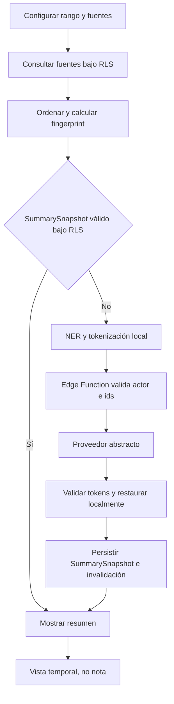

# Flujo de resumen de periodo

## Estado y objetivo

Este flujo es un contrato objetivo; `clinical-summary` aún responde `501`. Su objetivo es generar una vista sintetizada de fuentes clínicas autorizadas dentro de un intervalo temporal configurable. El resultado sirve para consulta, tiene caché invalidable y nunca se publica como nota ni se agrega a la timeline.

La síntesis sigue el mismo límite de privacidad: selección autorizada en el contexto del usuario, NER/tokenización local, proveedor cloud abstracto y restauración local. Solo se emplean fuentes sintéticas en desarrollo, evaluación y pruebas.

## Actores

- Perfil con membresía activa y permisos de lectura sobre todas las fuentes solicitadas.
- Aplicación Flutter, NER local y outbox local cifrada.
- Postgres con RLS como origen de pacientes, eventos y notas publicadas.
- Edge Function `clinical-summary` y `SynthesisProvider` abstracto.
- Administrador, suspendido, perfil ausente o anónimo como actores denegados.

## Permisos

- Una membresía activa puede solicitar y ver un resumen solo de hospitalizaciones y fuentes cubiertas por sus permisos y alcance.
- Una autoridad IAM no obtiene acceso clínico por invocar la Edge Function.
- La función no usa Service Role para ampliar o completar fuentes ocultas.
- El resumen no puede publicarse, confirmarse como nota ni convertirse automáticamente en evento.
- Un `SummarySnapshot` se protege con la misma organización, hospitalización, permisos y RLS que sus fuentes; una réplica local nunca amplía esa autoridad.

## Precondiciones

- Sesión válida, perfil/membresía activos y hospitalización visible dentro del alcance.
- Intervalo válido y explícito, con zona horaria y semántica de límites definidas.
- Tipos de fuente y filtros seleccionados pertenecen a una configuración permitida.
- La app obtiene las fuentes por consultas RLS; el servidor verifica el conjunto y calcula/valida un fingerprint reproducible sin confiar en el cliente.
- NER local, tokenización reversible, Edge Function y proveedor están disponibles, o existe una entrada de caché todavía válida.
- El guard de procedencia acredita que todas las fuentes son sintéticas; el prototipo no envía datos reales o de origen desconocido al cloud.
- Límites de cantidad/tamaño evitan prompts incompletos o costos no acotados.

## Flujo principal

1. El usuario abre el resumen del paciente y elige rango, zona horaria, tipos de evento/fuente y opciones permitidas.
2. La app normaliza el intervalo a `[desde, hasta)` en UTC y consulta bajo RLS solo fuentes cuyo `occurred_at` cae en el rango.
3. La app verifica completitud/paginación y ordena las fuentes de manera determinista; el backend valida ids/versiones y obtiene el `source_fingerprint` autoritativo.
4. Se calcula una clave de caché con organización, hospitalización/paciente, rango, configuración, fingerprint y versiones de pipeline, prompt, modelo y proveedor.
5. Si RLS permite un `SummarySnapshot` exacto y no expirado, se devuelve como cache hit sin llamar al proveedor.
6. Si no, NER local tokeniza las fuentes y conserva el mapa dentro del dispositivo.
7. La app llama `clinical-summary` con JWT, ids de fuentes, configuración, inventario de tokens, idempotency key y contenido tokenizado.
8. La Edge Function valida perfil/membresía, permisos, alcance, visibilidad de todos los ids, procedencia sintética, rango, límites y contrato; luego invoca el proveedor abstracto.
9. La app valida tokens y restaura entidades localmente; luego persiste mediante una operación idempotente un `SummarySnapshot` inmutable y restaurado bajo RLS. El mapa no se persiste y se purga.
10. La UI presenta rango, configuración, fuentes incluidas, fecha de generación y advertencia de síntesis. No ofrece “Publicar como nota”.

## Flujos alternativos y errores

- Rango vacío: se muestra “Sin fuentes en el periodo” y no se llama al proveedor.
- Rango inválido, futuro no permitido o demasiado amplio: validación local y servidor rechazan con error corregible.
- Fuente solicitada no visible: la Edge Function rechaza toda la operación; no resume un subconjunto silencioso.
- Respuesta paginada incompleta: no se genera hasta obtener todas las páginas o aplicar un límite visible y aceptado.
- Sin conexión: una réplica local solo puede mostrarse si una política explícita garantiza sesión, cifrado, expiración e invalidación; por defecto se encola la solicitud tokenizada si el snapshot de fuentes está completo, y sin fuentes completas no se genera.
- Cambia una fuente, aparece una nueva dentro del rango, cambia configuración, rol, estado, prompt o modelo: se invalida la entrada y se regenera bajo autorización vigente.
- Timeout, `429` o `5xx`: outbox local y reintento con backoff/idempotencia; el último resumen válido puede mostrarse marcado con su fecha si todavía es autorizado.
- Token alterado: se rechaza el resultado y no se actualiza caché.
- Suspensión, revocación de permiso o pérdida de alcance: RLS vuelve inalcanzable el snapshot, se purgan réplicas locales y la Edge Function deniega nuevos intentos.
- Solicitud de publicar: no existe endpoint ni acción. Para crear una nota, el usuario inicia deliberadamente el flujo de nota y redacta/confirma su propio contenido.

## Estados

| Estado             | Significado                                    |
| ------------------ | ---------------------------------------------- |
| `configuring`      | Usuario define rango y fuentes                 |
| `loading_sources`  | Consultas RLS y paginación en curso            |
| `empty`            | No hay fuentes autorizadas en el rango         |
| `cache_hit`        | SummarySnapshot exacto y autorizado            |
| `processing_local` | NER, tokenización o fingerprint local          |
| `queued_offline`   | Solicitud completa espera conectividad         |
| `synthesizing`     | Edge/proveedor procesan texto tokenizado       |
| `ready`            | Resumen restaurado visible como vista temporal |
| `stale`            | Caché invalidada; no se presenta como vigente  |
| `failed`           | Error recuperable o terminal                   |

No hay estados `ready_to_confirm`, `published` ni `awaiting_review`, porque el resumen no es una nota.

## Datos

- Configuración: `patient_id`, `from_utc` inclusivo, `to_utc` exclusivo, zona horaria de visualización, tipos de fuente, orden, extensión/estilo permitido y versión.
- Fuentes autorizadas: ids, `occurred_at`, tipo, autor y contenido necesario de eventos/notas visibles bajo RLS.
- Request cloud: ids verificables, configuración, texto tokenizado, inventario, idempotency key y versiones; nunca mapa ni texto restaurado.
- Caché servidor: `SummarySnapshot` inmutable con organización, hospitalización/paciente, resumen restaurado, `source_fingerprint`, configuración, versiones, `generated_at`, expiración y procedencia sintética.
- Local: mapa reversible y artefactos de outbox cifrados solo durante generación; una réplica del snapshot requiere política explícita y no es autoridad.
- No se inserta fila en `clinical_events` ni en `context_notes`; el snapshot tiene tabla/entidad derivada propia y RLS equivalente a las fuentes.
- Auditoría excluye fuentes y resumen; registra metadata de la solicitud y resultado.

## RLS y auditoría

Las fuentes se leen con el JWT y las policies clínicas vigentes. La Edge Function recibe el mismo JWT y verifica perfil, membresía, organización, alcance y visibilidad de cada hospitalización/source id; una lista o fingerprint del cliente no prueba autorización. Service Role no participa en lectura clínica.

La clave se invalida al cambiar hospitalización/paciente, rango, filtros, conjunto o versión de fuentes, prompt, modelo, proveedor, NER o formato de token. RLS vuelve el snapshot inalcanzable cuando cambian membresía, permisos o alcance, aunque la clave coincida. Una expiración temporal complementa, pero no reemplaza, fingerprint ni autorización. Al cerrar sesión se purgan réplicas y artefactos locales.

La auditoría registra actor, paciente, rango, filtros, ids o hash del conjunto de fuentes, cache hit/miss, versiones, latencia, resultado e invalidación. No registra texto fuente, resumen, tokens, mapa ni prompt completo.

## Criterios de aceptación

- El usuario configura explícitamente rango y fuentes, con semántica `[desde, hasta)` y zona horaria visible.
- Solo se incluyen fuentes/hospitalizaciones que el solicitante puede leer; una fuente no autorizada hace fallar la operación completa.
- El proveedor recibe únicamente texto tokenizado y la restauración ocurre localmente tras validar tokens.
- Una clave de caché cambia cuando cambia cualquier fuente, configuración o versión relevante.
- Un snapshot de otra organización, fuera de alcance o ya no autorizado nunca se muestra.
- El resumen indica periodo, fuentes, generación y naturaleza asistida.
- No existe acción, estado ni endpoint que lo publique como nota/evento.
- Sin conexión solo se usa una réplica permitida por política o una outbox completa; no se genera con fuentes parciales.
- Todas las evaluaciones usan datos clínicos sintéticos.

## Pruebas

- pgTAP: fuentes y `SummarySnapshot` visibles con membresía, permisos y alcance correctos; denegados entre organizaciones, fuera de alcance, suspendido, permiso ausente, sin perfil y `anon`.
- Edge Function: JWT, perfil/membresía, rango, límites, ids inexistentes/ocultos, mezcla de ids permitidos y denegados, fingerprint, paginación y proveedor simulado.
- Unitarias: normalización temporal, límites inclusivo/exclusivo, orden determinista, fingerprint y clave de caché.
- Caché: unicidad/concurrencia, hit, expiración, nueva fuente, nueva versión, cambio de filtro/prompt/modelo, suspensión, revocación y cruce de organización.
- Tokenización: reversibilidad, omisión permitida e invalidación ante token desconocido, fragmentado, modificado o repetido fuera de límites.
- Outbox: modo avión con snapshot completo/incompleto, reinicio, backoff, timeout, `429`, `5xx` e idempotencia.
- Manual: rango vacío, resumen largo, indicación de fuentes y ausencia de cualquier acción de publicación.
- Privacidad: inspección de red, logs y caché con corpus sintético para comprobar el límite de confianza.

## Evidencia y referencias

- En el baseline, [`clinical-summary`](../../../supabase/functions/clinical-summary/index.ts#L3-L18) validaba el usuario, pero declaraba la integración de IA diferida y devolvía `501`.
- En el baseline, [`ClinicalEventRepository`](../../../app/lib/domains/clinical_event/data/clinical_event_repository.dart#L10-L17) obtenía la timeline por paciente sin filtrar un periodo en servidor.
- [`clinical_timeline.sql`](../../../supabase/migrations/20260910110000_clinical_timeline.sql#L53-L68) somete eventos a la matriz de lectura clínica.
- [Arquitectura de audio, IA y NER](../09-audio-ai-ner.md) define tokenización, validación, proveedor y outbox.
- [ADR-011](../decisions/adr-011-resumen-temporal-cache.md) define intervalo semiabierto, `SummarySnapshot`, clave exacta e invalidación.
- [Supabase: autorización en Edge Functions](https://supabase.com/docs/guides/functions/auth) documenta cómo validar solicitudes y conservar contexto Auth.
- [Supabase: Row Level Security](https://supabase.com/docs/guides/database/postgres/row-level-security) documenta que la autorización de filas se ejecuta dentro de la base.
