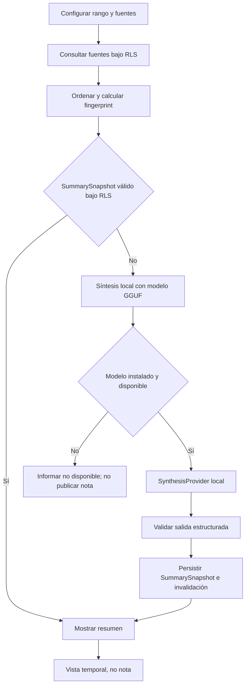

# Flujo de resumen de periodo

## Estado y objetivo

Este flujo es un contrato objetivo y sigue sin entrega: ADR-017 retiró la Edge Function `clinical-summary` y dejó la síntesis en el dispositivo, pero el resumen cacheado aún no existe. Su objetivo es generar una vista sintetizada de fuentes clínicas autorizadas dentro de un intervalo temporal configurable. El resultado sirve para consulta, tiene caché invalidable y nunca se publica como nota ni se agrega a la timeline.

Antes de V6 deben reconciliarse las descripciones de persistencia de caché local y servidor y sus implicaciones de privacidad. Este documento no decide entre ellas ni modifica la política del producto; el flujo y todas sus pruebas de aceptación siguen pendientes, y la función no está habilitada.

La síntesis sigue el mismo límite de privacidad: selección autorizada en el contexto del usuario y ejecución íntegramente local. No hay proveedor cloud, ni tokenización reversible, ni salida de texto (ADR-017). Solo se emplean fuentes sintéticas en desarrollo, evaluación y pruebas.

## Actores

- Perfil con membresía activa y permisos de lectura sobre todas las fuentes solicitadas.
- Aplicación Flutter con el runtime local de síntesis y caché cifrada.
- Postgres con RLS como origen de pacientes, eventos y notas publicadas.
- `SynthesisProvider` local como puerto del dominio, con adaptador GGUF y fake determinista.
- Administrador, suspendido, perfil ausente o anónimo como actores denegados.

## Permisos

- Una membresía activa puede solicitar y ver un resumen solo de hospitalizaciones y fuentes cubiertas por sus permisos y alcance.
- Una autoridad IAM no obtiene acceso clínico por ningún ajuste del modelo local.
- La app no usa Service Role para ampliar o completar fuentes ocultas.
- El resumen no puede publicarse, confirmarse como nota ni convertirse automáticamente en evento.
- Un `SummarySnapshot` se protege con la misma organización, hospitalización, permisos y RLS que sus fuentes; una réplica local nunca amplía esa autoridad.

## Precondiciones

- Sesión válida, perfil/membresía activos y hospitalización visible dentro del alcance.
- Intervalo válido y explícito, con zona horaria y semántica de límites definidas.
- Tipos de fuente y filtros seleccionados pertenecen a una configuración permitida.
- La app obtiene las fuentes por consultas RLS y calcula un fingerprint reproducible en el dispositivo, sin confiar en el cliente.
- El runtime local de síntesis y el modelo GGUF están instalados, o existe una entrada de caché todavía válida.
- No hay proveedor cloud al que enviar nada: la ausencia de egreso es la guarantee de privacidad (ADR-017).
- Límites de cantidad/tamaño evitan prompts incompletos o consumos no acotados de memoria y batería.

## Flujo principal

1. El usuario abre el resumen del paciente y elige rango, zona horaria, tipos de evento/fuente y opciones permitidas.
2. La app normaliza el intervalo a `[desde, hasta)` en UTC y consulta bajo RLS solo fuentes cuyo `occurred_at` cae en el rango.
3. La app verifica completitud/paginación y ordena las fuentes de manera determinista, y calcula el `source_fingerprint` local.
4. Se calcula una clave de caché con organización, hospitalización/paciente, rango, configuración, fingerprint y versiones de pipeline, prompt y modelo.
5. Si RLS permite un `SummarySnapshot` exacto y no expirado, se devuelve como cache hit sin ejecutar el modelo.
6. Si no, la app ejecuta la síntesis en el dispositivo con el modelo GGUF instalado y sus límites configurados.
7. La app pasa a `SynthesisProvider` el texto de las fuentes y la configuración; el puerto controla timeout, cancelación e idempotencia.
8. El adaptador local devuelve texto generado y, si el modelo la soporta, salida estructurada; ningún texto sale del dispositivo.
9. La app persiste mediante una operación idempotente un `SummarySnapshot` inmutable bajo RLS. El borrador intermedio se purga.
10. La UI presenta rango, configuración, fuentes incluidas, fecha de generación y advertencia de síntesis. No ofrece “Publicar como nota”.

## Flujos alternativos y errores

- Rango vacío: se muestra “Sin fuentes en el periodo” y no se ejecuta el modelo.
- Rango inválido, futuro no permitido o demasiado amplio: la validación local rechaza con error corregible.
- Fuente solicitada no visible: la consulta bajo RLS no la devuelve y la síntesis opera solo sobre lo autorizado.
- Respuesta paginada incompleta: no se genera hasta obtener todas las páginas o aplicar un límite visible y aceptado.
- Sin conexión: la síntesis local no necesita red. Si el snapshot de fuentes está completo se genera igual; la escritura del resumen queda encolada y sin fuentes completas no se genera.
- Cambia una fuente, aparece una nueva dentro del rango, cambia configuración, rol, estado, prompt o modelo: se invalida la entrada y se regenera bajo autorización vigente.
- Timeout, cancelación o fallo del motor local: se avisa, el texto original se conserva y el resumen previo válido puede mostrarse marcado con su fecha si sigue autorizado.
- Salida estructurada malformada o fuera de límites: se rechaza el resultado y no se actualiza caché.
- Suspensión, revocación de permiso o pérdida de alcance: RLS vuelve inalcanzable el snapshot, se purgan réplicas locales y no se generan resumenes nuevos.
- Solicitud de publicar: no existe endpoint ni acción. Para crear una nota, el usuario inicia deliberadamente el flujo de nota y redacta/confirma su propio contenido.

## Estados

| Estado             | Significado                                   |
| ------------------ | --------------------------------------------- |
| `configuring`      | Usuario define rango y fuentes                |
| `loading_sources`  | Consultas RLS y paginación en curso           |
| `empty`            | No hay fuentes autorizadas en el rango        |
| `cache_hit`        | SummarySnapshot exacto y autorizado           |
| `processing_local` | Fingerprint o ejecución local del modelo      |
| `queued_offline`   | Solicitud completa espera conectividad        |
| `synthesizing`     | `SynthesisProvider` local genera el borrador  |
| `ready`            | Resumen generado visible como vista temporal  |
| `stale`            | Caché invalidada; no se presenta como vigente |
| `failed`           | Error recuperable o terminal                  |

No hay estados `ready_to_confirm`, `published` ni `awaiting_review`, porque el resumen no es una nota.

## Datos

- Configuración: `patient_id`, `from_utc` inclusivo, `to_utc` exclusivo, zona horaria de visualización, tipos de fuente, orden, extensión/estilo permitido y versión.
- Fuentes autorizadas: ids, `occurred_at`, tipo, autor y contenido necesario de eventos/notas visibles bajo RLS.
- Síntesis local: texto de las fuentes, configuración, límites, idempotency key y versiones de prompt/modelo; nada sale del dispositivo.
- Caché servidor: `SummarySnapshot` inmutable con organización, hospitalización/paciente, resumen generado, `source_fingerprint`, configuración, versiones, `generated_at` y expiración.
- Local: artefactos de outbox cifrados solo durante generación; una réplica del snapshot requiere política explícita y no es autoridad.
- No se inserta fila en `clinical_events` ni en `context_notes`; el snapshot tiene tabla/entidad derivada propia y RLS equivalente a las fuentes.
- Auditoría excluye fuentes, prompt y resumen; registra metadata de la solicitud y resultado.

## RLS y auditoría

Las fuentes se leen con el JWT y las policies clínicas vigentes; la app solo sintetiza lo que RLS ya le devolvió, y una lista o fingerprint del cliente nunca amplía esa autoridad. El modelo local no consulta la base de datos y Service Role no participa en lectura clínica.

La clave se invalida al cambiar hospitalización/paciente, rango, filtros, conjunto o versión de fuentes, prompt o modelo. RLS vuelve el snapshot inalcanzable cuando cambian membresía, permisos o alcance, aunque la clave coincida. Una expiración temporal complementa, pero no reemplaza, fingerprint ni autorización. Al cerrar sesión se purgan réplicas y artefactos locales.

La auditoría registra actor, paciente, rango, filtros, ids o hash del conjunto de fuentes, cache hit/miss, versiones, latencia, resultado e invalidación. No registra texto fuente, resumen, tokens, mapa ni prompt completo.

## Criterios de aceptación

- El usuario configura explícitamente rango y fuentes, con semántica `[desde, hasta)` y zona horaria visible.
- Solo se incluyen fuentes/hospitalizaciones que el solicitante puede leer; una fuente no autorizada hace fallar la operación completa.
- Ningún texto sale del dispositivo: la síntesis y la persistencia del snapshot ocurren localmente y bajo RLS.
- Una clave de caché cambia cuando cambia cualquier fuente, configuración o versión relevante.
- Un snapshot de otra organización, fuera de alcance o ya no autorizado nunca se muestra.
- El resumen indica periodo, fuentes, generación y naturaleza asistida.
- No existe acción, estado ni endpoint que lo publique como nota/evento.
- Sin conexión solo se usa una réplica permitida por política o una outbox completa; no se genera con fuentes parciales.
- Todas las evaluaciones usan datos clínicos sintéticos.

## Pruebas

- pgTAP: fuentes y `SummarySnapshot` visibles con membresía, permisos y alcance correctos; denegados entre organizaciones, fuera de alcance, suspendido, permiso ausente, sin perfil y `anon`.
- Local: fingerprint, paginación, límites de longitud y cancelación del caso de uso con `SynthesisProvider` fake.
- Unitarias: normalización temporal, límites inclusivo/exclusivo, orden determinista, fingerprint y clave de caché.
- Caché: unicidad/concurrencia, hit, expiración, nueva fuente, nueva versión, cambio de filtro/prompt/modelo, suspensión, revocación y cruce de organización.
- Puerto: el fake y el adaptador GGUF cumplen el mismo contrato, los mismos límites y los mismos códigos de error.
- Outbox: modo avión con snapshot completo/incompleto, reinicio, backoff, timeout e idempotencia.
- Manual: rango vacío, resumen largo, indicación de fuentes y ausencia de cualquier acción de publicación.
- Privacidad: inspección de red, logs y caché con corpus sintético para comprobar el límite de confianza.

## Evidencia y referencias

- [ADR-017](../decisions/adr-017-sintesis-local.md) retiró la Edge Function `clinical-summary` y dejó la síntesis íntegramente en el dispositivo; no existe proveedor cloud.
- En el baseline, [`ClinicalEventRepository`](../../../app/lib/domains/clinical_event/data/clinical_event_repository.dart#L10-L17) obtenía la timeline por paciente sin filtrar un periodo en servidor.
- [`clinical_timeline.sql`](../../../supabase/migrations/20260910110000_clinical_timeline.sql#L53-L68) somete eventos a la matriz de lectura clínica.
- [Arquitectura de audio, IA y NER](../09-audio-ai-ner.md) define el límite de confianza, la síntesis local y el outbox.
- [ADR-011](../decisions/adr-011-resumen-temporal-cache.md) define intervalo semiabierto, `SummarySnapshot`, clave exacta e invalidación.
- [Supabase: autorización en Edge Functions](https://supabase.com/docs/guides/functions/auth) documenta cómo validar solicitudes y conservar contexto Auth, aunque esta ruta ya no se usa para síntesis.
- [Supabase: Row Level Security](https://supabase.com/docs/guides/database/postgres/row-level-security) documenta que la autorización de filas se ejecuta dentro de la base.
