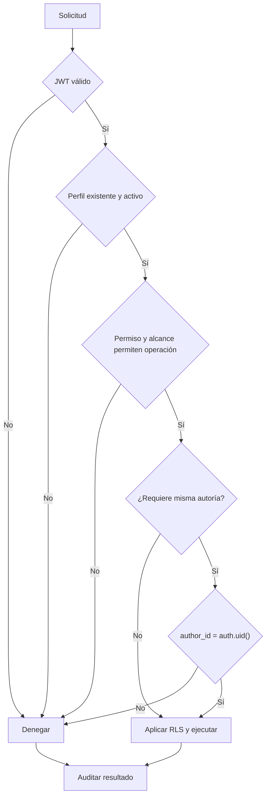

# Flujo de roles y permisos

## Estado y objetivo

El objetivo es convertir identidad, perfil, membresía, permiso, asignación asistencial, autoría y operación en una decisión consistente en Postgres y Edge Functions. La matriz global de lectura por enum está implementada; ADR-013 la sustituye para Personal clínico por un catálogo fijo, roles configurables y asignación vigente a hospitalización. Requiere migraciones aditivas y pruebas antes de habilitar notas o resúmenes.

La sección "Administración institucional" de `/settings` ofrece enlaces independientes a roles/permisos, usuarios y asignaciones asistenciales según permisos efectivos. Estos enlaces no conceden autoridad: las rutas y operaciones requieren autorización propia en sus fronteras servidor/RLS.

Solo se usan datos sintéticos para desarrollar y verificar este contrato.

La evidencia HTTP de cierre usa el actor Administrador existente y verifica denegación al caller clínico y al JWT Service Role. El reset de integración se limita al Supabase local desechable; no crea permisos nuevos ni demuestra concurrencia de dos sesiones.

## Actores

- Persona anónima.
- Cuenta autenticada sin perfil.
- Perfil y membresía en estado activo o suspendido.
- Roles configurables, asignaciones vigentes a hospitalización y alcances de organización o unidad que no sustituyen esa asignación para Personal clínico.
- Autor de una nota y otros practitioners.
- Postgres con RLS y Edge Functions autenticadas.

## Permisos

El baseline demuestra que `physician`, `nurse` y `technician` activos leen pacientes/eventos globalmente; `administrator` administra practitioners sin acceso clínico; suspendidos no acceden. No hay escritura clínica (`supabase/tests/patients_rls.test.sql:56-169`).

La matriz objetivo no concede capacidades por nombre de rol:

| Operación                             | Permiso objetivo                                | Restricción adicional                                           |
| ------------------------------------- | ----------------------------------------------- | --------------------------------------------------------------- |
| Leer membresías                       | `iam.membership.read`                           | Misma organización                                              |
| Gestionar membresías                  | `iam.membership.manage`                         | Autoridad delegable; sin autoelevación                          |
| Componer roles                        | `iam.role.manage`                               | Catálogo fijo; solo roles no protegidos                         |
| Asignar roles y alcances              | `iam.role.assign`                               | Rol/unidad de la misma organización                             |
| Gestionar asignaciones asistenciales  | `clinical.assignment.manage`                    | Permiso efectivo delegable, elegibilidad y tenant según ADR-014 |
| Consultar censo, paciente y timeline  | `clinical.assigned.read` y permisos concretos   | Personal clínico: asignación vigente a la hospitalización       |
| Consulta clínica organizacional demo  | `clinical.organization.read` y permiso concreto | Solo rol seed protegido; no delegable ni copiable               |
| Crear nota textual o de audio         | `context.note.create`                           | Hospitalización accesible                                       |
| Confirmar nota                        | `context.note.confirm`                          | Mismo autor; borrador vigente                                   |
| Leer nota confirmada                  | `context.note.read`                             | Hospitalización dentro del alcance                              |
| Generar resumen temporal              | Permisos de lectura de cada fuente              | Todas las fuentes y hospitalizaciones deben estar cubiertas     |
| Publicar resumen de periodo como nota | Ninguno                                         | Operación prohibida                                             |

## Precondiciones

- La solicitud tiene JWT válido cuando no es pública.
- Existe un perfil activo vinculado a `auth.uid()` y una membresía activa en la organización del recurso.
- La asignación de rol está activa y vigente y contiene el permiso requerido. Para Personal clínico también existe una asignación asistencial vigente a la hospitalización; el alcance de rol no la reemplaza.
- La operación, organización, hospitalización y recurso están identificados; no se autoriza solo por ocultar una ruta ni por `patient_id` aislado.
- Para confirmar o descartar, `author_id = auth.uid()` y la operación sigue en un estado local confirmable.
- Para resúmenes, todas las fuentes solicitadas son visibles para el llamador bajo RLS.
- La nueva escritura clínica no se despliega hasta que la matriz objetivo tenga políticas, grants y pruebas permitidas/denegadas.

## Flujo principal

1. El cliente autentica al usuario y envía el JWT.
2. Postgres o la Edge Function valida el JWT y resuelve `auth.uid()`.
3. Se cargan perfil, membresía, asignaciones, composición del rol y vigencia desde la base; no se confía en rol, organización o alcance enviados por Flutter.
4. Se evalúan operación, permiso y organización. Para Personal clínico se exige asignación asistencial vigente a la hospitalización; para Administración demo se exige `clinical.organization.read` reservado y alcance organizacional; cuando corresponde también se evalúa autoría.
5. RLS filtra filas y `with check` valida cualquier fila nueva o modificada.
6. La concesión/revocación asistencial invoca su RPC tipada PostgreSQL; actor, permiso efectivo, tenant, elegibilidad del target, intervalo e idempotencia se verifican en la transacción. El actor procede solo de `auth.uid()` y no puede autoasignarse.
7. Se registra una decisión permitida o denegada atribuible sin contenido clínico ni credenciales. El subset de auditoría de asignaciones es append-only y se lee con `audit.read` bajo RLS.
8. La respuesta contiene solo recursos permitidos; una denegación no revela existencia de filas ocultas.

## Flujos alternativos y errores

- JWT ausente o inválido: `401` en Edge Function o cero filas/error de privilegios en API de datos.
- Perfil ausente, suspendido o rol no permitido: `403` sin revelar el recurso clínico.
- Composición, asignación o alcance cambiados durante una sesión: la siguiente consulta usa el valor vigente de base de datos; el JWT no es fuente de permisos.
- Suspensión del perfil o membresía durante una operación: la mutación debe reevaluar estado en la misma transacción; no basta un chequeo previo en UI.
- Intento administrativo sobre datos clínicos: se deniega sin `clinical.organization.read` reservado y permiso concreto; el Administrador de demo sigue sujeto a RLS y tenant aunque tenga una operación servidor disponible.
- Intento de confirmar por otra persona: se deniega; no se crea `awaiting_review` ni reasignación.
- Fuente parcialmente no autorizada en un resumen: se rechaza la solicitud completa en vez de producir una salida ambigua.
- Función helper invocada por `anon`: privilegio de ejecución denegado.

## Estados

Perfil y membresía usan estados activos/suspendidos; roles y asignaciones agregan activación y vigencia. Una sesión válida no altera ninguno. Para operaciones locales de nota se permiten estados de trabajo como `local_draft`, `queued_offline`, `ready_to_confirm`, `published`, `failed` y `discarded`; ninguno amplía permisos ni sustituye RLS.

No existe `awaiting_review`. `ready_to_confirm` es un estado local accesible exclusivamente por el mismo autor. Los recursos publicados son de lectura para roles asistenciales activos según su política y no se vuelven editables por haber sido creados por el usuario.

## Datos

- Identidad de seguridad: `auth.uid()` derivada del JWT.
- Baseline: `practitioners.id`, `role`, `status`.
- Objetivo: perfil, `organization_membership`, rol, catálogo/composición, asignación de rol, `care_assignment`, vigencia y alcance.
- Contexto de recurso: `organization_id`, `hospitalization_id`, operación, `author_id` y estado persistido cuando corresponda.
- Contexto de síntesis: idempotency key, versión de pipeline y fuentes autorizadas; nunca un rol declarado por cliente.
- Auditoría: actor, rol observado, acción, recurso, decisión, política/versión y timestamp, sin cuerpo clínico.

## RLS y auditoría

Las tablas del esquema expuesto deben tener RLS habilitado, grants mínimos y políticas explícitas. Un grant no sustituye una policy y una policy no elimina grants excesivos. Los helpers `security definer` fijan `search_path = ''` y solo conceden `execute` a `authenticated` cuando RLS los necesita.

Las Edge Functions que leen datos clínicos crean un cliente con la clave pública y el `Authorization` original para conservar RLS. No usan Service Role para eludir la matriz. Las operaciones administrativas privilegiadas mantienen un cliente separado, exigen permisos IAM y no reciben permisos clínicos por esa capacidad técnica.

La auditoría registra tanto permitidos como denegados de alto riesgo: administración, publicación, confirmación, descarte, generación de resumen y fallos de integridad. Una bitácora no debe contener texto clínico, tokens, mapas, audio, transcripciones, JWT ni contraseñas.

## Criterios de aceptación

- La matriz del baseline permanece como evidencia histórica; el objetivo decide por catálogo, membresía, alcance y asignación en API directa, no por nombre/ID de rol ni navegación.
- Una autoridad IAM gestiona acceso pero no lee ni escribe información clínica sin permisos clínicos deliberados; el Administrador de demo los recibe mediante `clinical.organization.read` reservado y no por su nombre/ID.
- Perfil/membresía suspendidos, asignación asistencial vencida o ausente, permiso ausente o tenant ajeno deniegan a Personal clínico; cancelación/invalidación deniega y un traslado no modifica una asignación del mismo episodio.
- `clinical.organization.read` no puede agregarse, copiarse ni delegarse a roles ordinarios; solo la operación protegida puede asignar el rol Administrador y nunca deja a la organización sin uno efectivo.
- Solo el mismo autor activo confirma o descarta una nota en curso.
- Ningún rol publica un resumen temporal como nota.
- Cambios de rol o estado afectan la siguiente operación y no requieren reinstalar la app.
- Helpers internos no son RPC públicas y las funciones cloud no eluden RLS.
- Las decisiones sensibles quedan auditadas sin datos clínicos; todas las pruebas usan datos sintéticos.

## Pruebas

- pgTAP del baseline por rol/estado y del objetivo por organización, membresía, permiso reservado no delegable, asignación asistencial vigente/revocada, alta/cancelación/corrección, traslado, múltiples episodios y tenant, con casos permitidos y denegados. El contrato de lectura administrativo conserva nombre y estado de membresía del asignado histórico para el gestor autorizado; una membresía suspendida queda inelegible para nuevas concesiones y sin acceso clínico, sin cerrar ni alterar el intervalo de su care assignment.
- pgTAP de autoría: autor permitido; otro practitioner y administrador denegados; autor suspendido denegado.
- pgTAP de privilegios: helpers solo para `authenticated`; triggers y normalizadores no invocables como RPC.
- Edge Function: JWT ausente/inválido, perfil ausente, rol no permitido, suspensión y fuentes parcialmente ocultas.
- Integración: cambiar rol o suspender con sesión abierta y comprobar efecto inmediato.
- Regresión: rutas Flutter manipuladas manualmente no amplían acceso.
- Auditoría: operación permitida y denegada producen metadatos esperados sin payload sensible.

## Evidencia y referencias

### Composición implementada en Flutter

La ruta `/roles` y `RolesPermissionsScreen` ofrecen exclusivamente composición de roles activos no protegidos ya existentes. El acceso se presenta solo cuando el contexto efectivo de la organización incluye `iam.role.read` e `iam.role.manage`; un rol futuro con ambos permisos también accede. La pantalla agrupa los permisos por familia, muestra solo catálogo activo/delegable y oculta los roles protegidos. El directorio de roles y la lectura mínima tenant-scoped de `role_permissions` están sujetos a la política RLS de `iam.role.read`; `iam_role_directory` solo expone roles activos con `protected_kind` nulo y el repositorio solo mezcla sus códigos. La composición completa preserva permisos deprecated, system-only o que el actor no posee, pero estos no aparecen como editables en el catálogo. Un permiso existente que ya no está disponible bloquea guardar: no se elimina silenciosamente.

La UI nunca es frontera de autorización. `replace_iam_role_permissions` revalida en PostgreSQL el tenant, el rol no protegido, los permisos activos ordinarios y que el actor pueda delegar cada permiso; el reemplazo completo es idempotente y conserva la auditoría del servidor. Confirmación explícita precede todo reemplazo, incluido el conjunto vacío. Un error de transporte permite reintentar el snapshot exacto con su misma clave; una nueva acción crea otra clave. Al éxito se invalidan autoridad y datos y se vuelve a consultar, sin conservar la composición anterior durante carga/error.

### Mutabilidad de roles en el servidor

La autorización administrativa separa dos marcas que antes estaban confundidas. `protected_kind` bloquea cualquier acción, incluida la composición, y es lo que protege al Administrador de demo. `is_system` registra procedencia —un rol entregado por CRA— y bloquea renombrar y desactivar, pero admite `iam.role.permissions.replace`. Ninguna de las dos se relaja para el permiso reservado `clinical.organization.read`: lo rechaza `delegation_policy = system_only` dentro de la propia función y, de forma independiente, el trigger `enforce_system_permission_composition` sobre `role_permissions`.

Como el rol seed `Personal clínico` solo estaba marcado `is_system` por haber sido sembrado, `20261011400000_demote_clinician_role.sql` lo degrada a configuración del tenant: componerlo, renombrarlo y desactivarlo durante el onboarding deja de depender de una marca que solo refleja su origen. El Administrador de demo conserva `is_system = true` y `protected_kind = demo_administrator`. Flutter sigue sin exponer alta, renombrado ni desactivación de roles; la activación de un rol desactivado queda registrada como trabajo pendiente en `docs/todo.md`.

### UI de asignaciones asistenciales

La UI admite varios profesionales asociados a una misma hospitalización. El UUID del episodio siempre está visible y es copiable; el nombre del paciente solo se muestra con `clinical.census.read` y `clinical.patient.read` efectivos, y si RLS autoriza la fila. La vista administrativa puede mostrar identificador, estado y fecha del episodio con `clinical.assignment.manage`, pero eso no concede censo clínico general, demografía ni recursos clínicos. Para gestores autorizados, el historial conserva el nombre del asignado aunque su membresía esté suspendida; “Sin acceso · Membresía suspendida” indica la revocación de acceso de forma independiente y no cierra el período de la asignación. La elegibilidad para nuevas asignaciones continúa siendo exclusivamente de membresías activas.

La tarjeta del episodio muestra el nombre autorizado del paciente o “Hospitalización”, sin anteponer un título duplicado “Ingreso”; su subtítulo conserva UUID, estado y fecha de ingreso. Puede filtrarse localmente por el nombre del paciente ya autorizado o por el UUID del episodio, sin consultas ni acceso clínico adicionales. Los tiempos se presentan en la zona IANA institucional y sin segundos: una asignación actual dice `Asignado el DD-MM-YYYY · HH:mm`; una revocada o finalizada muestra su intervalo de inicio a término con el mismo formato.

- [`patients_rls.test.sql`](../../../supabase/tests/patients_rls.test.sql#L56-L169) separa administración de lectura clínica y niega todo acceso a suspendidos en el baseline.
- [Control de acceso objetivo](../05-access-control.md) define catálogo fijo, roles organizacionales configurables, membresías y alcances.
- [ADR-005](../decisions/adr-005-permisos-configurables.md) y [ADR-013](../decisions/adr-013-acceso-clinico-por-asignacion.md) registran la transición desde roles hard-coded a permisos configurables y asignación asistencial aplicados por RLS.
- [`patient_read_access.sql`](../../../supabase/migrations/20260910100000_patient_read_access.sql#L3-L23) autoriza lectura a los tres roles asistenciales activos.
- [`clinical_timeline.sql`](../../../supabase/migrations/20260910110000_clinical_timeline.sql#L53-L68) aplica la misma matriz a eventos.
- [`harden_function_privileges.sql`](../../../supabase/migrations/20260912000000_harden_function_privileges.sql#L3-L56) fija `search_path` y revoca ejecución innecesaria.
- [`patients_rls.test.sql`](../../../supabase/tests/patients_rls.test.sql#L29-L169) demuestra lectura asistencial, separación administrativa, suspensión y ausencia de escritura clínica.
- [Supabase: Row Level Security](https://supabase.com/docs/guides/database/postgres/row-level-security) describe la combinación de grants, RLS, `auth.uid()` y políticas.
- [Supabase: pruebas de base de datos](https://supabase.com/docs/guides/local-development/testing/overview) documenta `supabase test db` y pgTAP para políticas.
