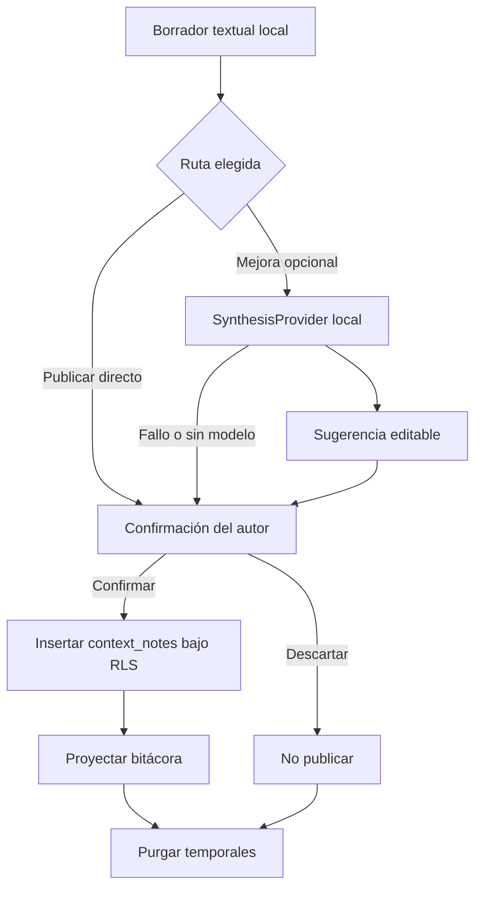

# Flujo de nota textual

## Estado y objetivo

Permite a un rol asistencial activo redactar una nota para un paciente autorizado y elegir entre publicarla tal cual o pedir una mejora local de redacción. La asistencia ocurre íntegramente en el dispositivo (ADR-017): no hay Edge Function de síntesis, ni proveedor cloud, ni tokenización reversible.

La nota se implementa como un hito de bitácora en `context_notes` (ADR-015, ADR-016): se publica confirmada en un solo paso, con `client_event_id` como clave de idempotencia, y se proyecta en la bitácora del episodio.

La nota solo se publica por decisión de su mismo autor. No existe `awaiting_review`, asignación a revisor ni confirmación por terceros. Desarrollo, pruebas y demostraciones usan exclusivamente texto y pacientes sintéticos.

## Actores

- Perfil con membresía activa, `context.note.create` y `context.note.confirm` dentro del alcance aplicable.
- Aplicación Flutter con almacenamiento local cifrado y, opcionalmente, el modelo GGUF instalado.
- Postgres con RLS para paciente y publicación.
- `SynthesisProvider` local como puerto del dominio, con adaptador GGUF y fake determinista.
- Administrador, suspendido u otro practitioner como actores denegados.

## Permisos

- Una membresía activa con `context.note.create` puede redactar una nota solo para una hospitalización dentro de su alcance.
- El mismo usuario que redacta el borrador y posee `context.note.confirm` puede publicarlo directamente, publicar una versión mejorada o descartarlo.
- Otro practitioner no puede confirmar, descartar ni publicar el borrador del autor.
- Una autoridad IAM sin permisos `context.*`, perfiles o membresías suspendidos, asignaciones vencidas, perfiles ausentes y anónimos no publican notas.
- Una nota publicada es inmutable para este flujo; no existe `UPDATE` ni `DELETE` en runtime sobre `context_notes`.
- La asistencia es opcional y no concede permisos adicionales: sin modelo instalado la nota se publica igual.

## Precondiciones

- Sesión válida, perfil y membresía activos, permisos `context.note.create`/`context.note.confirm` y hospitalización visible dentro del alcance.
- Contrato de escritura implementado mediante migración aditiva, grants de columna mínimos y pgTAP.
- Almacenamiento local cifrado disponible para temporales y outbox.
- Para la mejora de texto: modelo GGUF instalado y verificado, o su ausencia aceptada sin bloquear la publicación.
- `client_event_id` generado localmente y ligado a organización y autor.
- Aviso claro de que la asistencia no reemplaza el juicio del autor.

## Flujo principal

1. El autor abre una hospitalización autorizada y abre la hoja de hito.
2. Elige el modo texto y escribe su síntesis clínica.
3. Opcionalmente pide «Mejorar redacción»: la app llama a `SynthesisProvider` con el texto y recibe un borrador editable, o un código de error estable.
4. El autor revisa, corrige y confirma.
5. La app inserta una única fila `context_notes` con `input_method = 'text'`, `content` no vacío y `client_event_id`; RLS es la autoridad.
6. La fila confirmada se proyecta en `clinical_timeline_by_hospitalization` y aparece en la bitácora.
7. En ambos caminos se purgan los temporales locales.

## Flujos alternativos y errores

- Sin conexión antes de publicar: la operación queda encolada localmente y se reintenta con backoff al recuperar conectividad.
- Sin modelo local instalado: el botón de mejora se explica como no disponible y la publicación directa funciona igual.
- El motor local falla, agota el tiempo o devuelve salida no interpretable: se informa con un código estable, se conserva el texto del autor y se publica sin asistencia.
- Sin conexión al pedir mejora: la mejora local no necesita red; si la publicación falla por red, la operación queda encolada.
- Perfil o membresía suspendidos, permiso revocado u hospitalización fuera de alcance antes de confirmar: RLS deniega y la app ofrece descarte seguro, nunca transferencia a otro autor.
- Reinicio de app: el trabajo pendiente del mismo usuario se recupera del almacenamiento cifrado y se purga al vencer.
- Confirmación repetida después de timeout: el mismo `client_event_id` provoca `23505` y no inserta una segunda nota.

## Estados

| Estado             | Persistencia  | Significado                             |
| ------------------ | ------------- | --------------------------------------- |
| `local_draft`      | Local         | Texto editable del autor                |
| `processing_local` | Local         | Mejora de redacción en curso            |
| `ready_to_confirm` | Local         | Texto revisable por el mismo autor      |
| `queued_offline`   | Local         | Espera conectividad                     |
| `syncing`          | Local         | Publicación idempotente en curso        |
| `published`        | Servidor      | `context_notes` confirmada y proyectada |
| `failed`           | Local         | Error recuperable o terminal explicado  |
| `discarded`        | Local efímero | Operación terminada sin nota            |

`awaiting_review` está prohibido. `ready_to_confirm` no se comparte ni se persiste como tarea clínica en servidor.

## Datos

- Local: texto del autor, borrador de la sugerencia, estado e identificador de operación.
- Persistencia: `context_notes` con `organization_id`, `hospitalization_id`, `patient_id`, `author_id = auth.uid()`, `input_method = 'text'`, `content`, `status = 'confirmed'` y `client_event_id`.
- El hito de audio usa además `transcription_metadata`, que nunca contiene texto (ADR-016).
- `clinical_timeline_by_hospitalization` es una proyección reconstruible, no la fuente de escritura.
- Cualquier JSONB auxiliar requiere modelo Dart tipado y constraints SQL antes de habilitar escritura.
- Auditoría y logs no incluyen el cuerpo de la nota, sugerencias ni prompts.

## RLS y auditoría

Las políticas de `context_notes` exigen perfil y membresía activos, `context.note.create` y `context.note.confirm`, alcance sobre la hospitalización y `author_id = auth.uid()`. Los grants de columna limitan la inserción a los campos del contrato y no otorgan `UPDATE`, `DELETE` ni `TRUNCATE`. El guard de la UI reproduce el mismo requisito, pero no lo sustituye.

La auditoría registra actor, paciente, hospitalización, resultado, `client_event_id` y procedencia técnica, sin contenido. La eliminación local de temporales debe ser observable mediante métricas agregadas sin capturar sus valores.

## Criterios de aceptación

- Una membresía activa con permisos y alcance puede publicar directamente una nota en una hospitalización visible.
- El mismo autor publica o descarta; otra cuenta no accede a su borrador ni a su outbox.
- No existe `awaiting_review` en schema, API ni UI.
- Autoridad IAM sin `context.*`, suspendido, asignación vencida, fuera de alcance, sin perfil y anónimo no publican.
- Un reintento o doble toque produce una sola nota.
- Una nota publicada no puede actualizarse ni eliminarse desde este flujo.
- Confirmar, descartar, cerrar sesión o vencer purga los temporales.
- La ausencia del modelo local no impide publicar.
- Ningún dato real aparece en pruebas, fixtures, logs ni prompts.

## Pruebas

- Unitarias: contrato de `SynthesisProvider`, códigos de error estables, límites de longitud, cancelación y la garantía de que un fallo devuelve el texto del autor.
- Persistencia local: restauración tras reinicio, aislamiento por usuario, expiración y purga al confirmar, descartar o cerrar sesión.
- Outbox: modo avión, backoff, timeout después del commit, duplicado e idempotencia.
- pgTAP: publicación permitida con permiso y alcance, y denegada por otra organización, membresía suspendida, permiso ausente, otro autor y hospitalización oculta.
- pgTAP: idempotencia por `client_event_id` y ausencia de `UPDATE`/`DELETE` en runtime.
- Manual: publicación directa, mejora opcional, modelo ausente, cancelación y revocación antes de confirmar.
- Privacidad: interceptar solicitudes y logs con texto sintético para demostrar que el texto nunca sale del dispositivo.

## Evidencia y referencias

- [Control de acceso](../05-access-control.md) exige permisos explícitos para escritura, y [modelo de datos](../08-data-model.md) define los contratos JSONB.
- [ADR-016](../decisions/adr-016-asr-local-transcripcion-confirmada.md) define que solo se persiste la nota confirmada por su autor.
- [ADR-017](../decisions/adr-017-sintesis-local.md) define la síntesis local y la retirada del tokenizador y del proveedor cloud.
- `app/lib/domains/context_note/domain/synthesis_provider.dart`: puerto del dominio con códigos de error estables.
- `app/lib/domains/context_note/domain/usecases/synthesis_usecases.dart`: la asistencia nunca bloquea la publicación.
- `app/lib/domains/context_note/data/context_note_repository.dart`: escritura única con contenido confirmado y procedencia.
- `supabase/tests/context_notes_milestones.test.sql`: contrato RLS, idempotencia e inmutabilidad.
- [Modelo de dominio](../07-domain-model.md#nota-de-contexto) define `ContextNote` con confirmación del autor, corrección append-only y proyección al timeline.
- [Supabase: Row Level Security](https://supabase.com/docs/guides/database/postgres/row-level-security) documenta políticas `with check` para filas nuevas.
