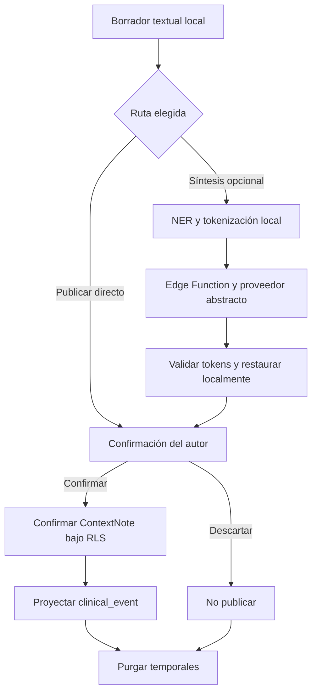

# Flujo de nota textual

## Estado y objetivo

Este flujo es un contrato objetivo; la escritura clínica todavía no está implementada. Permite a un rol asistencial activo redactar una nota para un paciente autorizado y elegir entre publicación directa o síntesis cloud opcional con NER y tokenización locales.

La nota solo se publica por decisión de su mismo autor. No existe `awaiting_review`, asignación a revisor ni confirmación por terceros. Desarrollo, pruebas y demostraciones usan exclusivamente texto y pacientes sintéticos.

## Actores

- Perfil con membresía activa, `context.note.create` y, para confirmar, `context.note.confirm` dentro del alcance aplicable.
- Aplicación Flutter, NER local y almacenamiento/outbox local.
- Postgres con RLS para paciente y publicación.
- Edge Function de síntesis y un `SynthesisProvider` abstracto, solo si el autor elige asistencia.
- Administrador, suspendido u otro practitioner como actores denegados.

## Permisos

- Una membresía activa con `context.note.create` puede iniciar una nota solo para una hospitalización dentro de su alcance.
- El mismo usuario que crea el borrador y posee `context.note.confirm` puede confirmarlo directamente, confirmar una versión sintetizada o descartarlo.
- Otro practitioner no puede confirmar, descartar ni enviar la outbox del autor.
- Una autoridad IAM sin permisos `context.*`, perfiles/membresías suspendidos, asignaciones vencidas, perfiles ausentes y anónimos no crean ni confirman notas.
- Una nota publicada es inmutable para este flujo; no se permite update o delete.
- La síntesis es opcional y no concede permisos adicionales.

## Precondiciones

- Sesión válida, perfil/membresía activos, permisos `context.note.create`/`context.note.confirm` y hospitalización visible dentro del alcance.
- Matriz objetivo de escritura implementada mediante migración aditiva, grants mínimos y pgTAP.
- Almacenamiento local cifrado disponible para borrador, mapa y outbox.
- Para síntesis: NER local inicializado, Edge Function disponible o solicitud encolable y proveedor configurado en servidor.
- El guard de procedencia confirma que todo el dataset es sintético; el prototipo rechaza procedencia real o desconocida antes del cloud.
- Idempotency key generada localmente y ligada a autor, paciente y operación.
- Aviso claro de que la asistencia no reemplaza el juicio del autor.

## Flujo principal

1. El autor abre una hospitalización autorizada e inicia una nota textual.
2. Flutter crea un borrador local asociado a `auth.uid()`, `organization_id`, `hospitalization_id` e idempotency key.
3. El autor escribe y elige una de dos rutas.
4. Publicación directa: revisa su texto y solicita confirmación bajo su JWT.
5. Síntesis opcional: NER local detecta entidades, crea tokens opacos y guarda el mapa solo en el dispositivo.
6. La app envía texto tokenizado a una Edge Function autenticada; esta valida perfil/membresía, permisos, hospitalización, procedencia sintética, esquema, límites y tokens antes de usar el proveedor abstracto.
7. La app recibe la respuesta tokenizada, comprueba que todos sus tokens pertenecen al inventario de entrada y restaura las entidades localmente. La síntesis puede omitir entidades irrelevantes, pero no introducir tokens desconocidos o alterados.
8. El mismo autor revisa la nota restaurada y confirma o descarta.
9. Al confirmar, una operación transaccional crea o transiciona exactamente una `ContextNote` canónica de `Draft` a `Confirmed`, con `author_id = auth.uid()`; al descartar, elimina/cierra el borrador sin nota confirmada.
10. El proyector genera de forma idempotente la fila de `clinical_events`; Flutter nunca escribe el read model.
11. En ambos casos se purgan texto local, mapa, prompts, respuestas intermedias y entrada de outbox.

## Flujos alternativos y errores

- Sin conexión antes de publicar: la operación queda `queued_offline` en la outbox local cifrada y se reintenta con backoff al recuperar conectividad.
- Sin conexión al pedir síntesis: se encola solo la solicitud tokenizada y su metadata; texto original y mapa permanecen locales. El autor puede cancelar o elegir publicación directa.
- NER no disponible o falla: no se llama al cloud. El autor puede publicar directamente o descartar.
- La Edge Function devuelve `401/403`: no se reintenta automáticamente; se retira el contenido si la sesión o permiso ya no son válidos.
- Timeout, `429` o `5xx`: se conserva la operación para reintento idempotente y se muestra estado recuperable.
- Token desconocido, alterado o fragmentado, o repetición fuera de límites: se rechaza toda la respuesta, no se restaura parcialmente y se permite reintentar o volver al texto original. Omitir un token no invalida por sí solo una síntesis.
- Perfil/membresía suspendidos, permiso revocado o hospitalización fuera de alcance antes de confirmar: RLS deniega y la app ofrece descarte seguro, no transferencia a otro autor.
- Reinicio de app: se recupera el borrador del mismo usuario desde almacenamiento cifrado y se reanuda sin duplicar.
- Confirmación repetida después de timeout: la misma idempotency key devuelve el resultado ya creado y no inserta otra nota.

## Estados

| Estado             | Persistencia  | Significado                                 |
| ------------------ | ------------- | ------------------------------------------- |
| `local_draft`      | Local         | Texto editable del autor                    |
| `processing_local` | Local         | NER/tokenización en curso                   |
| `queued_offline`   | Local         | Espera conectividad                         |
| `synthesizing`     | Local/Edge    | Solicitud tokenizada en curso               |
| `ready_to_confirm` | Local         | Resultado restaurado visible al mismo autor |
| `syncing`          | Local         | Publicación idempotente en curso            |
| `published`        | Servidor      | ContextNote confirmada y proyección creada  |
| `failed`           | Local         | Error recuperable o terminal explicado      |
| `discarded`        | Local efímero | Operación terminada sin nota                |

`awaiting_review` está prohibido. `ready_to_confirm` no se comparte ni se persiste como tarea clínica en servidor.

## Datos

- Local: texto original, entidades NER, mapa token-valor, texto tokenizado, respuesta intermedia, estado e idempotency key.
- Red de síntesis: JWT hacia Edge Function, paciente/source ids mínimos, texto tokenizado, inventario de tokens y versión del pipeline. Nunca mapa ni texto original.
- Persistencia objetivo: `ClinicalRecord`/`ContextNote` canónicos con `organization_id`, `hospitalization_id`, paciente derivado, `author_id = auth.uid()`, estado, contenido, versión, timestamps y procedencia `direct` o `synthesized`.
- `clinical_events` contiene solo una proyección reconstruible de la nota confirmada; no es fuente de escritura ni única copia del contenido.
- Cualquier JSONB auxiliar requiere modelo Dart tipado y constraints SQL antes de habilitar escritura.
- Auditoría y logs no incluyen cuerpo de la nota, entidades, tokens, mapa, prompts ni JWT.

## RLS y auditoría

Las políticas/función de dominio exigen perfil y membresía activos, `context.note.create`, alcance sobre la hospitalización y `author_id = auth.uid()`. Confirmar exige además `context.note.confirm`, misma autoría y estado `Draft`. Una nota confirmada no se edita destructivamente; una corrección futura crea una versión trazable con `context.note.correct`.

La Edge Function usa el contexto del llamador para verificar perfil y paciente; Service Role no amplía acceso clínico. La publicación directa no atraviesa el proveedor de IA.

La auditoría registra inicio de publicación, modo directo/sintetizado, actor, paciente, idempotency key, resultado y versión, sin contenido. Descartar se audita solo con metadata si la política lo exige. La eliminación local de temporales debe ser observable mediante métricas agregadas sin capturar sus valores.

## Criterios de aceptación

- Una membresía activa con permisos y alcance puede confirmar directamente una nota en una hospitalización visible.
- La síntesis solo envía texto tokenizado y solo restaura después de validar tokens localmente.
- El mismo autor confirma o descarta; otra cuenta no accede al borrador ni a su outbox.
- No existe `awaiting_review` en schema, API ni UI.
- Autoridad IAM sin `context.*`, suspendido, asignación vencida, fuera de alcance, sin perfil y anónimo no confirman.
- Un reintento o doble toque produce una sola nota.
- Una nota publicada no puede actualizarse o eliminarse desde este flujo.
- Confirmar o descartar purga mapa y artefactos temporales; cerrar sesión impide acceso cruzado.
- Ningún dato real aparece en pruebas, fixtures, logs o prompts.

## Pruebas

- Unitarias: tokenización reversible, tokens opacos/no reutilizados, omisión permitida y rechazo de tokens desconocidos, alterados o repetidos fuera de límites.
- Persistencia local: restauración tras reinicio, aislamiento por usuario, expiración y purga al confirmar, descartar o cerrar sesión.
- Outbox: modo avión, backoff, timeout después de commit, `429`, `5xx`, duplicado e idempotencia.
- pgTAP: creación/confirmación permitidas con permiso y alcance, y denegadas por otra organización, membresía suspendida, permiso ausente, asignación vencida, otro autor y hospitalización oculta.
- pgTAP: mutación destructiva de nota confirmada y escritura directa de `clinical_events` denegadas.
- Edge Function: autenticación, autorización, límites, schema, integridad de tokens y proveedor simulado.
- Manual: publicación directa, síntesis opcional, cancelación, error NER y revocación antes de confirmar.
- Privacidad: interceptar solicitudes y logs con texto sintético para demostrar que mapa y texto original nunca salen del dispositivo.

## Evidencia y referencias

- [Control de acceso](../05-access-control.md) exige permisos explícitos para escritura, y [modelo de datos](../08-data-model.md) define los contratos JSONB.
- En el baseline, [`clinical_events`](../../../supabase/migrations/20260910000000_initial_clinical_schema.sql#L28-L39) era la única estructura de timeline, pero el objetivo no la usa como fuente canónica de notas.
- En el baseline, [`clinical_timeline.sql`](../../../supabase/migrations/20260910110000_clinical_timeline.sql#L45-L51) exigía un `payload.summary` no vacío.
- [`patients_rls.test.sql`](../../../supabase/tests/patients_rls.test.sql#L56-L79) demuestra que los inserts clínicos estaban denegados en el baseline.
- [Arquitectura de audio, IA y NER](../09-audio-ai-ner.md) define límite confiable, tokenización, proveedor abstracto, outbox y borrado.
- [Modelo de dominio](../07-domain-model.md#nota-de-contexto) define `ContextNote` con borrador, confirmación del autor, corrección append-only y proyección al timeline.
- [Supabase: Row Level Security](https://supabase.com/docs/guides/database/postgres/row-level-security) documenta políticas `with check` para filas nuevas.
- [Supabase: autorización en Edge Functions](https://supabase.com/docs/guides/functions/auth) documenta cómo mantener el contexto Auth del llamador.
