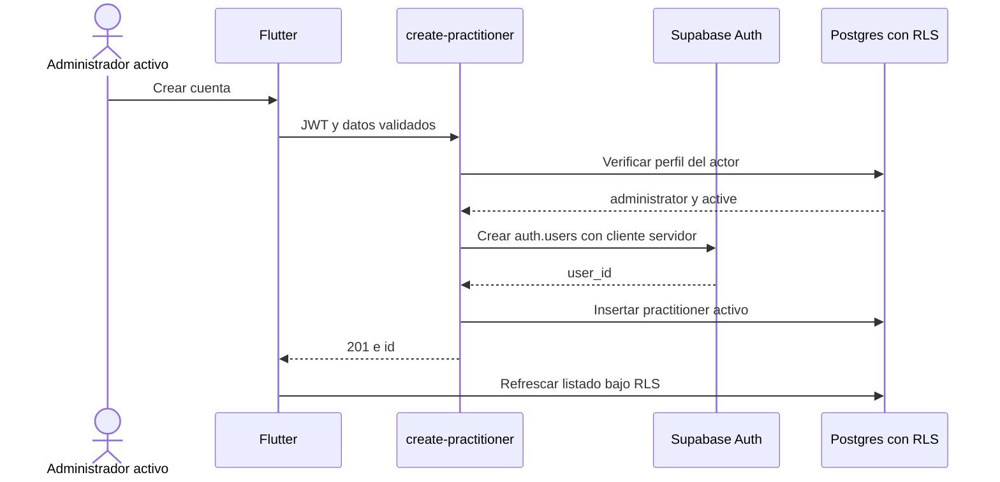
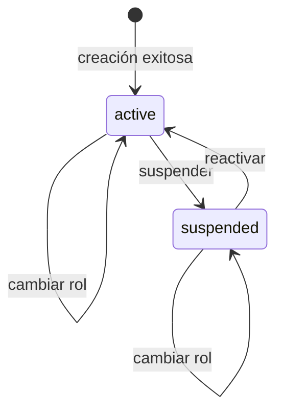

# Flujo de administración de usuarios

## Estado y objetivo

El listado, creación, cambio de rol global y cambio de estado están implementados para `administrator/active`. El objetivo evoluciona esa base hacia perfiles, membresías y roles configurables por organización sin exponer la Service Role Key ni otorgar acceso clínico por autoridad IAM.

Este contrato endurece dos aspectos que el backend del baseline no imponía: impedir autoedición administrativa y registrar auditoría de cambios. La UI capturada ocultaba al usuario autenticado, pero RLS permitía que un administrador activo actualizara cualquier fila visible. Solo se usan datos sintéticos en desarrollo y pruebas.

## Actores

- Baseline: administrador con perfil `active`.
- Objetivo: actor con perfil y membresía activos y permisos IAM aplicables en la organización.
- Perfil/membresía objetivo.
- Aplicación Flutter.
- Edge Function `create-practitioner`.
- Supabase Auth y Postgres con RLS.

## Permisos

- En el baseline, solo `administrator` activo puede listar cuentas ajenas, crear cuentas, cambiar roles, suspender o reactivar.
- En el objetivo, `iam.membership.read` permite listar; `iam.membership.manage` crear/invitar, activar o suspender; `iam.role.manage` componer roles; `iam.role.assign` asignar/revocar roles y alcances.
- La autoridad IAM no obtiene lectura clínica por estas facultades.
- Un actor no puede elevar su propia autoridad ni asignar permisos fuera de su conjunto delegable; la restricción existe en servidor, no solo en UI.
- No se permite registro público, eliminación desde la UI ni exposición de contraseñas existentes.
- Roles válidos: `administrator`, `physician`, `nurse`, `technician`.
- Estados válidos: `active`, `suspended`.

## Precondiciones

- Baseline: sesión válida y perfil `administrator/active`.
- Objetivo: perfil/membresía activos, permiso IAM requerido y organización resuelta desde datos persistidos.
- La Edge Function tiene acceso servidor a `SUPABASE_SERVICE_ROLE_KEY`; Flutter no la recibe.
- El correo nuevo no está ocupado y nombre/contraseña inicial cumplen validaciones; en el baseline el rol pertenece al enum, y en el objetivo roles, permisos y unidades pertenecen a la organización.
- Las políticas RLS y el endpoint vuelven a verificar rol y estado aunque la ruta Flutter ya esté protegida.
- Existe una política operativa para comunicar la contraseña inicial sin incorporarla a logs o documentación.

## Flujo principal

1. El administrador abre Gestión de usuarios.
2. Flutter lista practitioners por PostgREST; RLS verifica `is_administrator()`.
3. El administrador elige crear usuario e ingresa correo, contraseña inicial, nombre visible y rol.
4. Flutter invoca `create-practitioner` con el JWT del administrador.
5. La Edge Function valida JWT, carga el perfil del actor con sus credenciales y exige `administrator/active`.
6. Un cliente servidor separado crea `auth.users`; luego inserta el perfil `practitioners` en estado `active`.
7. Si falla el perfil, la función intenta eliminar el usuario Auth creado para evitar una cuenta huérfana.
8. La respuesta devuelve solo el identificador; Flutter invalida el listado y muestra el nuevo usuario.
9. En el baseline, Flutter cambia rol/estado por `update` directo. En el objetivo, cambios de membresía, composición, asignación y alcance pasan por una Edge Function/RPC auditada que exige los permisos IAM correspondientes y evita autoelevación.

## Flujos alternativos y errores

- Actor sin JWT: `401`; actor no administrador o suspendido: `403`.
- Método o payload inválido: `405` o `400`, sin invocar el cliente privilegiado.
- Correo duplicado, contraseña inválida o fallo de Auth: error de creación no enumerativo para clientes no autorizados y detalle técnico redactado en servidor.
- Fallo al insertar perfil: rollback compensatorio de `auth.users`; si también falla, se emite una alerta técnica sin registrar payload ni contraseña.
- Pérdida de red o timeout tras crear: el reintento debe usar una idempotency key para no duplicar cuentas; este control objetivo no existía en la función del baseline.
- Intento de autoelevación, asignación de rol no delegable o referencia a otra organización: servidor lo deniega aunque se evite la UI.
- Intento de eliminar: no forma parte del flujo; se deniega hasta definir retención y ciclo de vida.
- Cambio que suspende a un usuario con sesión abierta: las siguientes operaciones quedan denegadas por RLS; la UI debe converger a la pantalla suspendida.
- Conflicto concurrente: se rechaza o reevalúa con versión/`updated_at`, se recarga el registro y se evita sobrescritura silenciosa.

## Estados

`active` y `suspended` eran los estados del practitioner en el baseline. El objetivo separa estado global del perfil, estado local de cada membresía, estado del rol y vigencia de sus asignaciones. La creación es una operación transaccional-compensada, no un estado visible. No se modela borrado destructivo; suspender conserva identidad y trazabilidad.

## Datos

- Entrada de creación: `email`, contraseña inicial, `displayName`, `role` y opcionalmente `licenseNumber` en el endpoint.
- Baseline persistido: `id`, `display_name`, `role`, `status`, `license_number`, `created_at`, `updated_at`.
- Objetivo: perfil vinculado a Auth, membresía con `organization_id` y estado, roles locales, catálogo/composición, asignaciones con vigencia y alcance de organización o unidad.
- Auth persiste credenciales; la aplicación y la tabla pública no persisten contraseña.
- Actualización: identificador objetivo, rol o estado nuevo, versión esperada para control de concurrencia futuro e idempotency key cuando aplique.
- Auditoría objetivo: actor, objetivo, acción, valores anterior/nuevo permitidos, timestamp, request/idempotency id y resultado. Nunca contraseña ni tokens.

## RLS y auditoría

En el baseline, `is_administrator()` exigía que `auth.uid()` correspondiera a un perfil administrador activo. Las políticas capturadas habilitaban select, insert, update y delete administrativos sobre `practitioners`. El objetivo reemplaza esa lista por permisos IAM, tenant y alcance, mantiene solo operaciones necesarias, impide autoelevación y niega delete mientras no exista política explícita.

La creación valida dos veces: JWT/usuario con el cliente del llamador y rol/estado desde una consulta sometida a RLS. Solo entonces usa un cliente distinto con Service Role. Esta separación evita transferir privilegios al contexto del usuario.

Cada creación y cambio de rol/estado debe producir auditoría inmutable, incluso si falla. El acceso a esa bitácora requiere un permiso específico futuro; no se presupone por ser administrador. El baseline no incluía auditoría de practitioners, por lo que debe implementarse antes de considerar completo este contrato objetivo.

## Criterios de aceptación

- El baseline limita gestión a administradores activos; el objetivo exige el permiso IAM exacto en la organización correcta.
- Un rol asistencial, un administrador suspendido, un usuario sin perfil y un anónimo reciben denegación en servidor.
- La Service Role Key nunca aparece en Flutter, respuesta, logs ni archivos versionados.
- Una creación exitosa produce exactamente un usuario Auth y un perfil activo con el mismo UUID.
- Un fallo de perfil no deja silenciosamente una cuenta huérfana; se compensa o alerta.
- El actor no puede autoelevarse, cruzar organizaciones ni eliminar perfiles/membresías mediante API directa.
- Suspender elimina acceso administrativo o clínico en la siguiente operación.
- Cada mutación genera auditoría sin credenciales y soporta reintento idempotente.
- Todas las pruebas y demostraciones usan identidades sintéticas.

## Pruebas

- pgTAP: administrador activo puede listar y actualizar a otro; roles asistenciales, suspendidos, sin perfil y `anon` no pueden.
- pgTAP objetivo: separación entre organizaciones, permiso ausente, autoelevación, rol/unidad ajenos y delete denegados; cambios crean auditoría y suspensión revoca permisos.
- Edge Function: sin JWT, JWT inválido, rol incorrecto, estado suspendido, payload inválido, correo duplicado, fallo de perfil y fallo del rollback.
- Idempotencia: dos solicitudes con la misma clave crean una sola identidad y devuelven el mismo resultado lógico.
- Manual: crear, cambiar rol, suspender y reactivar; verificar que el usuario actual no aparece como editable.
- Privacidad: inspeccionar tráfico y logs para confirmar que contraseña y Service Role no se exponen.

## Evidencia y referencias

- [`UsersScreen`](../../../app/lib/domains/users/presentation/users_screen.dart#L11-L83) lista usuarios ajenos y ofrece activar, suspender y cambiar rol; la creación está en el diálogo del mismo archivo.
- [`PractitionerRepository`](../../../app/lib/domains/practitioner/data/practitioner_repository.dart#L21-L54) usa la Edge Function para crear y PostgREST para actualizar.
- [`create-practitioner`](../../../supabase/functions/create-practitioner/index.ts#L21-L104) valida al actor, separa clientes y ejecuta rollback compensatorio.
- [`auth_administration.sql`](../../../supabase/migrations/20260910010000_auth_administration.sql#L12-L32) contiene la RLS administrativa del baseline, incluido un `delete` más amplio que este flujo objetivo.
- [`practitioners_rls.test.sql`](../../../supabase/tests/practitioners_rls.test.sql#L27-L108) prueba perfil propio, denegación de autoelevación y revocación al suspender al administrador.
- [Control de acceso objetivo](../05-access-control.md#operaciones-privilegiadas) define membresías, permisos IAM, roles configurables y alcance organizacional.
- [Supabase: Edge Functions y Auth](https://supabase.com/docs/guides/functions/auth) documenta la autenticación y los clientes ligados al contexto del llamador.
- [Supabase: seguridad de API y RLS](https://supabase.com/docs/guides/api/securing-your-api) explica por qué la autorización debe imponerse en base de datos.
- [Supabase: gestión de usuarios en servidor](https://supabase.com/docs/reference/javascript/auth-admin-createuser) indica que las APIs `auth.admin` requieren una clave `service_role` y deben ejecutarse solo en servidor confiable.
