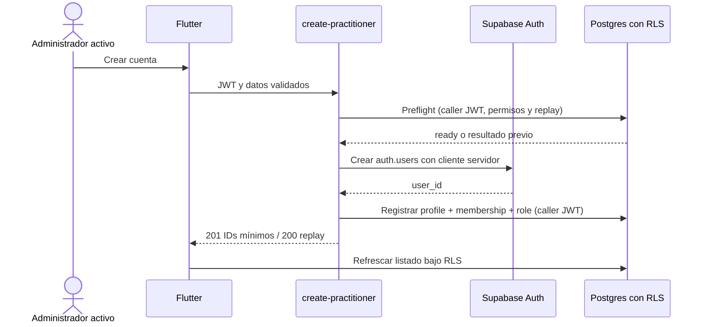
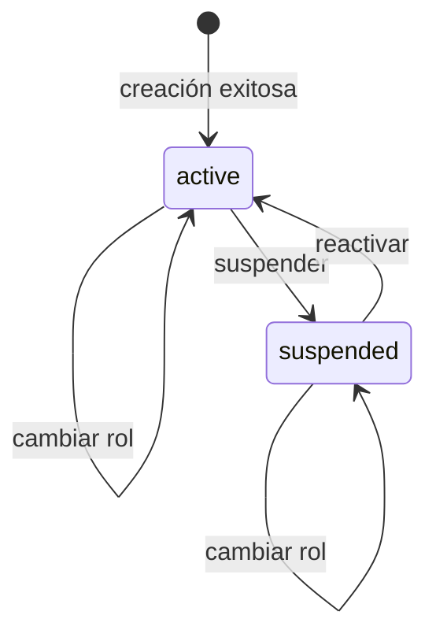

# Flujo de administración de usuarios

## Estado y objetivo

El listado, creación, cambio de rol global y cambio de estado están implementados para `administrator/active`. El objetivo evoluciona esa base hacia perfiles, membresías y roles configurables por organización sin exponer la Service Role Key ni otorgar acceso clínico por autoridad IAM. ADR-013 reserva `clinical.organization.read` para el rol seed protegido de Administrador de demo, siempre bajo RLS y solo con datos sintéticos.

La entrada administrativa de Flutter está implementada dentro de la pantalla de ajustes: la sección "Administración institucional" de `/settings` presenta entradas independientes y limitadas por sus permisos efectivos a gestión de usuarios, composición de roles/permisos y asignaciones asistenciales, y se oculta por completo cuando el usuario no tiene ninguno de esos permisos. La sección es navegación, no concesión de autoridad; cada destino y operación vuelve a depender de sus permisos y de la autorización servidor/RLS. Desde `/`, los usuarios con permisos clínicos conservan el landing de pacientes y los demás caen en ajustes.

Estado actual de Flutter: la pantalla principal `/users` no muestra selector ni nombre de hospital; la demo opera en una organización. Las otras pantallas administrativas pueden seguir mostrando contexto de organización. El estado del perfil GLOBAL es solo lectura; activar o suspender acceso al hospital cambia únicamente la membresía. UsersScreen lista perfiles activos con membresía `active` o `suspended`, permite reactivar las suspendidas y no muestra perfiles globales suspendidos ni membresías `invited` o `ended`; no presenta encabezados de grupos. Las nuevas asignaciones de rol se ofrecen solo cuando membresía y perfil están activos y la asignación es vigente; roles ya concedidos se filtran por `role_id` cuando su intervalo no revocado se solapa. DB/RPC sigue siendo la autoridad. El selector de nuevas care assignments exige elegibilidad activa, mientras el historial conserva el nombre del asignado para gestores autorizados aunque su membresía esté suspendida; esa suspensión se indica como falta de acceso independiente y no cierra el período de la asignación. Esto no añade un toggle de perfil global ni amplía permisos.

Este contrato endurece dos aspectos que el backend del baseline no imponía: impedir autoedición administrativa y registrar auditoría de cambios. La UI capturada ocultaba al usuario autenticado, pero RLS permitía que un administrador activo actualizara cualquier fila visible. Solo se usan datos sintéticos en desarrollo y pruebas.

## Actores

- Baseline: administrador con perfil `active`.
- Objetivo: actor con perfil y membresía activos y permisos IAM aplicables en la organización.
- Perfil/membresía objetivo.
- Aplicación Flutter.
- Edge Function `create-practitioner`.
- Supabase Auth y Postgres con RLS.

## Permisos

- En el baseline, solo `administrator` activo puede listar cuentas ajenas, crear cuentas, cambiar roles, suspender o reactivar.
- En el objetivo, `iam.membership.read` permite listar; `iam.membership.manage` crear/invitar, activar o suspender; `iam.role.manage` componer roles; `iam.role.assign` asignar/revocar roles y alcances; `clinical.assignment.manage` gestiona asignaciones asistenciales mediante RPC transaccional PostgreSQL. `audit.read` permite leer auditoría tenant-scoped y se concede al rol Administrador protegido por migración.
- La autoridad IAM no obtiene lectura clínica por estas facultades. El Administrador de demo recibe lectura clínica por `clinical.organization.read` reservado y permisos concretos, no por permisos IAM ni por el nombre del rol.
- Un actor no puede elevar su propia autoridad ni asignar permisos fuera de su conjunto delegable; la restricción existe en servidor, no solo en UI. El permiso reservado no se delega, copia ni compone en roles ordinarios.
- No se permite registro público, eliminación desde la UI ni exposición de contraseñas existentes.
- Baseline: roles válidos `administrator`, `physician`, `nurse`, `technician`. Objetivo: Administrador protegido y Personal clínico; el upgrade migra `administrator`, `physician` y `nurse` activos, y deja a `technician` sin acceso clínico.
- Estados válidos: `active`, `suspended`.

## Precondiciones

- Baseline: sesión válida y perfil `administrator/active`.
- Objetivo: perfil/membresía activos, permiso IAM requerido y organización resuelta desde datos persistidos.
- La Edge Function tiene acceso servidor a `SUPABASE_SERVICE_ROLE_KEY`; Flutter no la recibe.
- El correo nuevo no está ocupado y nombre/contraseña inicial cumplen validaciones; en el baseline el rol pertenece al enum, y en el objetivo roles, permisos y unidades pertenecen a la organización.
- Las políticas RLS y el endpoint vuelven a verificar rol y estado aunque la ruta Flutter ya esté protegida.
- Existe una política operativa para comunicar la contraseña inicial sin incorporarla a logs o documentación.

La prueba HTTP de registro usa una identidad sintética única en memoria; éxito/replay/conflicto se limpian mediante reset completo del Supabase local desechable, incluida auditoría append-only. No ejecutar contra un proyecto remoto ni eliminar manualmente su historia.

## Flujo principal

1. El administrador abre Gestión de usuarios.
2. Flutter lista practitioners por PostgREST; RLS verifica `is_administrator()`.
3. El administrador elige crear usuario e ingresa correo, contraseña inicial, nombre visible y rol.
4. Flutter invoca `create-practitioner` con el JWT del administrador.
5. La Edge Function valida JWT con `auth.getUser()` y llama el preflight con el cliente del caller, que aplica RLS y revalida `iam.membership.manage` + `iam.role.assign`.
6. Si no existe replay, un cliente servidor separado crea `auth.users`; nunca se usa Service Role como identidad ni autorización.
7. El cliente del caller invoca `register_organization_member`, que crea perfil, membresía activa y asignación ordinaria delegable en una transacción, bajo tenant.
8. Si la RPC falla de forma observable, la función intenta eliminar el usuario Auth. La respuesta nueva devuelve solo los IDs institucionales mínimos; un replay devuelve los mismos IDs.
9. En el baseline, Flutter cambia rol/estado por `update` directo. En el objetivo, cambios de membresía, composición, asignación de rol, alcance y `care_assignment` pasan por una Edge Function/RPC auditada que exige el permiso exacto y evita autoelevación. El bootstrap crea un Administrador sintético inicial; otro Administrador efectivo puede añadir uno, pero ninguna operación puede autoasignarlo ni dejar sin Administrador efectivo a la organización.

## Flujos alternativos y errores

- Actor sin JWT: `401`; actor sin permisos efectivos o suspendido: `403`.
- Método o payload inválido: `405` o `400`, sin invocar el cliente privilegiado.
- Correo duplicado, contraseña inválida o fallo de Auth: código estable y neutro `registration_failed`.
- Fallo al insertar perfil: rollback compensatorio de `auth.users`; si también falla, se emite una alerta técnica sin registrar payload ni contraseña.
- La idempotency key UUID se limita por organización y actor; email normalizado, nombre visible y role ID conforman el payload lógico (solo se persiste su hash). Un retry completado devuelve el resultado anterior antes de crear otro usuario Auth; otro payload con la misma clave devuelve `409 idempotency_conflict`.
- La RPC exige que el email Auth de la identidad recién creada coincida con el email normalizado de la solicitud; ausencia de Auth/email o mismatch devuelve `invalid_request` auditado sin crear filas institucionales.
- Si el actor tiene membresía resoluble pero le falta autoridad, el primer preflight deja una denegación auditada sin payload personal; repeticiones siguen siendo opacas mientras falte autoridad y solo se compara el fingerprint después de reautorizar. Sin membresía resoluble o tenant activo no se intenta auditar.
- Límite: un crash del proceso después de `auth.admin.createUser` y antes del registro PostgreSQL puede dejar una identidad Auth huérfana. No existe transacción distribuida Auth/Postgres; la compensación cubre errores observables, no ese crash.
- Intento de autoelevación, copia/delegación de `clinical.organization.read`, asignación de rol no delegable, autoasignación asistencial o referencia a otra organización: servidor lo deniega aunque se evite la UI.
- Suspender, revocar o retirar los permisos del último Administrador efectivo: la operación transaccional se deniega.
- Intento de eliminar: no forma parte del flujo; se deniega hasta definir retención y ciclo de vida.
- Cambio que suspende a un usuario con sesión abierta: las siguientes operaciones quedan denegadas por RLS; la UI debe converger a la pantalla suspendida.
- Conflicto concurrente: se rechaza o reevalúa con versión/`updated_at`, se recarga el registro y se evita sobrescritura silenciosa.

## Estados

`active` y `suspended` eran los estados del practitioner en el baseline. El objetivo separa estado global del perfil, estado local de cada membresía, estado del rol y vigencia de sus asignaciones. La creación es una operación transaccional-compensada, no un estado visible. No se modela borrado destructivo; suspender conserva identidad y trazabilidad.

## Datos

- Entrada institucional JSON exacta: `organizationId`, `email`, contraseña inicial, `displayName`, `roleId`, `idempotencyKey`; no acepta enum legacy, licencia, RUT ni rol protegido por etiqueta.
- Baseline persistido: `id`, `display_name`, `role`, `status`, `license_number`, `created_at`, `updated_at`.
- Objetivo: perfil vinculado a Auth, membresía con `organization_id` y estado, roles locales, catálogo/composición, asignaciones de rol con vigencia/alcance y `care_assignments` por hospitalización.
- Auth persiste credenciales; la aplicación y la tabla pública no persisten contraseña.
- Actualización: identificador objetivo, rol o estado nuevo, versión esperada para control de concurrencia futuro e idempotency key cuando aplique.
- Auditoría objetivo: actor, objetivo, acción, valores anterior/nuevo permitidos, timestamp, request/idempotency id y resultado. Nunca contraseña ni tokens.

## RLS y auditoría

En el baseline, `is_administrator()` exigía que `auth.uid()` correspondiera a un perfil administrador activo. Las políticas capturadas habilitaban select, insert, update y delete administrativos sobre `practitioners`. El objetivo reemplaza esa lista por permisos IAM, tenant y alcance, mantiene solo operaciones necesarias, impide autoelevación y niega delete mientras no exista política explícita.

La creación valida JWT y permisos efectivos mediante RPCs owner-controlled ejecutadas por el cliente del llamador bajo RLS. El cliente Service Role separado solo llama `auth.admin.createUser/deleteUser`; no decide autorización ni escribe perfiles.

La RPC de registro audita el resultado y el fingerprint del payload, sin email, nombre ni contraseña, y comprueba que `auth.users.email` coincida normalizado con el email solicitado. El preflight y registro revalidan autoridad antes de revelar replay; las denegaciones de preflight con actor/membresía resolubles son auditadas sin revelar conflictos a actores aún no autorizados. La RPC no habilita DML runtime directo en `profiles`, incluso para `service_role`.

## Criterios de aceptación

- El baseline limita gestión a administradores activos; el objetivo exige el permiso IAM o `clinical.assignment.manage` exacto en la organización correcta.
- Un rol asistencial, un administrador suspendido, un usuario sin perfil y un anónimo reciben denegación en servidor.
- La Service Role Key nunca aparece en Flutter, respuesta, logs ni archivos versionados.
- Una creación exitosa produce un usuario Auth, perfil activo, membresía activa y asignación ordinaria delegable en la organización, con atomicidad PostgreSQL.
- Un fallo de perfil no deja silenciosamente una cuenta huérfana; se compensa o alerta.
- El actor no puede autoelevarse, copiar/delegar el permiso reservado, autoasignarse atención, cruzar organizaciones ni eliminar perfiles/membresías mediante API directa.
- La organización conserva al menos un Administrador efectivo después de cada suspensión, revocación o cambio de rol.
- Suspender elimina acceso administrativo o clínico en la siguiente operación.
- Cada mutación genera auditoría sin credenciales y soporta reintento idempotente.
- Todas las pruebas y demostraciones usan identidades sintéticas.

## Pruebas

- pgTAP: administrador activo puede listar y actualizar a otro; roles asistenciales, suspendidos, sin perfil y `anon` no pueden.
- pgTAP objetivo: separación entre organizaciones, permiso ausente, autoelevación, copia/delegación de `clinical.organization.read`, autoasignación del rol protegido, último Administrador, rol/unidad ajenos y delete denegados; cambios crean auditoría y suspensión revoca permisos.
- Edge Function: método, falta/token inválido, payload inválido, forbidden, replay, conflicto, éxito, fallo Auth, fallo DB, rollback y fallo del rollback; las pruebas HTTP no contienen credenciales reales.
- Idempotencia: preflight tipado evita Auth duplicado en retries completados; register también protege duplicados concurrentes por organización/actor/clave.
- Manual: crear, cambiar rol, suspender y reactivar; verificar que el usuario actual no aparece como editable.
- Privacidad: inspeccionar tráfico y logs para confirmar que contraseña y Service Role no se exponen.

## Evidencia y referencias

- [`UsersScreen`](../../../app/lib/domains/users/presentation/users_screen.dart#L11-L83) lista perfiles activos con membresía activa o suspendida, excluyendo al actor y perfiles globales suspendidos, membresías invitadas o terminadas; permite suspender y reactivar membresías. No muestra encabezados de grupos ni selector/nombre de hospital en la pantalla principal demo de una organización. `/users` ya no ofrece un menú de destinos por permisos ni un acceso directo a pacientes: la barra superior usa la navegación clínica común y su acción de volver regresa a `/settings`, cerrando el back del sistema al mismo destino.
- La ruta `/` dirige a `/patients` a los usuarios con permisos clínicos efectivos y a `/settings` en el resto de los casos. La sección "Administración institucional" de ajustes presenta por separado gestión de usuarios, composición de roles/permisos y asignaciones asistenciales, cada una solo cuando los permisos requeridos están presentes, y no aparece si el usuario no tiene ninguno; no otorga permisos ni sustituye autorización en servidor. Desde cada pantalla administrativa se vuelve a ajustes.
- [`PractitionerRepository`](../../../app/lib/domains/practitioner/data/practitioner_repository.dart#L21-L54) usa la Edge Function para crear y PostgREST para actualizar.
- El directorio IAM conserva membresías `invited`, `active`, `suspended` y `ended`, además del estado de perfil; UsersScreen solo presenta perfiles activos cuya membresía esté `active` o `suspended`. La reactivación está disponible para las suspendidas. Las asignaciones históricas a roles ordinarios y care assignments siguen visibles para revocación aunque el target o rol estén inactivos; para gestores autorizados, el historial de care assignments conserva el nombre del asignado suspendido y muestra separadamente que no tiene acceso. La suspensión no modifica el intervalo ni revoca por sí misma la asignación histórica; la vista de elegibilidad para nuevas care assignments sí exige estados y permisos activos.
- En UsersScreen no se muestra el estado global del perfil, contexto/nombre/selector de hospital ni encabezados de grupos; el estado global solo se consulta, no se modifica desde este flujo. La activación/suspensión afecta solo la membresía de la organización. Las opciones de nuevas asignaciones de rol requieren perfil y membresía activos y vigencia; se excluyen grants del mismo `role_id` cuyo intervalo no revocado se solapa. La elegibilidad del selector de care assignment es activa, sin ocultar el historial. La administración institucional se recorre desde la sección homónima de `/settings`, que ofrece únicamente usuarios, roles/permisos y asignaciones asistenciales según permisos efectivos. La autorización y las mutaciones siguen bajo DB/RPC y los permisos ya definidos.
- [`create-practitioner`](../../../supabase/functions/create-practitioner/index.ts) y [`handler.ts`](../../../supabase/functions/create-practitioner/handler.ts) implementan el endpoint institucional testeable; `20261011320000_register_organization_member.sql` y su corrección aditiva `20261011330000_harden_member_registration_authority_and_email.sql` contienen preflight, registro transaccional, guard de perfiles y vínculo email/Auth.
- [`auth_administration.sql`](../../../supabase/migrations/20260910010000_auth_administration.sql#L12-L32) contiene la RLS administrativa del baseline, incluido un `delete` más amplio que este flujo objetivo.
- [`practitioners_rls.test.sql`](../../../supabase/tests/practitioners_rls.test.sql#L27-L108) prueba perfil propio, denegación de autoelevación y revocación al suspender al administrador.
- [Control de acceso objetivo](../05-access-control.md#operaciones-privilegiadas) define membresías, permisos IAM, roles configurables y alcance organizacional.
- [Supabase: Edge Functions y Auth](https://supabase.com/docs/guides/functions/auth) documenta la autenticación y los clientes ligados al contexto del llamador.
- [Supabase: seguridad de API y RLS](https://supabase.com/docs/guides/api/securing-your-api) explica por qué la autorización debe imponerse en base de datos.
- [Supabase: gestión de usuarios en servidor](https://supabase.com/docs/reference/javascript/auth-admin-createuser) indica que las APIs `auth.admin` requieren una clave `service_role` y deben ejecutarse solo en servidor confiable.
  Membership status/validity changes are available only through the authenticated PostgreSQL IAM operation requiring `iam.membership.manage`. Suspending or ending the last effective Administrator is denied. Backend onboarding (fase 4.2) está implementado con pruebas dirigidas. Fase 4.3 añade contexto IAM, directorio tenant-scoped, alta institucional Flutter y operaciones de membresía/roles vía RPC; no declara completo el corte ni migra el censo/detalle/timeline clínico de 4.4. La transacción distribuida no cubre un crash entre Auth create y RPC; errores observables se compensan con deleteUser.
